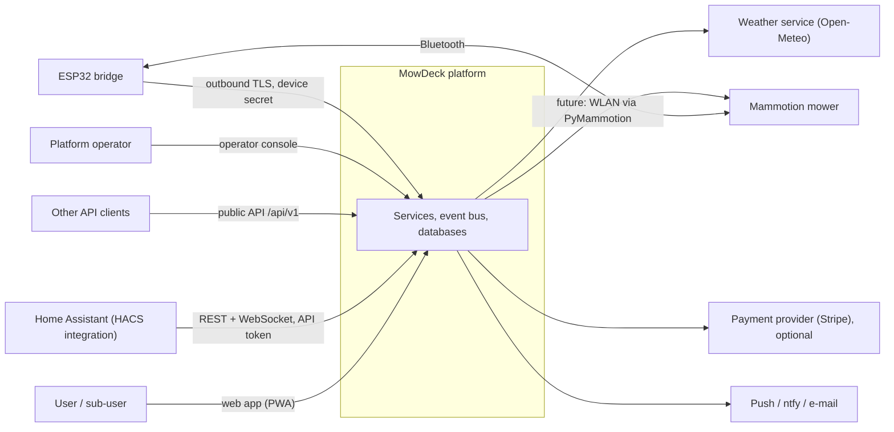

# 3. Context and scope

## Business context

Users operate their mowers through the web app, Home Assistant or other API clients. The platform talks to mowers through the Device-Gateway only, using Bluetooth bridges or (later) WLAN.

## System context (C4 level 1)

## Technical context

| Interface | Technology | Direction |
| --- | --- | --- |
| Public API | REST under `/api/v1` and WebSocket, through Traefik | clients to platform |
| Bridge link | outbound TLS connection with a device secret | bridge to Device-Gateway |
| Mower | Bluetooth (bridge) or WLAN, via PyMammotion | Device-Gateway to mower |
| Internal bus | NATS JetStream | between services |
| Payment | Stripe adapter (Checkout, customer portal, signed webhooks) | Billing to provider |
| Notifications | Web Push, ntfy, e-mail | Notifications to channels |
| Weather | Open-Meteo adapter | Scheduler to provider |
