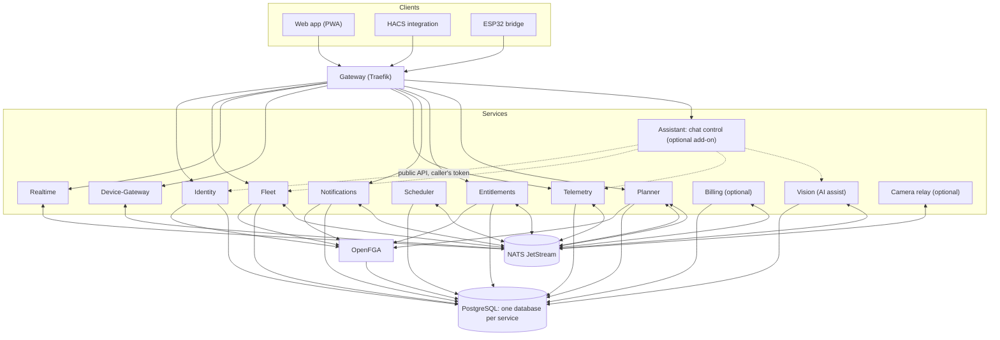

# 5. Building blocks

!!! tip "Diagrams generated from the code"
    The diagrams below are hand-written. For the routes, NATS subjects, API surface and database
    ownership as the code has them today, see [Generated architecture diagrams](generated.md).

## Container view (C4 level 2)

Only the Device-Gateway talks to mowers. App, Home Assistant and bridges are equal clients. A later **Vision** service adds camera and Ai Recover.

## Services

| Service | Responsibility | Own data | Scales with | Reusable |
| --- | --- | --- | --- | --- |
| Gateway | single entry: TLS, routing, rate limits, token check | none | requests | standard software (Traefik) |
| Identity | accounts, users, sub-users, roles and permissions, login plug-ins, API tokens, issuing short-lived tokens | users, sessions, identities | logins | yes, for any project with login |
| Authz (OpenFGA) | answers every permission question from model and relations | relations (who, role, level) | check requests | standard software |
| Fleet (available, Phase 1) | mowers, sites, groups, connection type, command records, bulk commands (shares are role assignments in Identity) | sites, groups, mowers, commands | requests | no |
| Device-Gateway (available: simulated mowers, Mammotion cloud and BLE bridge adapters) | holds connections to mowers and bridges, executes commands, reports state | transient only | connected mowers (sharding by mower ID) | yes, core as library `mowdeck-control` |
| Telemetry (available, Phase 1) | stores and queries latest state, de-duplicated history, positions with RTK fix, command result timeline | latest state, history, position track, command timeline, mower directory | data volume | no |
| Scheduler | schedules, rain pause, maintenance reminders | plans | number of plans | no |
| Planner (available, Phase 5) | mowing patterns as plug-ins (`mowdeck-patterns`), route calculation, validation chain, preview, coverage and gaps from the position track, execution mode per mower ([ADR 0030](../adr/0030-mowing-patterns-and-planner.md)) | pattern templates and a snapshot directory of maps and capabilities; plans are never stored | CPU load | yes, as library `mowdeck-patterns` |
| Notifications (available, Phase 2) | derives notifications (finished, stuck, battery low, offline) from the mower states, delivers by Web Push, ntfy and other channel plug-ins per user preferences | preferences, push subscriptions, ntfy targets, inbox, delivery outbox, mower directory and watch | messages | yes |
| Realtime | WebSocket fan-out of live data to app and Home Assistant | none | open connections | yes |
| Entitlements (available, Phase 4) | answers "may account X use feature Y, or have one more Z?" over `entitlements.check`; plans as data, assignments, the feature catalogue of the module descriptors, operator endpoints ([ADR 0028](../adr/0028-entitlements-plans-and-enforcement.md)) | plans, account plans and their history, feature catalogue | requests (snapshot cached per account in every client) | no |
| Billing (available, optional, Phase 4) | subscriptions through a payment provider (Stripe Checkout and customer portal), signed webhooks processed once that set plan statuses in Entitlements over `entitlements.plan.set`; not started when billing is disabled ([ADR 0031](../adr/0031-billing-with-stripe-adapter.md)) | customers, subscriptions, invoice references, webhook ledger | webhooks | no |
| Vision (available, Phase 6) | AI assist for stuck mowers and Find Dock: camera snapshot and map context to a vision model (any family through LiteLLM, per-user providers, an optional installation model), a proposed maneuver a user with `can_drive` approves, driven through `fleet.drive.*` with blades off and a safety watch ([ADR 0033](../adr/0033-vision-assisted-recovery-with-approval.md)) | proposals, step audit, short-lived images, cost accounting, encrypted user provider keys | running executions | yes |
| Camera relay (in progress, optional) | one camera source session per account and mower shared by every viewer of that account: leases (viewer, Vision) with heartbeat, grace and limits, signed tickets bound to account, lease and random paths, lifecycle events on the stream `CAMERA`; the media plane: MediaMTX (WHEP, ICE on one UDP/TCP port) with the relay as its auth callback, the source pipeline (ffmpeg: the `fake` source, the H.264 transcoder) and the reconcile loop; the Agora driver follows ([ADR 0045](../adr/0045-camera-relay.md)) | none (sessions and leases in memory, one replica) | concurrent sessions | no |
| Assistant (available, optional add-on) | chat control: a typed request becomes a work order of validated mower actions (start now or once later, pause, resume, dock) built from the mower's real capabilities, areas and the caller's relations; the web app executes it after the user confirmed, through Fleet and the Scheduler. HTTP only with the caller's token (no NATS user, no database); the AI is the user's provider through Vision's structured answers ([ADR 0075](../adr/0075-chat-control-assistant-add-on.md)) | none | requests | no |
| Web app (PWA, available, Phase 2) | UI for users and operators: SvelteKit 2 SPA served by the `web` service at `/` ([ADR 0020](../adr/0020-web-app-architecture.md)) | none | static, CDN capable | no |
| ESP32 bridge | firmware on the mower, Bluetooth to WLAN | none | none | yes |
| HACS integration (available, Phase 3; own repository [`lukislp/mowdeck-hacs`](https://github.com/lukislp/mowdeck-hacs)) | Home Assistant as client: custom integration `mowdeck` with config flow (URL and API token), lawn mower, sensors, numbers, select, buttons, GPS tracker and actions, live states over the Realtime WebSocket ([ADR 0025](../adr/0025-home-assistant-integration-as-api-client.md), [guide](../dev/home-assistant.md)) | none | none | no |

## Libraries (`libs/`, Apache-2.0 unless stated)

| Library | Purpose | Status |
| --- | --- | --- |
| `mowdeck-control` | mower control without the platform (scripts, other projects): `MowerConnection`, safety controller, simulated mower | available (0.1.0) |
| `mowdeck-control-mammotion` (GPL-3.0, [ADR 0011](../adr/0011-gpl-package-for-pymammotion-adapter.md)) | the real Mammotion adapter on PyMammotion: `cloud` and `ble_bridge` connections ([ADR 0019](../adr/0019-mammotion-adapter-transports.md)) | available (0.1.0), hardware run pending |
| `mowdeck-control-husqvarna` | the Husqvarna Automower cloud provider on aioautomower (Automower Connect API, [ADR 0066](../adr/0066-cloud-provider-plugins-and-more-vendors.md)) | available (0.1.0), untested on real hardware, off by default |
| `mowdeck-control-worx` (GPL-3.0) | the Worx Landroid, Kress and LandXcape cloud provider on pyworxcloud (unofficial API, MQTT push, [ADR 0066](../adr/0066-cloud-provider-plugins-and-more-vendors.md)) | available (0.1.0), untested on real hardware, off by default |
| `mowdeck-provider-testkit` | the provider conformance kit (test-only): one vendor-neutral suite every adapter runs on its fake vendor client; new adapters start from `templates/provider` ([ADR 0069](../adr/0069-provider-conformance-kit-and-package-template.md)) | available (0.1.0) |
| `mowdeck-contracts` | all API and event formats | available (0.1.0) |
| `mowdeck-auth` | verify access tokens against Identity's cached JWKS (EdDSA), the kit's principal resolver, token issuing and test helpers ([ADR 0015](../adr/0015-tokens-sessions-and-key-rotation.md)) | available (0.1.0) |
| `mowdeck-authz` | thin OpenFGA client: one question, fail closed, decision cache, tuple writer, in-memory fake on the real model, FastAPI dependencies ([ADR 0014](../adr/0014-authorization-model-and-tuple-ownership.md)) | available (0.1.0) |
| `mowdeck-service-kit` | service skeleton: config, logging, tracing, health, bus, tenant filter, error format, the Entitlements client (`require_limit`, `require_feature`, snapshot cache, problem types `plan-limit` and `feature-not-in-plan`) | available (0.1.0) |
| `mowdeck-ui` | design system of the web app (pnpm package `@mowdeck/ui`): design tokens with light and dark themes, Svelte 5 components (status, mower card, command bar with the emergency stop, permission gate, forms, layout), token lint rules and contrast check; the map component follows in Task 11 | available (0.1.0) |
| `mowdeck-patterns` | mowing patterns as plug-ins (entry point group `mowdeck.patterns`), the validation chain, chains, coverage and gaps, preview; pure computation on Shapely ([ADR 0030](../adr/0030-mowing-patterns-and-planner.md)) | available (0.1.0) |

Details and examples: [shared libraries](../dev/libraries.md).

## Service status

| Service | Status | Where |
| --- | --- | --- |
| Device-Gateway | available (0.1.0): simulated mowers, Mammotion `cloud` and `ble_bridge` adapters ([ADR 0019](../adr/0019-mammotion-adapter-transports.md)), commands, telemetry, connection events, map and capabilities snapshots, sharding ([ADR 0013](../adr/0013-device-gateway-registry-and-sharding.md)) | `services/device-gateway` |
| Identity | available (0.1.0): registration, password login, sessions with rotation (cookie-only refresh and reuse grace for browsers), sub-users, roles and assignments with anti-escalation, API tokens, audit log, JWKS and key rotation, OpenFGA tuples, the `ui_areas` of the deployed modules ([ADR 0015](../adr/0015-tokens-sessions-and-key-rotation.md)) | `services/identity` |
| Fleet | available (0.1.0): sites with a hidden default site, groups, mowers, hierarchy tuples in OpenFGA, the Device-Gateway's registry (`fleet.mowers.list`, `mower.*` events), commands checked per command kind with command records, bulk commands per site and group ([ADR 0016](../adr/0016-fleet-commands-and-authorization-per-command-kind.md)), plan limits on mowers, sites and groups and the `control` feature on every command but the emergency stop ([ADR 0028](../adr/0028-entitlements-plans-and-enforcement.md)) | `services/fleet` |
| Telemetry | available (0.1.0): latest state, history with de-duplicated heartbeats and `date_bin` downsampling, position track, command timeline, map and capabilities snapshots, mower directory from Fleet, retention under an advisory lock ([ADR 0017](../adr/0017-telemetry-storage-and-retention.md)) | `services/telemetry` |
| Realtime | available (0.1.0): WebSocket `/api/v1/realtime/ws` with the token in the first message, `can_view` per subscription re-checked on `identity.grants.changed`, every 60 s and on token refresh, per-instance fan-out without queue groups, coalesced states and slow consumer close (4430), connection limits ([ADR 0018](../adr/0018-realtime-websocket-protocol.md)) | `services/realtime` |
| Notifications | available (0.1.0): rules over `MowerState` and connection events (mowing finished, stuck, battery low with hysteresis, offline and online, job started), cooldown and de-duplication, subscribers re-checked with `can_view`, quiet hours per time zone, DE and EN templates, outbox worker with `SKIP LOCKED` and backoff, Web Push (VAPID) and ntfy channels, inbox ([ADR 0022](../adr/0022-notifications-rules-and-delivery.md)) | `services/notifications` |
| Web app | available (0.1.0): login with cookie-only refresh ([ADR 0021](../adr/0021-browser-auth-flow.md)), mower list and detail with live status, commands with the emergency stop, blade height and speed, area picker on a schematic map, mower settings, sub-users, API tokens, account (theme, language, install), German and English, service worker ([ADR 0020](../adr/0020-web-app-architecture.md)) | `apps/web`, served by the Compose service `web` |
| Scheduler | available (0.1.0): weekly and every-N-days schedules for a mower or a group in the site's time zone (DST safe), windows, manual skip, pattern rotation, rain pause with Open-Meteo behind a weather port, ticker with `SKIP LOCKED`, starts and returns to the dock through Fleet's `fleet.commands.issue` on behalf of the owner with a re-check of `can_control`, run records and events ([ADR 0024](../adr/0024-scheduler-recurrence-rain-pause-and-command-issuing.md)) | `services/scheduler` |
| Entitlements | available (0.1.0): plans seeded from `infra/entitlements/plans.yaml`, `MOWDECK_ENTITLEMENTS_BILLING_ENABLED` (off: every account `unlimited`), trial and grace computed from the clock, `entitlements.check` with snapshot, `entitlements.plan.changed`, feature catalogue from the module descriptors, operator endpoints on `platform:main#can_manage_plans`; enforced by Fleet, Scheduler, Identity, Realtime and Notifications ([ADR 0028](../adr/0028-entitlements-plans-and-enforcement.md)) | `services/entitlements` |
| Planner | available (0.1.0): patterns from the registry with their settings schemas, previews and plans for a mower or a raw map (map area, spot in local metres or WGS84), the validation chain on every plan, `SpotMowPlan` with hash for `StartMow.spot_plan`, execution mode (`custom_paths`, `native`, `unsupported`), coverage and gaps from Telemetry's track (`tracks.positions.query`), templates per account, plan feature `spot_mowing` ([ADR 0030](../adr/0030-mowing-patterns-and-planner.md)) | `services/planner` |
| Billing | available (0.1.0), optional (Compose profile `billing`, Helm `services.billing.enabled`): `PaymentProvider` with `StripeProvider` (SDK 16, `api_base` for stripe-mock) and `FakeProvider`, one customer per account, Checkout in subscription mode with trial, tax id and `automatic_tax`, the customer portal, prices from `infra/billing/prices.yaml`, webhooks with signature check and the `webhook_events` ledger, Stripe status to plan status (grace from the end of the last paid period), `billing.subscription.changed`, owner only (`can_manage_billing`) ([ADR 0031](../adr/0031-billing-with-stripe-adapter.md)) | `services/billing` |
| Camera relay | in progress (0.1.0), optional (Compose profile `relay`, Helm `services.cameraRelay.enabled`): the session domain (states with grace, start timeout and backoff, leases with heartbeat and binding deadline, Vision caps and daily minutes, account separation), Ed25519 tickets, `relay.camera.attach|renew|detach` responders and the `camera.relay.*` events; the media plane with MediaMTX, the auth callback, the reconcile loop, the `fake` source and the transcoder (step 4); Fleet's camera endpoint as the front door with `transport` `auto|relay|direct`, renew, detach and the stream audit (step 5); the web player and the Agora driver follow ([ADR 0045](../adr/0045-camera-relay.md)) | `services/camera-relay` |
| Vision | available (0.1.0): `VisionProvider` port with a LiteLLM adapter (model string, JSON schema or prompt mode, validation retry, cost accounting) and a rule based fake, per-user providers with AES-GCM keys and an installation default (`ai_recover`, `ai_recover_hosted`), proposals with approval, execution through the drive channel at 5 Hz (`ttl_ms` 1000, blades off) with abort on emergency stop, sensor stop, geofence, missing state and cancellation, verification, rounds, `find_dock` ending in `return_to_dock`, `vision.proposal.created` ([ADR 0033](../adr/0033-vision-assisted-recovery-with-approval.md)); structured text answers on the caller's provider for optional modules ([ADR 0075](../adr/0075-chat-control-assistant-add-on.md)) | `services/vision` |
| Assistant | available (0.1.0), optional (Compose profile `assistant`, Helm `services.assistant.enabled`): catalog from the mower's relations, connection, areas and activity, strict schema, validation of the answer (all or nothing), the user's AI provider through Vision or a phrase parser (demo mode), proposals the web app executes after confirmation ([ADR 0075](../adr/0075-chat-control-assistant-add-on.md)) | `services/assistant` |

## Extension points

| Extension point | Interface | Examples |
| --- | --- | --- |
| Mower models and links | `MowerConnection` in `mowdeck-control`, registered through the entry point group `mowdeck.connections` | LUBA and YUKA via Mammotion cloud and ESPHome BLE bridge (`mowdeck-control-mammotion`), WLAN later |
| Login methods | `CredentialAuthenticator`, `RedirectAuthenticator` | password, GitHub, Google, passkey, OIDC |
| Authorization | `Authorizer` in `mowdeck-authz` | extend the OpenFGA model with new object types |
| Payment providers | `PaymentProvider` | Stripe, Paddle, invoice |
| Notification channels | `NotificationChannel` in `services/notifications`, registered through the entry point group `mowdeck.notification_channels` | Web Push, ntfy, log (shipped); e-mail, Telegram (interfaces) |
| Weather, maps, AI | one adapter port each | Open-Meteo, vision models |
| Mowing patterns | `MowPattern` in `mowdeck-patterns`, registered through the entry point group `mowdeck.patterns` | stripes, diagonal, checkerboard, spiral, border first + fill, contour-parallel, auto-aligned, cells, alternating, edge only, re-mow (shipped); waves, lawn art (later) |
| New feature | new service listening to existing events | reports, maintenance planner |
| New UI area | built-in module in the app shell (`apps/web/src/lib/modules/<name>/module.ts`: route, menu label, required permission), enabled when a deployed service announces the route in its `ui_areas` | fleet map, operator console |

Each service describes itself (rights it defines, plan features, events, UI areas). Identity, Entitlements and the app read these descriptions at startup, so a new service appears in role and plan management automatically.
