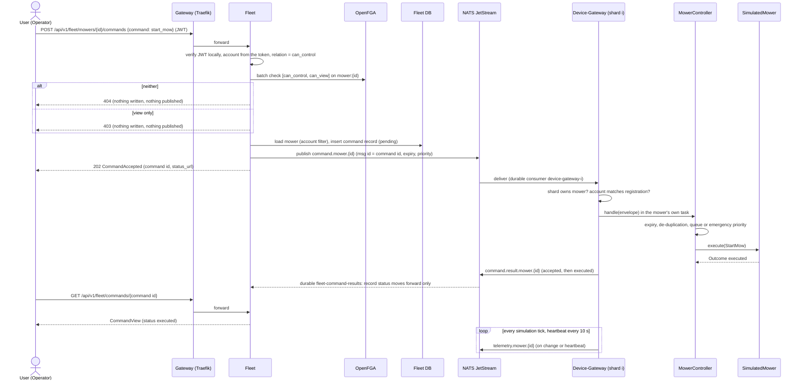
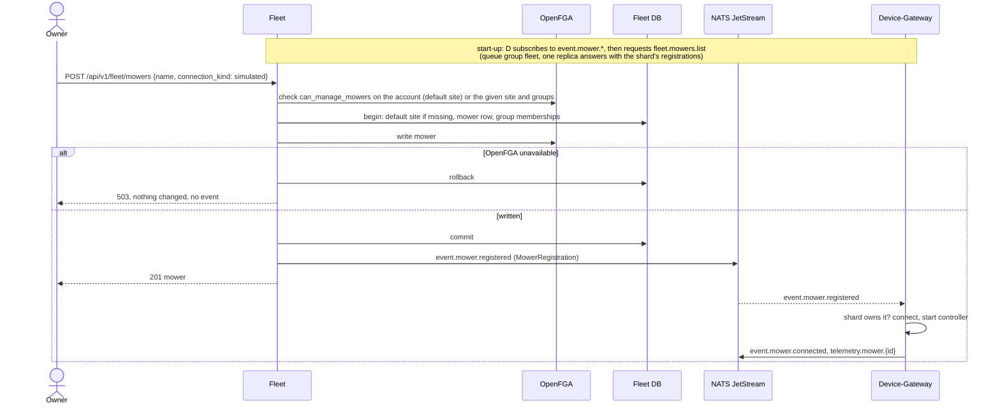
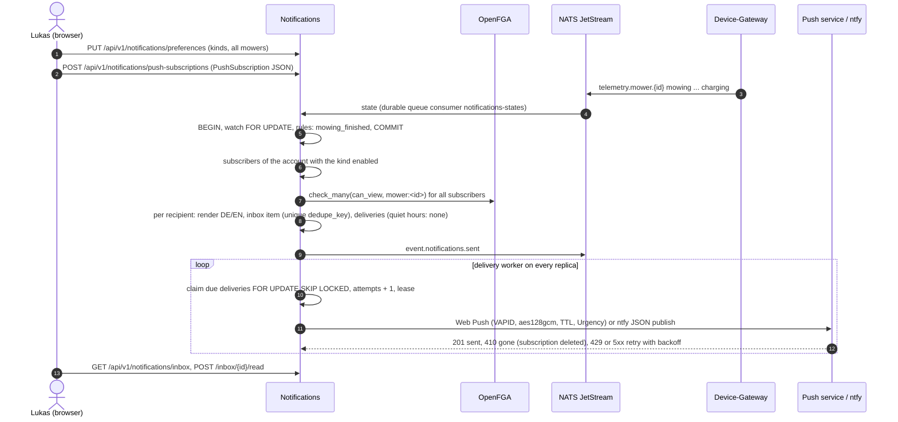
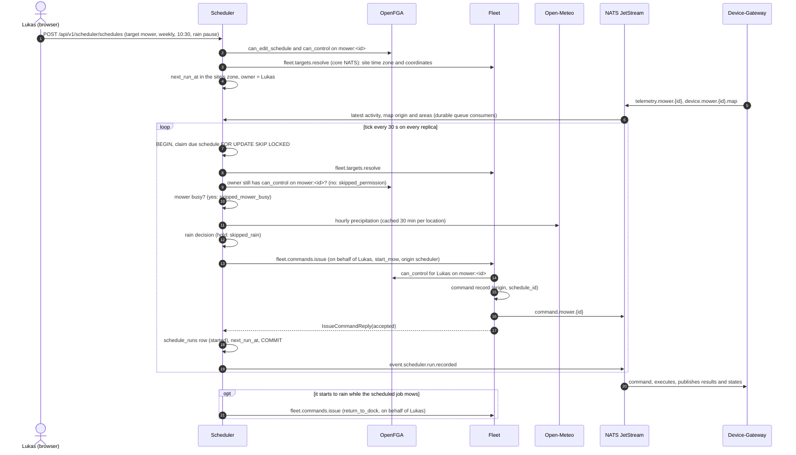
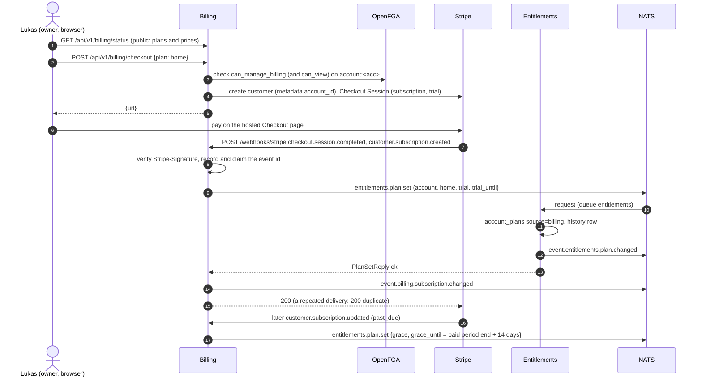
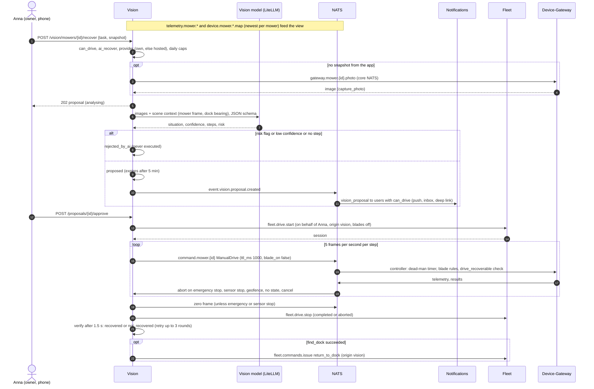
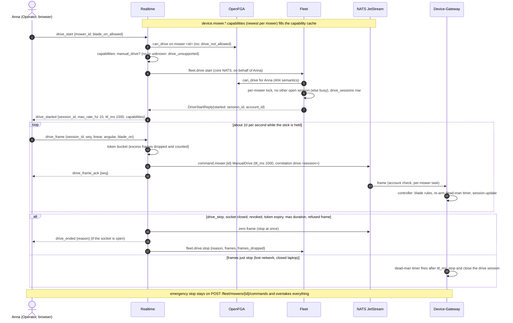
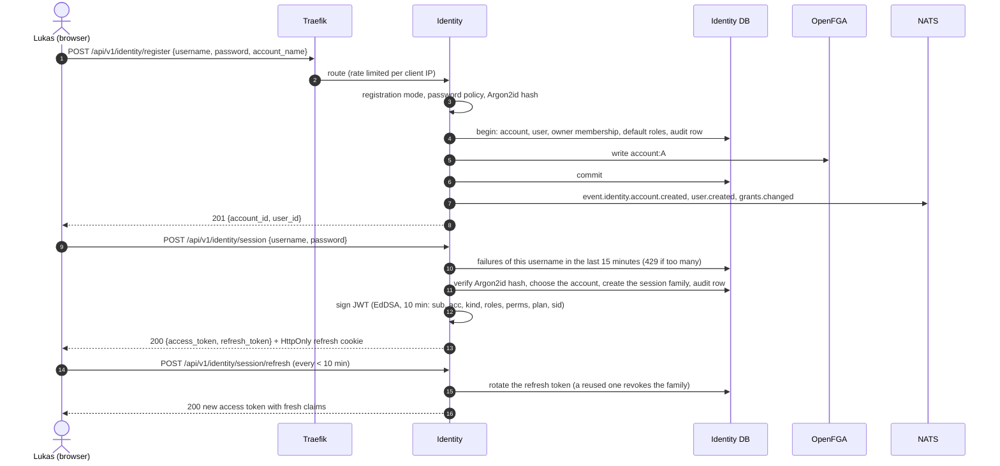

# 6. Runtime view

## Communication rules

- **From outside:** clients talk only to the gateway (REST and WebSocket). The public API is versioned (`/api/v1`).
- **Between services:** NATS JetStream. Commands as `command.mower.<id>`, state as `telemetry.mower.<id>`, domain events such as `mower.registered` or `subscription.changed`.
- **Tokens:** Identity issues short-lived JWTs (EdDSA, 10 minutes) with user, account, roles, permission keys and plan. Every service verifies them itself against Identity's published keys (`mowdeck-auth`, [ADR 0015](../adr/0015-tokens-sessions-and-key-rotation.md)).
- **Reliability:** commands have a unique ID, an expiry and emergency stop has priority.
- **Bridge:** the ESP32 bridge connects outbound (TLS, device secret), so it works behind any router.

## Scenario: send a start command

Implemented in Phase 1 by Fleet and the Device-Gateway ([ADR 0016](../adr/0016-fleet-commands-and-authorization-per-command-kind.md), [ADR 0013](../adr/0013-device-gateway-registry-and-sharding.md)). The relation Fleet checks depends on the command kind: `can_control` for start, pause, resume, dock, blade height and speed, `can_drive` for manual drive, `can_emergency_stop` (equal to `can_view`) for an emergency stop.



If the envelope's account differs from the registered owner, the Device-Gateway publishes a `rejected` result and the command never reaches the controller. Commands of different mowers run concurrently; an emergency stop overtakes queued commands of its own mower. A bulk command (`POST /groups/{id}/commands`, `/sites/{id}/commands`) needs `can_bulk_command` on the target (view for an emergency stop) and is then checked per mower: allowed mowers get their own command, visible ones without the right are reported `forbidden`, invisible ones are omitted.

## Scenario: register a mower



`identity.account.created` makes Fleet create the account's hidden default site; registering a mower without a site creates it too if the event has not arrived yet.

## Scenario: live status

Implemented by Telemetry ([ADR 0017](../adr/0017-telemetry-storage-and-retention.md)) and Realtime ([ADR 0018](../adr/0018-realtime-websocket-protocol.md)). Telemetry stores every state per the write rules and answers `GET /api/v1/telemetry/mowers/{id}/state` for clients that do not need a push; Realtime pushes states and command results over a WebSocket. Every Realtime instance subscribes to the whole stream (no queue group), so any instance can serve any client. The Phase 1 acceptance test (`tests/e2e`) runs this sequence through Traefik.

```mermaid
sequenceDiagram
    autonumber
    actor U as Anna (Operator, browser)
    participant R as Realtime
    participant A as OpenFGA
    participant F as Fleet
    participant N as NATS JetStream
    participant D as Device-Gateway
    participant T as Telemetry
    U->>R: GET /api/v1/realtime/ws (upgrade through Traefik)
    U->>R: {"type": "auth", "token": access token}
    R->>R: verify locally (JWKS), limits per user and account, expiry timer
    R-->>U: ready {principal, token_expires_at}
    U->>R: subscribe {mower_ids}
    R->>A: check_many(can_view, mower:<id>)
    R-->>U: subscribed {mower_ids, denied}, then the cached newest state
    U->>F: POST /api/v1/fleet/mowers/{id}/commands start_mow
    F->>A: can_control on the mower
    F->>N: command.mower.{id}
    F-->>U: 202 {command_id}
    N->>D: command
    D->>N: command.result.mower.{id} executed, telemetry.mower.{id} mowing
    N->>R: result and state (every instance, ephemeral consumers)
    R-->>U: command_result, state (newest state per mower, never blocks the bus)
    N->>T: state (durable queue consumer)
    T->>T: latest row, history (changes and a periodic row), position track
    Note over R,A: identity.grants.changed, every 60 s and on a new auth: re-check, revoked {mower_ids}
    Note over U,R: token exp without a new auth: close 4401; slow reader: close 4430
```

## Scenario: mowing finished notification

Implemented by Notifications ([ADR 0022](../adr/0022-notifications-rules-and-delivery.md)). The rules run per state under a row lock on the mower's watch; recipients are the subscribers of the account, re-checked with `can_view` before anything is stored; the outbox worker of any replica sends.



## Scenario: a scheduled run

Implemented by the Scheduler ([ADR 0024](../adr/0024-scheduler-recurrence-rain-pause-and-command-issuing.md)). Every replica ticks; a due schedule is claimed with `FOR UPDATE SKIP LOCKED` and fired inside its transaction. The command goes through Fleet on behalf of the schedule's owner, so Fleet keeps the single command record and audit.



## Scenario: a subscription through Stripe

Implemented by Billing ([ADR 0031](../adr/0031-billing-with-stripe-adapter.md)), only where billing is enabled (Compose profile `billing`). Payment pages are Stripe's; Billing only sees ids and statuses.



## Scenario: AI assist frees a stuck mower

Implemented by the Vision service ([ADR 0033](../adr/0033-vision-assisted-recovery-with-approval.md)) on top of the drive channel of [ADR 0026](../adr/0026-manual-drive-channel.md). The Device-Gateway's controller stays the safety authority.



## Scenario: manual driving with the joystick

Implemented by Realtime and Fleet ([ADR 0026](../adr/0026-manual-drive-channel.md)); the Device-Gateway's controller stays the only safety authority ([ADR 0012](../adr/0012-mower-control-interface-and-safety-rules.md)). The session is opened once through Fleet; the frames go from Realtime straight to the gateway.



## Scenario: live camera

Implemented by Fleet, the Device-Gateway and the web app ([ADR 0032](../adr/0032-live-camera-over-agora.md)). MowDeck hands out credentials only; the video goes from the mower through Mammotion's cloud and Agora straight to the browser.

```mermaid
sequenceDiagram
    autonumber
    actor A as Anna (Viewer, browser)
    participant F as Fleet
    participant O as OpenFGA
    participant E as Entitlements
    participant D as Device-Gateway
    participant M as Mammotion cloud
    participant G as Agora
    A->>F: POST /fleet/mowers/{id}/camera/session
    F->>O: can_view on mower:<id> (404 semantics)
    F->>E: feature camera (cached; no: 403 feature-not-in-plan)
    F->>D: gateway.mower.<id>.camera.session (core NATS, the shard's instance answers)
    D->>D: account owns the mower? connection CameraCapable?
    D->>M: get_stream_subscription (PyMammotion; the mower starts publishing)
    M-->>D: appid, channel, token, uid, cameras, key and salt
    D-->>F: CameraSessionReply(session)
    F->>F: audit mower.camera_opened (never the token)
    F-->>A: CameraSession (Cache-Control: no-store)
    A->>G: join channel as audience (Agora Web SDK, encryption first)
    G-->>A: video of the mower's camera
    loop a minute before expires_at
        A->>F: POST .../camera/session
        F-->>A: fresh session
        A->>G: renewToken
    end
    A->>G: leave (panel closed or page left)
```

## Scenario: registration and login

Implemented by Identity ([ADR 0015](../adr/0015-tokens-sessions-and-key-rotation.md)). The tuples are written inside the database transaction, right before the commit; if OpenFGA cannot be written, nothing is saved and the request answers 503.



## Scenario: an authorized request

Every service verifies the token itself; Identity is not asked per request. Implemented by the Device-Gateway (token level), Identity and Fleet (object level).

```mermaid
sequenceDiagram
    autonumber
    actor A as Anna (app)
    participant T as Traefik
    participant S as Service (Fleet)
    participant J as JWKS cache (mowdeck-auth)
    participant Z as mowdeck-authz
    participant F as OpenFGA
    participant DB as Service DB
    A->>T: POST /api/v1/fleet/mowers/m1/commands (Bearer JWT)
    T->>S: route (no auth decision in the gateway)
    S->>J: key for kid (cached 5 min; an unknown kid refetches the JWKS once)
    S->>S: verify EdDSA signature, iss, aud, exp; Principal(acc=A)
    S->>Z: require_or_not_found(can_control, mower:m1)
    Z->>Z: pre-filter: "mower.control" in perms? decision cache
    Z->>F: batch check can_control and can_view for user:anna on mower:m1
    F-->>Z: [true, true]
    S->>DB: SELECT mower WHERE id = m1 AND account_id = A
    S-->>A: 202
    Note over S,F: Bob (account B): the path account or the check fails, the answer is 404
```

## Scenario: foreign account is rejected

A user of account B requests mower `X` of account A. The service takes the account ID from the token (B), the query filter and the OpenFGA check both fail, and the service answers 404 or 403 without revealing existence. Every service ships tests for exactly this case.
