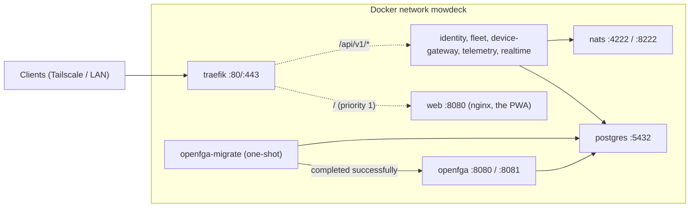
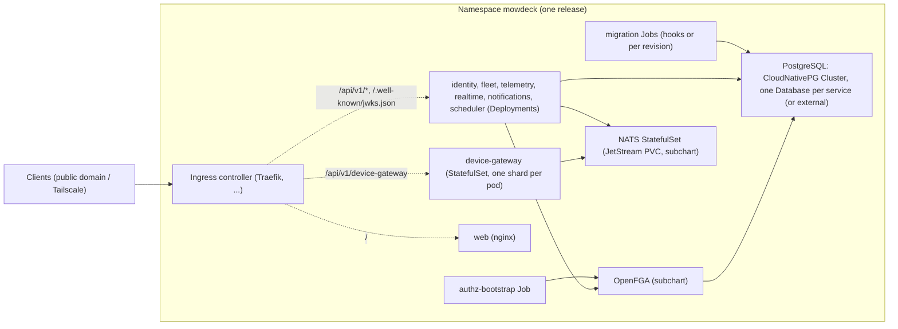

# 7. Deployment view

The same container images run at home and in the cloud. Only configuration and instance counts differ.

| | Self-hosted (owner start) | Cloud |
| --- | --- | --- |
| Start | one `docker compose up` | Helm chart on Kubernetes |
| Instances | one per service | per service by load, autoscaled |
| Database | one PostgreSQL with one database per service | PostgreSQL per service or managed cluster |
| Event bus | NATS single container | NATS cluster |
| Billing | off | on or off |
| Registration | off | open or invitation only |
| External access | Tailscale or reverse proxy | gateway with public domain |
| Hardware | mini PC, NAS or Raspberry Pi 5 with 4 GB | any |

## Compose topology (foundation)

The `web` service serves the static web app (an unprivileged, read-only nginx) at `/` with router priority 1, so every `/api/v1/*` route and `/.well-known/jwks.json` take precedence; the app and the API share one origin, so no CORS is needed and the refresh cookie (`SameSite=Strict`) works unchanged ([ADR 0020](../adr/0020-web-app-architecture.md)). Traefik waits for a healthy `web` like for the API services.

See [Operating the Compose stack](../ops/compose.md) for ports and commands.

## Kubernetes topology (Helm chart)

The chart `infra/helm/mowdeck` ([ADR 0029](../adr/0029-helm-chart-and-release-pipeline.md), [Helm operations](../ops/helm.md)) deploys the same images with the same settings (`values.yaml` uses the names of the Compose `.env.example`).

| | Homelab overlay | Cloud overlay |
| --- | --- | --- |
| Replicas | one per service | two per stateless service, CPU autoscaling, PodDisruptionBudgets, spread over nodes |
| PostgreSQL | CloudNativePG, one instance | CloudNativePG with three instances, or a managed PostgreSQL (`postgresql.external`) |
| NATS | one server with JetStream | three node cluster with JetStream |
| OpenFGA | one replica | three replicas |
| Ingress | k3s Traefik or the Tailscale operator | Ingress controller with cert-manager TLS and a rate limit on the login paths |

Migrations run as `pre-install`/`pre-upgrade` hooks with an external database and as Jobs per release revision with the in-cluster one; every database service waits in an init container until its schema is current, every OpenFGA user until the store carries its release's model. Releases (`.github/workflows/release.yml`, [Releases](../ops/release.md)) publish multi-arch images to `ghcr.io/<owner>/mowdeck/<image>` and the chart to `oci://ghcr.io/<owner>/charts/mowdeck`.

## Image rules

- Built for amd64 and arm64 (release workflow, QEMU), running as non-root with a read-only file system.
- Configuration and secrets only through environment variables or secret files, never in the image.
- Database migrations run as a separate one-shot step before the service starts (Compose: `<service>-migrate`, Kubernetes: migration Jobs plus the `wait-for-schema` init container).
- Remote access at home goes through Tailscale or an HTTPS reverse proxy. Installing the PWA reliably and Web Push need HTTPS (for example Tailscale's HTTPS certificates); behind HTTPS set `IDENTITY_REFRESH_COOKIE_SECURE=true` and `REALTIME_ALLOWED_ORIGINS` to the HTTPS origin.

Storage is exchangeable: PostgreSQL for time series, local volume or S3-compatible storage (such as MinIO) for files. Moving from home to cloud is a database export, not a rebuild.
