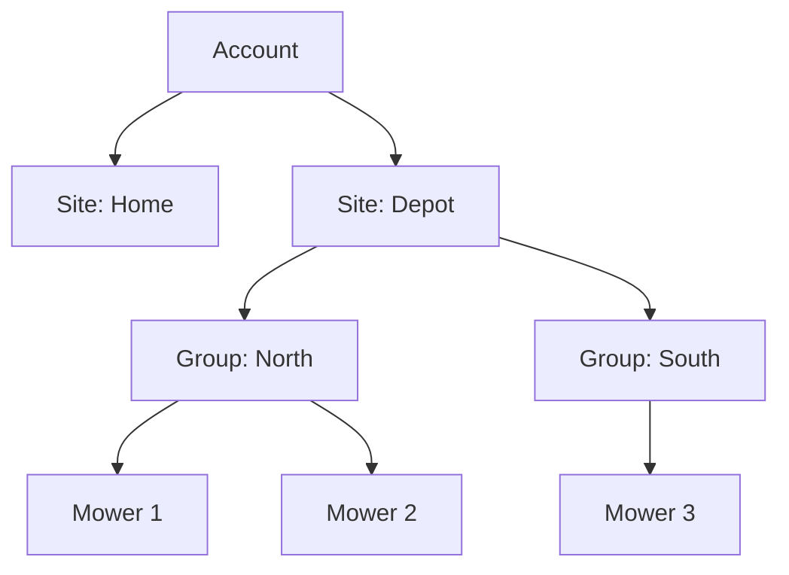

# 8. Crosscutting concepts

## Accounts, users and permissions

An **account** (household or business) has one owner and any number of sub-users. Permissions are granted on one level of a hierarchy and apply to everything below.

A household has a single invisible default site, so the same logic covers household and fleet.

- **Account:** data and billing boundary. Every record carries the account ID, which comes only from the verified token.
- **Sub-user:** created by the account via invitation link or directly with a username (for example staff without e-mail). They belong to the account and can be blocked at any time. A person may be a member of several accounts.
- **Permissions:** fine grained, for example `mower.view`, `mower.control`, `mower.drive`, `schedule.edit`, `fleet.bulk_command`, `fleet.manage`, `users.manage`, `billing.manage`, `audit.view`.
- **Roles:** named bundles of permissions. Default roles exist; each account may define its own.
- **Checks:** OpenFGA answers *who may do what on which object*. The model is a file in the repository (`infra/openfga/model.fga`), versioned and tested; services ask through `mowdeck-authz` ([ADR 0014](../adr/0014-authorization-model-and-tuple-ownership.md)). Roles live in Identity and are written to OpenFGA as expanded `grant_*` tuples; Owner and Admin are fixed relations. API tokens are their own subjects with explicit grants. Anyone who can view a mower can trigger its emergency stop.
- **Operator level:** operator admins manage accounts and plans but cannot see mower data. Support access needs account approval, is time limited and logged.
- **Audit log:** every permission change and every control command is stored with who, what and when.

| Default role | Typical level | May |
| --- | --- | --- |
| Owner | Account | everything, including subscription, delete account, transfer ownership |
| Admin | Account | manage users, roles, sites and mowers |
| Manager | Site or group | set up mowers, schedules, bulk commands |
| Operator | Site, group or mower | mow, drive, spot mowing |
| Viewer | any | view only |
| Integration (API token) | freely selectable | only the chosen permissions, for example for Home Assistant |

## Tenant isolation

Three independent layers protect every account:

1. **Account id only from the token.** Services take the account id from the verified principal (`CurrentAccountId`), never from a path, query or body.
2. **Object check in OpenFGA with a tenant guard.** Every permission below the account is intersected with `tenant from account`, so even a wrongly written grant or a mower wired under a foreign group grants nothing in another account. `mowdeck-authz` fails closed: an unanswered check is a deny.
3. **Account filter in every query.** The handler loads the row with `WHERE id = :id AND account_id = :account_id`.

A foreign object answers 404, so its existence is not revealed (`require_or_not_found`). Every service has tests that deliberately request foreign data. Bulk commands never bypass the permission system: Fleet checks every single mower and reports per mower whether the command arrived.

## Subscription and entitlements

Billing handles money only; Entitlements answers what an account may do. With `billing.enabled = false` Entitlements reports everything allowed (plan "Unlimited"). Plans are data (limits for mowers and users, features such as spot mowing, camera, AI). The current plan is in the token; services check features locally, hard limits are asked from Entitlements. After payment problems a grace period applies, then view and emergency stop only, never a mower stranded in the garden because of a subscription.

**Feature gates** ([ADR 0028](../adr/0028-entitlements-plans-and-enforcement.md)). Every function a plan can switch sits behind a feature key that its module declares in the descriptor (`features`); keys are hierarchical (`notifications` grants `notifications.push`) and `*` grants all. A service enforces with one call through the kit's `EntitlementsClient`: `require_feature(account, key)` (403 `urn:mowdeck:problem:feature-not-in-plan`) or `require_limit(account, key, current)` (409 `urn:mowdeck:problem:plan-limit` with the limit and the current count in `errors`). The client asks `entitlements.check` once and caches the account's snapshot for 60 s; `entitlements.plan.changed` drops it. While `MOWDECK_ENTITLEMENTS_BILLING_ENABLED` is false (the installation default) every account has the plan `unlimited`; when Entitlements does not answer, the calling service's own switch decides (off: allowed, on: refused). `view` and `emergency_stop` are never gated, and in `grace` or `expired` an account keeps exactly these two: viewing and stopping always work, nothing new is created, and no plan change ever sends a command to a mower. The token's `plan` claim (from Entitlements at issue) is informational; decisions go through the client.

**Billing** ([ADR 0031](../adr/0031-billing-with-stripe-adapter.md)). Billing is an optional service: with billing disabled it is not started at all (Compose profile `billing`, Helm `services.billing.enabled`), and the web app shows billing only when the public `GET /api/v1/billing/status` answers with JSON (`enabled: true`); a network error, a 404 or the SPA fallback hide it. Payment runs on the provider's hosted pages (Stripe Checkout and customer portal), so no card data reaches MowDeck. Webhooks carry no token: the `Stripe-Signature` over the raw body is verified first, every event id is processed once (`webhook_events`, a claim with a lease, a replay answers 200 `duplicate`), a failure answers 500 so the provider retries, and an event older than the last applied one is ignored. A subscription status becomes a plan status in Entitlements (`entitlements.plan.set`, `source=billing`): `trialing` trial, `active` active, payment problems `grace` until the end of the last paid period plus `MOWDECK_BILLING_GRACE_DAYS` and `expired` after it; as everywhere, grace and expired keep viewing and the emergency stop. Billing is owner only (`can_manage_billing`); legal texts and VAT/OSS registration are the operator's ([Billing operations](../ops/billing.md)).

## Mowing patterns

Patterns are plug-ins in `mowdeck-patterns`: input is an area polygon with exclusions, mower data and pattern settings; the settings describe themselves as JSON Schema so the app builds the form automatically; output is a neutral mowing plan. All patterns pass the same validation chain (inside the area with safety margin, feasible turning circle, no no-go zones, blade off when crossing). Patterns can be chained and rotated by schedules.

## Safety when driving

Dead-man switch (a command expires after about 1 second without signal), blade off during transfers, an always visible emergency stop button, sensor stops are never bypassed.

**Automated driving (AI assist, [ADR 0033](../adr/0033-vision-assisted-recovery-with-approval.md))** follows the same rules and adds its own: a vision model only proposes; nothing moves without the approval of a user with `can_drive`, and the steps are driven on that user's behalf through a drive session Fleet records with `origin: vision`. Every frame has `blade_on = false` (the answer schema has no blade field) and `ttl_ms` 1000, so the controller's dead-man timer stops the mower within a second whatever happens to the Vision service. Execution aborts on an emergency stop by anyone, a sensor stop, a new error, another activity, a refused frame, no state for 3 seconds, leaving the mapped areas plus a margin or entering a no-go zone, and on cancellation; after an emergency or sensor stop not even a zero frame is sent. A stuck mower is not a sensor stop: only errors an adapter marks `drive_recoverable` admit drive frames at the controller, lift, tilt and collision never do. Answers with a risk flag (people, animals, drop-off, water, road) or low confidence are never proposed.

## Observability and errors

OpenTelemetry for traces and logs, Prometheus metrics, correlation ID through all services, structured logs on stdout, uniform error format from `mowdeck-service-kit`.

## Documentation

Docs live in this repository and are built with MkDocs Material: arc42, C4 as Mermaid, ADRs, generated API and permission references, operations handbook, developer guide, user manual, changelog from Conventional Commits. A change is done only when docs and ADRs are updated. Semantic Versioning applies to services, libraries and the public API.
