# Generated architecture diagrams

!!! note "Generated, do not edit"
    This page is written by `tools/repo-checks/scripts/arch_diagrams.py` from the code
    and the Compose file. Run `uv run poe arch-diagrams` after changing a service, a
    route, a NATS subject or the Compose stack; CI fails when the page is stale.
    The hand-written diagrams of the
    [architecture chapters](01-introduction-and-goals.md) and the ADRs explain the *why*;
    this page shows what the code does *today*.

## How this is generated

| Diagrams | Source of truth |
|---|---|
| Routing, platform, external systems, data ownership | `infra/compose/docker-compose.yml`: services, profiles, Traefik labels, `MOWDECK_*` environment variables, Alembic revisions of `services/*` |
| Messaging | `subscribe`, `publish` and `request` calls on the bus in `services/*/src`, subject constants and helpers of `libs/*/src` (read with `ast`), stream definitions in `mowdeck_contracts/v1/subjects.py` |
| HTTP API | OpenAPI documents in `apps/web/openapi` (exported from the services) |

Not derivable from code and therefore not shown: the browser, mobile and Home Assistant clients are drawn as one node; subjects built at runtime are listed as such.

## Services and routing

Traefik is the only entry point. Dotted arrows are services that start only with a Compose profile.

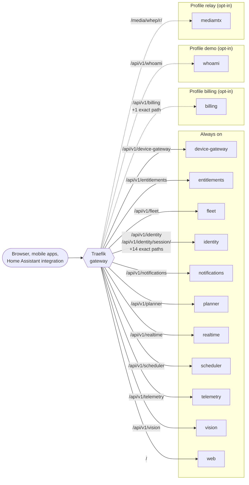

| Service | Path prefixes | Exact paths | Profile |
|---|---|---|---|
| `billing` | `/api/v1/billing` | `/api/v1/billing/webhooks/stripe` | billing |
| `device-gateway` | `/api/v1/device-gateway` | - | always |
| `entitlements` | `/api/v1/entitlements` | - | always |
| `fleet` | `/api/v1/fleet` | - | always |
| `identity` | `/api/v1/identity`, `/api/v1/identity/session/` | `/.well-known/jwks.json`, `/api/v1/identity/app-login/session`, `/api/v1/identity/app-login/start`, `/api/v1/identity/me/external-identities/apple/link`, `/api/v1/identity/me/external-identities/github/link`, `/api/v1/identity/oauth/apple/callback`, `/api/v1/identity/oauth/apple/start`, `/api/v1/identity/oauth/github/callback`, `/api/v1/identity/oauth/github/start`, `/api/v1/identity/passkeys/challenge`, `/api/v1/identity/passkeys/session`, `/api/v1/identity/register`, `/api/v1/identity/session`, `/api/v1/identity/token` | always |
| `mediamtx` | `/media/whep/r/` | - | relay |
| `notifications` | `/api/v1/notifications` | - | always |
| `planner` | `/api/v1/planner` | - | always |
| `realtime` | `/api/v1/realtime` | - | always |
| `scheduler` | `/api/v1/scheduler` | - | always |
| `telemetry` | `/api/v1/telemetry` | - | always |
| `vision` | `/api/v1/vision` | - | always |
| `web` | `/` | - | always |
| `whoami` | `/api/v1/whoami` | - | demo |

Infrastructure containers: `mediamtx`, `nats`, `openfga`, `postgres`, `traefik`, `whoami`. One-shot jobs (migrations, bootstrap): `authz-bootstrap`, `billing-migrate`, `entitlements-migrate`, `fleet-migrate`, `identity-migrate`, `notifications-migrate`, `openfga-migrate`, `planner-migrate`, `scheduler-migrate`, `telemetry-migrate`, `vision-migrate`.

## Platform dependencies

Services are grouped by what they depend on: a database, NATS, OpenFGA and the token keys of identity (JWKS).

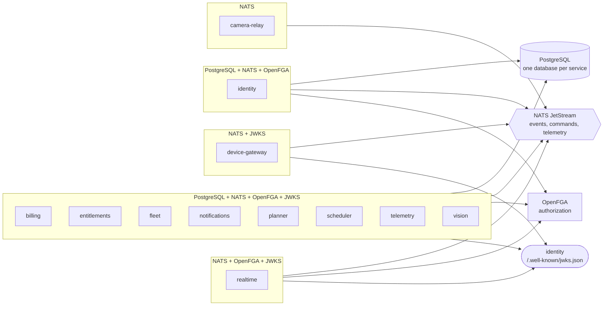

Services that call other services over HTTP (configured by URL):

| Service | Calls |
|---|---|
| `billing` | `entitlements` |
| `entitlements` | `device-gateway`, `fleet`, `identity`, `notifications`, `planner`, `realtime`, `scheduler`, `telemetry`, `vision` |
| `identity` | `device-gateway`, `entitlements`, `fleet`, `notifications`, `planner`, `realtime`, `scheduler`, `telemetry`, `vision` |

## External systems

Recognised from the environment variables each service is configured with.

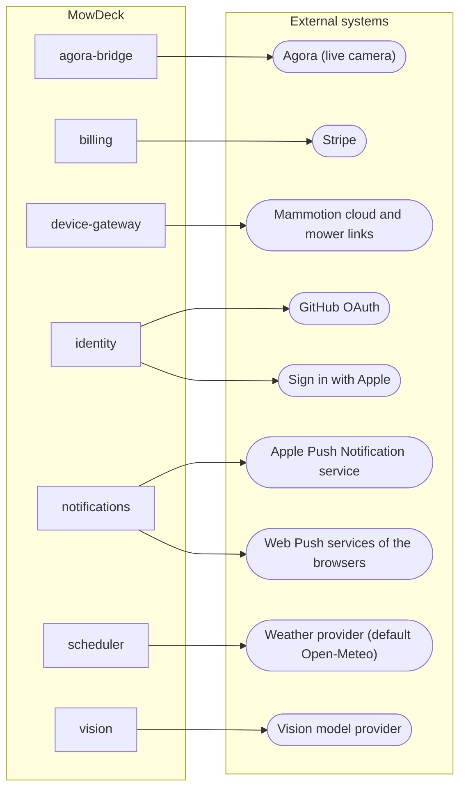

## Messaging

Streams are the JetStream streams of the contracts; every other subject is core NATS request/reply. Subjects use `*` for the mower id.

### JetStream streams

#### CAMERA

Captures `camera.>`.

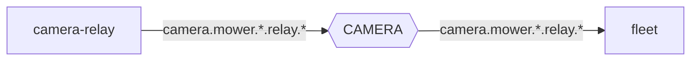

#### COMMANDS

Captures `command.>`.

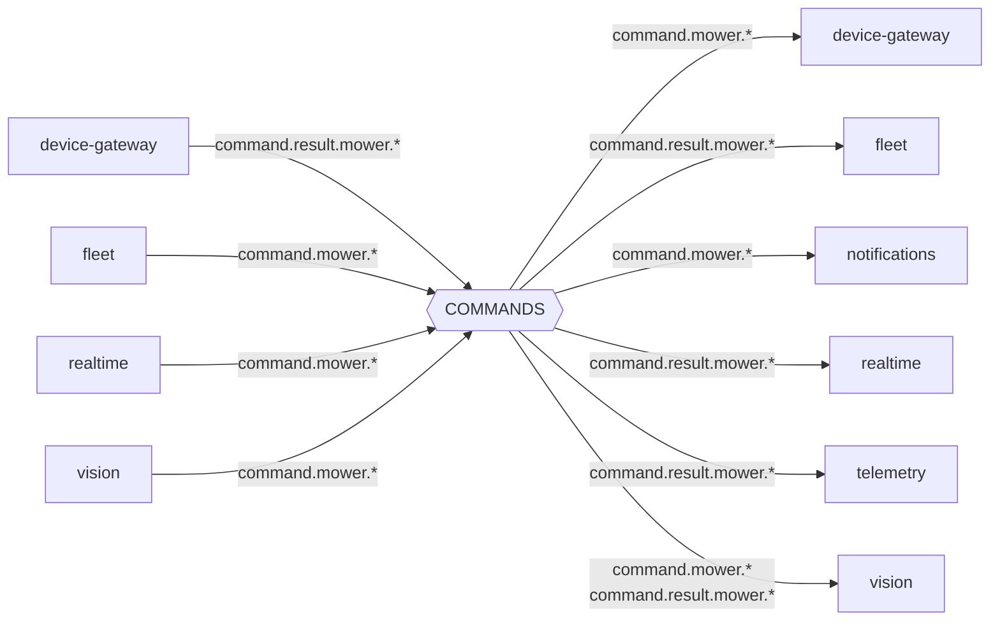

#### DEVICE

Captures `device.>`.

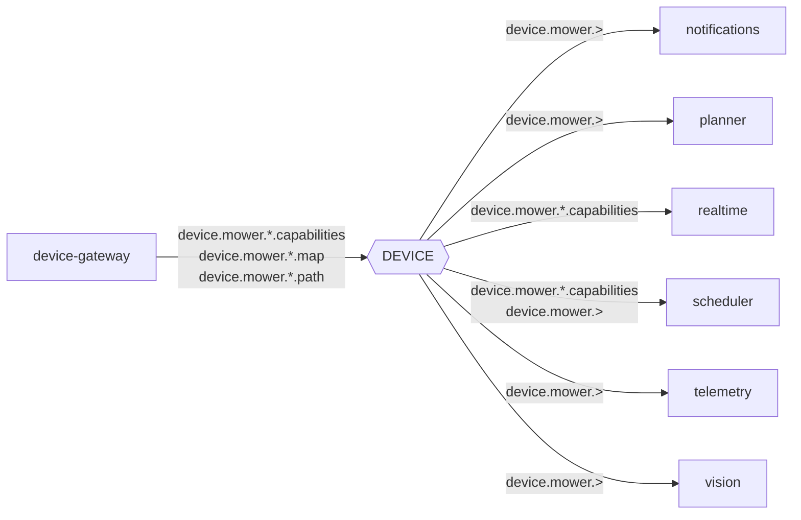

#### EVENTS

Captures `event.>`.

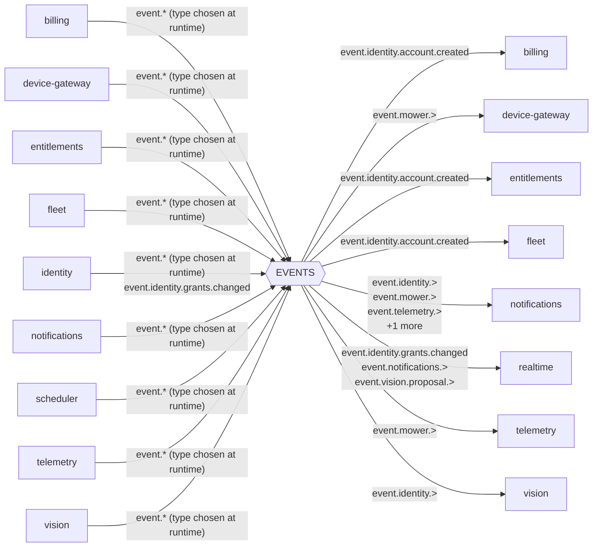

#### TELEMETRY

Captures `telemetry.>`.

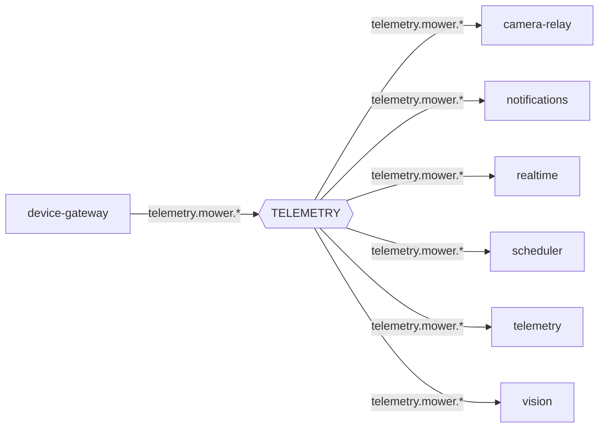

### Request and reply

#### Answered by camera-relay

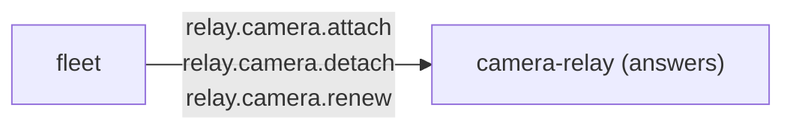

#### Answered by device-gateway

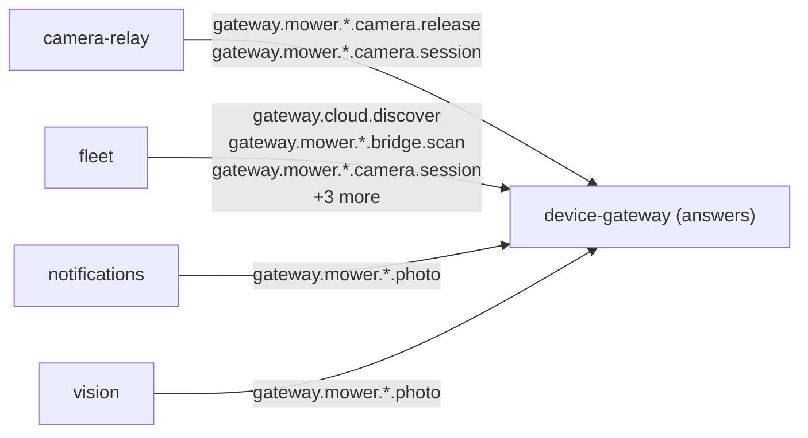

#### Answered by entitlements

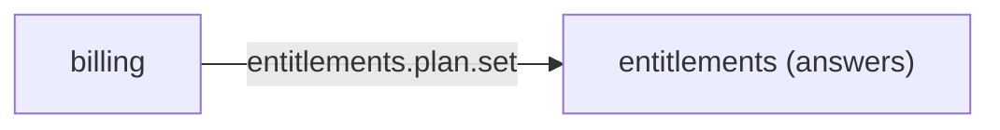

#### Answered by fleet

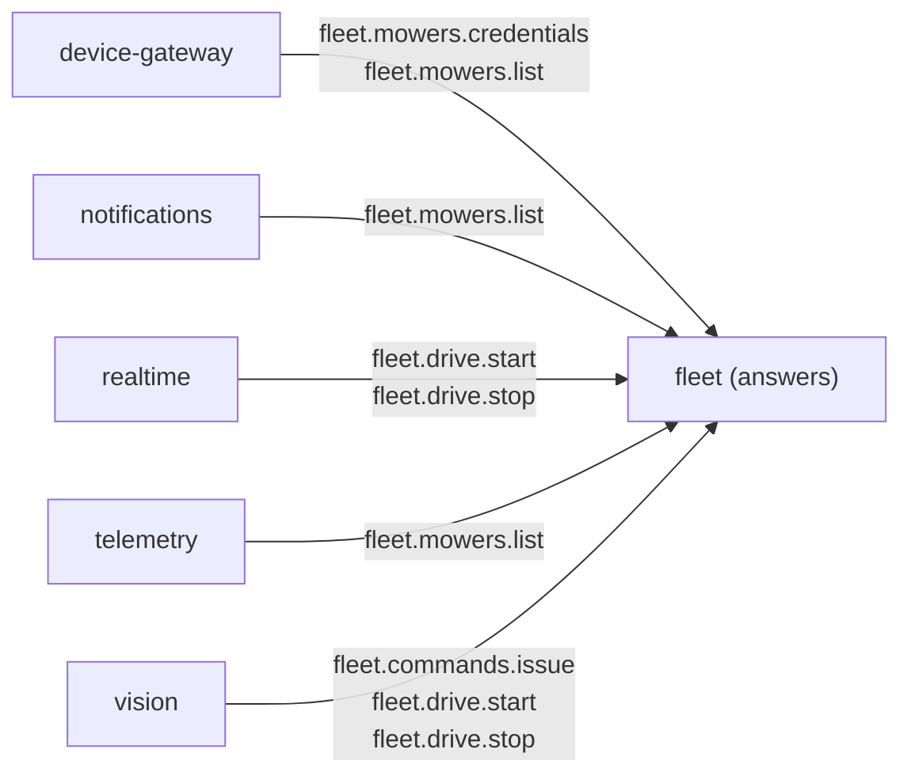

#### Answered by telemetry

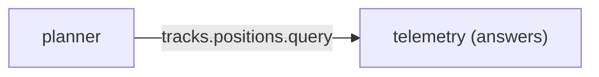

### All subjects

| Subject | Stream | Publishes or requests | Subscribes or answers |
|---|---|---|---|
| `camera.mower.*.relay.*` | CAMERA | camera-relay | fleet |
| `command.mower.*` | COMMANDS | fleet, realtime, vision | device-gateway, notifications, vision |
| `command.result.mower.*` | COMMANDS | device-gateway | fleet, realtime, telemetry, vision |
| `device.mower.*.capabilities` | DEVICE | device-gateway | realtime, scheduler |
| `device.mower.*.map` | DEVICE | device-gateway | - |
| `device.mower.*.path` | DEVICE | device-gateway | - |
| `device.mower.>` | DEVICE | - | notifications, planner, scheduler, telemetry, vision |
| `entitlements.check` | core | - | entitlements |
| `entitlements.plan.set` | core | billing | entitlements |
| `event.* (type chosen at runtime)` | EVENTS | billing, device-gateway, entitlements, fleet, identity, notifications, scheduler, telemetry, vision | - |
| `event.identity.>` | EVENTS | - | notifications, vision |
| `event.identity.account.created` | EVENTS | - | billing, entitlements, fleet |
| `event.identity.grants.changed` | EVENTS | identity | realtime |
| `event.mower.>` | EVENTS | - | device-gateway, notifications, telemetry |
| `event.notifications.>` | EVENTS | - | realtime |
| `event.telemetry.>` | EVENTS | - | notifications |
| `event.vision.>` | EVENTS | - | notifications |
| `event.vision.proposal.>` | EVENTS | - | realtime |
| `fleet.commands.issue` | core | vision | fleet |
| `fleet.drive.start` | core | realtime, vision | fleet |
| `fleet.drive.stop` | core | realtime, vision | fleet |
| `fleet.mowers.credentials` | core | device-gateway | fleet |
| `fleet.mowers.list` | core | device-gateway, notifications, telemetry | fleet |
| `fleet.targets.resolve` | core | - | fleet |
| `gateway.cloud.discover` | core | fleet | device-gateway |
| `gateway.mower.*.bridge.scan` | core | fleet | device-gateway |
| `gateway.mower.*.camera.release` | core | camera-relay | device-gateway |
| `gateway.mower.*.camera.session` | core | camera-relay, fleet | device-gateway |
| `gateway.mower.*.firmware.check` | core | fleet | device-gateway |
| `gateway.mower.*.path.preview` | core | fleet | device-gateway |
| `gateway.mower.*.photo` | core | fleet, notifications, vision | device-gateway |
| `relay.camera.attach` | core | fleet | camera-relay |
| `relay.camera.detach` | core | fleet | camera-relay |
| `relay.camera.renew` | core | fleet | camera-relay |
| `telemetry.mower.*` | TELEMETRY | device-gateway | camera-relay, notifications, realtime, scheduler, telemetry, vision |
| `tracks.positions.query` | core | planner | telemetry |

2 bus calls build their subject at runtime from variables and are not listed. Shared libraries (for example the plan-change subscription of the service kit) are not attributed to a service.

## HTTP API

Operations per OpenAPI tag of each service, from the documents the web app's types are generated from.

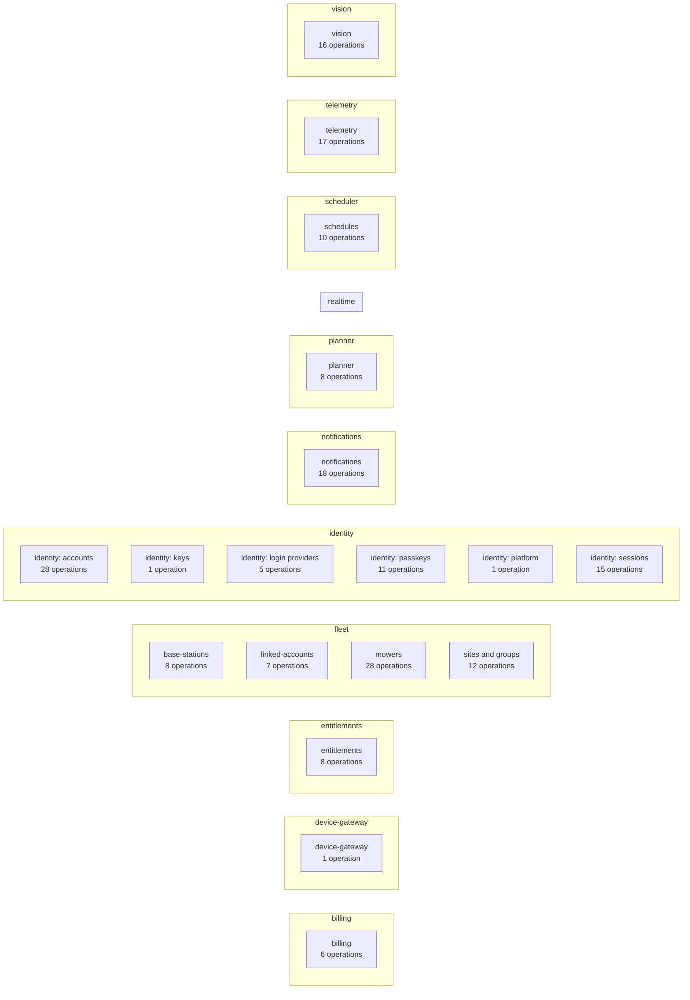

| Service | Tag | Operations | Paths |
|---|---|---|---|
| `billing` | `billing` | 6 | 6 |
| `billing` | `operations` | 1 | 1 |
| `device-gateway` | `device-gateway` | 1 | 1 |
| `device-gateway` | `operations` | 1 | 1 |
| `entitlements` | `entitlements` | 8 | 7 |
| `entitlements` | `operations` | 1 | 1 |
| `fleet` | `base-stations` | 8 | 5 |
| `fleet` | `linked-accounts` | 7 | 5 |
| `fleet` | `mowers` | 28 | 21 |
| `fleet` | `operations` | 1 | 1 |
| `fleet` | `sites and groups` | 12 | 6 |
| `identity` | `identity: accounts` | 28 | 19 |
| `identity` | `identity: keys` | 1 | 1 |
| `identity` | `identity: login providers` | 5 | 5 |
| `identity` | `identity: passkeys` | 11 | 9 |
| `identity` | `identity: platform` | 1 | 1 |
| `identity` | `identity: sessions` | 15 | 15 |
| `identity` | `operations` | 1 | 1 |
| `notifications` | `notifications` | 18 | 13 |
| `notifications` | `operations` | 1 | 1 |
| `planner` | `operations` | 1 | 1 |
| `planner` | `planner` | 8 | 6 |
| `realtime` | `operations` | 1 | 1 |
| `scheduler` | `operations` | 1 | 1 |
| `scheduler` | `schedules` | 10 | 7 |
| `telemetry` | `operations` | 1 | 1 |
| `telemetry` | `telemetry` | 17 | 17 |
| `vision` | `operations` | 1 | 1 |
| `vision` | `vision` | 16 | 13 |

The tag `operations` holds the probe endpoints every service exposes.

## Data ownership

Each service owns one database; nothing else reads it.

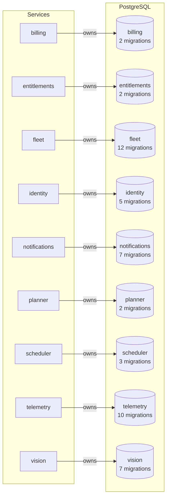

Services without a database: `agora-bridge`, `camera-relay`, `device-gateway`, `realtime`, `web`.
