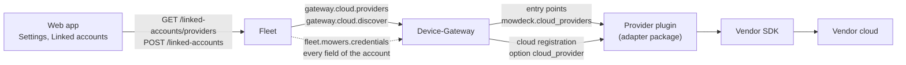

# Cloud providers: adding a vendor

MowDeck talks to mowers through adapter packages. A vendor whose mowers are reached through its cloud (account linking, device list, cloud connections) plugs in as a **cloud provider** ([ADR 0066](../adr/0066-cloud-provider-plugins-and-more-vendors.md)). The core services never import a vendor package and never name a vendor: the Device-Gateway loads the providers through entry points, Fleet learns their credential fields from the gateway, and the web app renders the link form from those fields.

## How the pieces fit



1. The gateway loads the specs of the installed packages (`mowdeck.cloud_providers`) and creates a plugin for every **enabled** provider: those with `enabled_by_default` (tested on real hardware) plus `MOWDECK_CLOUD_PROVIDERS_ENABLE`, minus `MOWDECK_CLOUD_PROVIDERS_DISABLE`. Disabled providers are not loaded and not offered.
2. Fleet asks for the enabled providers on `gateway.cloud.providers` and serves their descriptors at `GET /api/v1/fleet/linked-accounts/providers`.
3. The web app renders the provider's fields, guidance and warnings ("untested on real hardware", "needs a developer account").
4. Linking: Fleet checks the credentials against the descriptor, asks the gateway to log in (`gateway.cloud.discover`), seals the secret fields (AES-256-GCM) and stores the rest. Secrets never leave Fleet except in two internal NATS replies and are never logged or returned.
5. A mower registered from the account carries `cloud_provider` in its registration; the gateway hands it to that provider's plugin and merges the account's credential fields into the connection options when it connects.

## Checklist

1. **Package.** Create `libs/mowdeck-control-<vendor>`: Apache-2.0 when the vendor SDK is permissive, GPL-3.0 with its own `LICENSE` when it is GPL ([ADR 0011](../adr/0011-gpl-package-for-pymammotion-adapter.md)); read the SDK's `LICENSE` file, not only its PyPI metadata. Depend on `mowdeck-contracts`, `mowdeck-control` and the SDK, pinned exactly.
2. **Connection.** Implement `MowerConnection` as a thin translator ([ADR 0012](../adr/0012-mower-control-interface-and-safety-rules.md), checklist in `libs/mowdeck-control/README.md`): honest `MowerCapabilities` (default "not supported"), states mapped onto MowDeck's activities, `raw.lifted` and the lift code for the theft alarm ([ADR 0027](../adr/0027-health-history-and-theft-alarm.md)), `raw.blade_on`. The controller owns every safety rule; do not duplicate them.
3. **Plugin.** Implement `CloudProviderPlugin`: the `descriptor` (credential fields with English labels and help, exactly one identity field, at least one secret; setup steps and links to the vendor's pages; `needs_developer_account`; `tested_on_hardware`), `discover(credentials)` raising `CloudLoginRefused` or `CloudUnavailable` with messages that never contain credentials or vendor payloads, `create_connection(config)` and `close()`. Share one vendor session per account between the account's mowers and the discovery when the vendor supersedes logins.
4. **Fake cloud.** With `ProviderContext.fake` the plugin answers from a fake cloud in the package (fixed test accounts documented in the package README); the browser tests and local development use it (`MOWDECK_FAKE_CLOUDS=true`, refused in production). Import the fake only when it is selected.
5. **Entry point and boundary.** Register the spec and declare the vendor modules:

    ```toml
    [project.entry-points."mowdeck.cloud_providers"]
    acme = "mowdeck_control_acme.plugin:SPEC"

    [tool.mowdeck.adapter]
    vendor-modules = ["acme_sdk"]
    ```

    `tools/repo-checks/tests/test_vendor_isolation.py` fails when core code imports the package or `acme_sdk`.

    Ship the vendor's error lexicon too (`[project.entry-points."mowdeck.error_lexicons"]`, see [Adding an error lexicon for a vendor](error-lexicon.md)); the same test requires it.
6. **Tests.** Unit tests against recorded or handwritten payloads and a fake SDK client, no network: descriptor, credential handling, state and capability mapping, lift codes, command translation, errors, the fake cloud.
7. **Image.** Add the package to the Device-Gateway's dependencies (`services/device-gateway/pyproject.toml`) and to the workspace (`pyproject.toml`: dev dependencies, `tool.uv.sources`, mypy files). That is packaging; no core module changes.
8. **Docs.** A package README (what the user must provide, capabilities, limits, rate limits, the fake accounts, "untested on real hardware"), a line in the root README's supported mowers and, for a decision worth recording, an ADR.
9. **Enable.** Leave `enabled_by_default` off until someone tested on real hardware; operators enable the provider with `MOWDECK_CLOUD_PROVIDERS_ENABLE=<id>` (Compose: `GATEWAY_CLOUD_PROVIDERS_ENABLE`).

## Credentials

| Field kind | Entered as | Stored | Shown on the linked account |
| --- | --- | --- | --- |
| `email` | e-mail input | plain (`public_credentials`) | yes |
| `text` | text input (monospace) | plain | yes |
| `choice` | select | plain | yes (the choice's label) |
| `secret` | password input, write-only | sealed with `MOWDECK_CREDENTIAL_ENCRYPTION_KEY` | never |

The identity field is the account's title and is unique per provider and MowDeck account (compared without case). A re-authentication (`POST /linked-accounts/{id}/sync` with `credentials`) takes secret fields only; the stored values stay for the others.

Never log a credential, never put one into an exception message, and never answer one in an API response; the gateway reports only the exception type of an unexpected plugin error.

## Providers today

| Provider | Package | Licence | User provides | Tested on hardware | On by default |
| --- | --- | --- | --- | --- | --- |
| `mammotion` | `mowdeck-control-mammotion` | GPL-3.0 | e-mail and password of a second Mammotion account | yes (LUBA 2 AWD X) | yes |
| `husqvarna` | `mowdeck-control-husqvarna` | Apache-2.0 | application key and secret of their own application in the Husqvarna Developer Portal (free developer account) | no | no (`MOWDECK_CLOUD_PROVIDERS_ENABLE=husqvarna`) |

The Husqvarna adapter's capabilities, state mapping, commands and rate limits are in `libs/mowdeck-control-husqvarna/README.md`. The research behind further vendors (Husqvarna, Segway Navimow, Worx) is in [ADR 0066](../adr/0066-cloud-provider-plugins-and-more-vendors.md).
