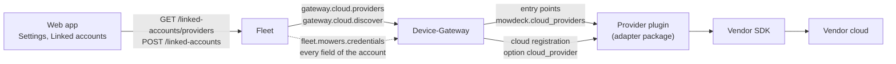

# Cloud providers: adding a vendor

MowDeck talks to mowers through adapter packages. A vendor whose mowers are reached through its cloud (account linking, device list, cloud connections) plugs in as a **cloud provider** ([ADR 0066](../adr/0066-cloud-provider-plugins-and-more-vendors.md)). The core services never import a vendor package and never name a vendor: the Device-Gateway loads the providers through entry points, Fleet learns their credential fields from the gateway, and the web app renders the link form from those fields.

## How the pieces fit



1. The gateway loads the specs of the installed packages (`mowdeck.cloud_providers`) and creates a plugin for every **enabled** provider: those with `enabled_by_default` (tested on real hardware) plus `MOWDECK_CLOUD_PROVIDERS_ENABLE`, minus `MOWDECK_CLOUD_PROVIDERS_DISABLE`. Disabled providers are not loaded and not offered.
2. Fleet asks for the enabled providers on `gateway.cloud.providers` and serves their descriptors at `GET /api/v1/fleet/linked-accounts/providers`.
3. The web app renders the provider's fields, guidance and warnings ("untested on real hardware", "needs a developer account").
4. Linking: Fleet checks the credentials against the descriptor, asks the gateway to log in (`gateway.cloud.discover`), seals the secret fields (AES-256-GCM) and stores the rest. Secrets never leave Fleet except in two internal NATS replies and are never logged or returned.
5. A mower registered from the account carries `cloud_provider` in its registration; the gateway hands it to that provider's plugin and merges the account's credential fields into the connection options when it connects.

## The principle

MowDeck is the same for every provider; a mower shows what its adapter declares and nothing more. Every feature is gated by `MowerCapabilities`, by capability-declared device settings ([ADR 0046](../adr/0046-device-settings-as-capabilities.md)) and by the mower options the provider declares, never by the vendor. An adapter that only connects, reports its state and starts, pauses and docks gets a clean MowDeck without dead buttons; declare more, get more.

## Checklist

1. **Package** `libs/mowdeck-control-<vendor>`: Apache-2.0, or GPL-3.0 with its own `LICENSE` when the SDK is GPL ([ADR 0011](../adr/0011-gpl-package-for-pymammotion-adapter.md); read the SDK's `LICENSE` file, not only PyPI). Pin the SDK exactly.
2. **Connection**: a thin `MowerConnection` ([ADR 0012](../adr/0012-mower-control-interface-and-safety-rules.md)). Declare only what the mower does in `MowerCapabilities` (the defaults mean "not supported"; the controller refuses the rest); map the state, `raw.lifted` and `raw.blade_on` ([ADR 0027](../adr/0027-health-history-and-theft-alarm.md)), and `error_category` from your error lexicon.
3. **Plugin**: a `CloudProviderPlugin` with its `descriptor` (credential fields, setup steps, links, `needs_developer_account`, `tested_on_hardware`, `mower_options` for the settings its mowers take), `discover`, `create_connection`, `close`, and a fake cloud for `ProviderContext.fake`.
4. **Declarations** in `pyproject.toml`:

    ```toml
    [project.entry-points."mowdeck.cloud_providers"]
    acme = "mowdeck_control_acme.plugin:SPEC"

    [project.entry-points."mowdeck.error_lexicons"]
    acme = "mowdeck_control_acme.lexicon:LEXICON"

    [tool.mowdeck.adapter]
    vendor-modules = ["acme_sdk"]
    brand-names = ["acme"]
    ```

    `tools/repo-checks/tests/test_vendor_isolation.py` then keeps the vendor out of the core. The lexicon guide: [Adding an error lexicon for a vendor](error-lexicon.md).
5. **Tests** against recorded or handwritten payloads and a fake SDK client, no network.
6. **Image** (the one mechanical core step): add the package to `services/device-gateway/pyproject.toml` and to the workspace `pyproject.toml` (dev group, `tool.uv.sources`, mypy files), then `uv lock`.
7. **Docs**: a package README (what the user provides, capabilities, limits, rate limits, the fake accounts, "untested on real hardware") and a row in the root README.
8. **Enable**: off by default until tested on real hardware; operators set `MOWDECK_CLOUD_PROVIDERS_ENABLE=<id>` (Compose: `GATEWAY_CLOUD_PROVIDERS_ENABLE`).

## Credentials

| Field kind | Entered as | Stored | Shown on the linked account |
| --- | --- | --- | --- |
| `email` | e-mail input | plain (`public_credentials`) | yes |
| `text` | text input (monospace) | plain | yes |
| `choice` | select | plain | yes (the choice's label) |
| `secret` | password input, write-only | sealed with `MOWDECK_CREDENTIAL_ENCRYPTION_KEY` | never |

The identity field is the account's title and is unique per provider and MowDeck account (compared without case). A re-authentication (`POST /linked-accounts/{id}/sync` with `credentials`) takes secret fields only; the stored values stay for the others.

Never log a credential, never put one into an exception message, and never answer one in an API response; the gateway reports only the exception type of an unexpected plugin error.

## Providers today

| Provider | Package | Licence | User provides | Tested on hardware | On by default |
| --- | --- | --- | --- | --- | --- |
| `mammotion` | `mowdeck-control-mammotion` | GPL-3.0 | e-mail and password of a second Mammotion account | yes (LUBA 2 AWD X) | yes |

The research behind further vendors (Husqvarna, Segway Navimow, Worx) is in [ADR 0066](../adr/0066-cloud-provider-plugins-and-more-vendors.md).
