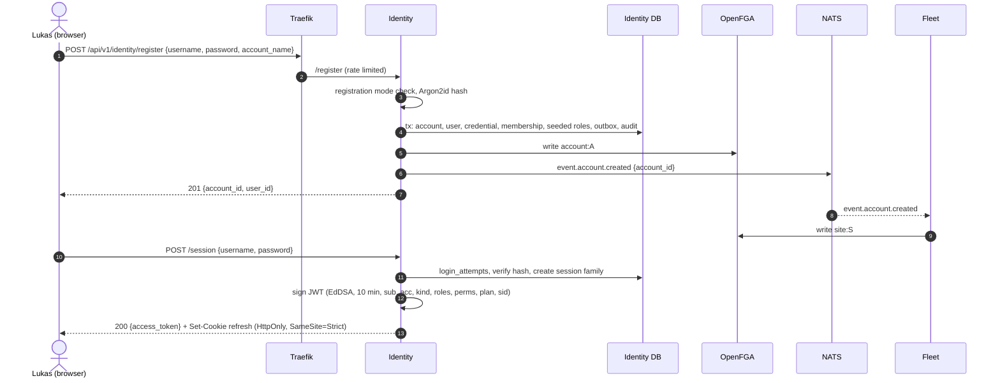

# Design: OpenFGA authorization model, mowdeck-authz, Identity service and mowdeck-auth (Tasks 5 and 6)

Status: approved 2026-10-08. Sections 1 and 2 (model and `mowdeck-authz`, Task 5) are implemented as of 2026-10-09 and this text was updated to match the code; the decision is recorded in [ADR 0014](../adr/0014-authorization-model-and-tuple-ownership.md). Sections 3 and 4 (Identity service and `mowdeck-auth`) are implemented as of 2026-10-09 (Task 6) within the scope cut of section 5; the token decisions are recorded in [ADR 0015](../adr/0015-tokens-sessions-and-key-rotation.md). Where the implementation differs from this text, the notes marked **Implemented** say how, and the service README is the reference. Scope: Phase 1 (Foundation). Inputs: `docs/plan/project-plan.de.md` (sections "Konten, Benutzer & Rechte", "Kommunikation & Verträge", "Erweiterbarkeit", "Abo & Zahlung", "Risiken"), ADR 0001, 0002, 0009, 0012, `mowdeck_contracts.v1.principal`, `mowdeck_contracts.v1.module`, `mowdeck_service_kit.tenancy`, `infra/compose/docker-compose.yml` (OpenFGA v1.22.0, pre-shared key auth, own `openfga` and `identity` databases already exist).

Verification note: the model in section 1 and the test file in section 1.6 were run with the official CLI image `openfga/cli:v0.8.1` (`fga model test --tests model.fga.yaml`) on 2026-10-08: **8/8 tests, 58/58 checks, 2/2 list_objects passing**. Library facts are cited; anything not verified is marked **[unverified]**.

---

## 0. Key decisions at a glance

1. **Roles live in Identity's database; OpenFGA only sees expanded grant tuples** (`user:anna#grant_mower_control@group:north`). No `role` type in the model.
2. **Owner and Admin are static relations** (`account#owner`, `account#admin`) because they must not be weakened by editing a role; Manager, Operator, Viewer and custom roles are editable bundles.
3. **Every permission below the account is intersected with `tenant from account`.** A wrongly written grant or a mower wired under a foreign group cannot leak across accounts (tested).
4. **Three isolation layers:** account id only from the token, FGA check (with the tenant intersection), DB query filtered by account id. A foreign object answers 404.
5. **API tokens are their own FGA subject** (`api_token:<id>`) with explicit grants, bounded at creation by the creator's rights, never inheriting them, and never able to hold `users.manage`, `billing.manage` or `audit.view`.
6. **Operator admins** sit on `platform`; they get `can_operator_manage` on accounts and nothing else. **Support access** is a conditional tuple (`not_expired`) that grants view only.
7. **Access JWT: EdDSA (Ed25519), 10 min, small**: `sub`, `acc`, `kind`, `roles`, `perms` (account-wide upper bound, a pre-filter only), `plan`, `sid`, `jti`, `iat`, `exp`, `iss`, `aud`. Object-level rights always come from OpenFGA.
8. **Refresh tokens are opaque, hashed, rotated with reuse detection.** API tokens are exchanged for a JWT at `POST /token`, so services only ever verify JWTs.
9. **DB is the source of truth, FGA is a projection** written through an outbox with a per-subject reconcile, so retries are idempotent and drift heals.
10. **Model bootstrap is a one-shot compose job** (`authz-bootstrap`) that writes the model only when it changed; services resolve the store by name and pin the latest model id at startup.

---

## 1. OpenFGA authorization model

### 1.1 Modeling choices

**Hierarchy.** `account > site > group > mower`, as in the plan. Concretely:

- `site#account -> account`.
- `group#account -> account`, `group#parent -> site` (optional, because the plan allows groups across sites: "Mäher-Gruppen, auch standortübergreifend"; a cross-site group simply has no `parent` and inherits from the account).
- `mower#account -> account`, `mower#parent -> site | group`, multi-valued: one site tuple (always, the hidden default site for households) plus zero or more group tuples.
- Every computed relation referenced through `X from parent` exists with the same name on every parent type (`site`, `group`), so tuple-to-userset resolution is uniform. The OpenFGA docs do not state how a parent type lacking the relation is handled, so we avoid the case entirely ([configuration language](https://openfga.dev/docs/configuration-language)).

**Permissions.** Each permission key from the catalogue maps to a direct, assignable `grant_<key>` relation on the levels where it makes sense, and to a computed `can_*` relation that combines the direct grant, inheritance from above, and the tenant guard:

| Permission key | Grant relation | Computed relation | Levels |
| --- | --- | --- | --- |
| `mower.view` | `grant_mower_view` | `can_view` | account, site, group, mower |
| `mower.control` | `grant_mower_control` | `can_control` | account, site, group, mower |
| `mower.drive` | `grant_mower_drive` | `can_drive` | account, site, group, mower |
| `schedule.edit` | `grant_schedule_edit` | `can_edit_schedule` | account, site, group, mower |
| `fleet.bulk_command` | `grant_fleet_bulk_command` | `can_bulk_command` | account, site, group |
| `fleet.manage` (set up mowers, sites, groups) | `grant_fleet_manage` | `can_manage_mowers` | account, site, group, mower |
| `users.manage` (users, roles, tokens) | `grant_users_manage` | `can_manage_users` | account |
| `billing.manage` | `grant_billing_manage` | `can_manage_billing` | account |
| `audit.view` | `grant_audit_view` | `can_view_audit` | account |
| (owner only) | `owner` | `can_manage_account` (delete, transfer) | account |
| (derived) | none | `can_emergency_stop` = `can_view` | all |

The mapping lives as data in `mowdeck_authz.permissions.PERMISSION_RELATIONS` (key to grant relation, computed relation, allowed levels). `fleet.manage` is a new key; the plan lists examples, not a closed set (see open question 3).

**Tenant guard.** Below the account, every `can_*` is `(grant or inherited) and tenant from account`. `tenant` is `member or support`. This is defense in depth against a bug in Identity (a grant written for a user of account B on an object of account A) or in Fleet (a mower of account B wired under a group of account A). Both cases are covered by tests in 1.6. At account level the grant is intersected with `member` directly. Cost: one extra relation lookup per check, acceptable at our scale; OpenFGA's own guidance is to measure on realistic data ([modeling roles](https://openfga.dev/docs/best-practices/modeling-roles)).

**Mower permissions do not imply each other in the model.** `can_control` does not include `can_view`. Bundling is enforced by Identity when a role is saved (every `mower.*` and `schedule.*` permission requires `mower.view` in the same role). This keeps the model flat and the "403 versus 404" logic in `mowdeck-authz` simple (section 2.4).

**Emergency stop.** `can_emergency_stop: can_view` on every level: anyone who can see a mower can stop it. This follows the plan's safety rule that the emergency stop always wins and must be reachable (open question 1).

### 1.2 Custom roles: expanded tuples versus a `role` type

OpenFGA documents three patterns: relations as roles (static), user-defined roles via a `role` type with `assignee` and `[role#assignee]` on the permission relations, and instance-specific role assignments via a `role_assignment` type ([modeling roles](https://openfga.dev/docs/best-practices/modeling-roles), [custom roles](https://openfga.dev/docs/modeling/custom-roles)). We need instance-specific assignments (Anna is Operator on group North only), so the `role` variant that fits would be the third one:

```
type role_assignment
  relations
    define assignee: [user, api_token]
    define role: [role]
    define can_control: assignee and grant_mower_control from role
type group
  relations
    define assignment: [role_assignment]
    define can_control: can_control from assignment or ...
```

**Option A, expanded tuples (chosen).** Identity stores roles and assignments in PostgreSQL and writes the union of the permissions of all assignments of a subject at a level as `grant_*` tuples.

- Pros: the model stays small and readable; checks are one hop shorter (OpenFGA rates role assignments as "highest impact" on performance); roles and the permission catalogue can change without a model change; the model test file reads like the business story; Identity can enforce anti-escalation rules on the data it already holds.
- Cons: editing a role rewrites the tuples of every assignment of that role (fan-out). Mitigation: per-subject reconcile (section 3.9); a household has a handful of subjects, a business maybe hundreds; writes are chunked (OpenFGA's default limit is 100 tuples per write; verified for v1.22: `--max-tuples-per-write` default 100). Two assignments can justify the same tuple; the reconcile computes the union, so removing one assignment never removes a tuple another assignment still needs.

**Option B, `role` and `role_assignment` types.** Pros: a role edit is one tuple. Cons: two more types, more tuples per assignment, slower checks, every new permission needs a relation on `role` and on `role_assignment` anyway, and Identity must still keep roles in its DB to render the UI and validate escalation. Rejected.

### 1.3 Subjects

- **`user`**: persons and sub-users alike. A sub-user is a `user` whose row in Identity has `owner_account_id` set; the model does not need to know.
- **`api_token`**: its own subject. It is a `member` of exactly one account and holds explicit grants only. Grants for `users.manage`, `billing.manage` and `audit.view` are restricted to `[user]` by type, so a token cannot hold them even if Identity had a bug (tested).
- **Operator admins**: `platform:main#operator_admin`. Each account carries `account#platform@platform:main` (written by Identity on account creation). Operators get `can_operator_manage` on accounts and nothing on sites, groups or mowers (tested).
- **Support access**: `account#support: [user with not_expired]`, tuple context `expires_at`, request context `current_time`. Support grants view on the whole account (via `account#can_view` and the inherited `can_view` below) and nothing else. Tuples persist the expiry, so a forgotten revoke still expires; Identity additionally deletes the tuple at expiry and writes an audit entry for grant, use and expiry. `mowdeck-authz` always sends `current_time` in the check context. Note from the docs: when tuple context and request context share a key, the tuple value wins ([conditions](https://openfga.dev/docs/modeling/conditions)), so a client cannot extend the window.
- **Households**: Fleet creates one hidden default site per account on `event.account.created` and writes `site:<id>#account@account:<id>`. Every mower gets `parent` = that site. Fleet's UI hides sites when there is only the default one.

### 1.4 Tuple ownership

| Tuples | Written by |
| --- | --- |
| `account#owner`, `#admin`, `#member`, `#support`, `#platform`; all `grant_*` on any level; `platform#operator_admin` | Identity |
| `site#account`; `group#account`, `#parent`; `mower#account`, `#parent` | Fleet |

Every object id is a UUID v4 (or v7) generated by the owning service. FGA ids are never built from user input without a DB lookup (section 2.6).

### 1.5 The model (`infra/openfga/model.fga`)

```fga
model
  schema 1.1

# MowDeck authorization model (Phase 1).
# Hierarchy: account > site > group > mower.
# grant_* relations are written by Identity (expanded from roles).
# account and parent relations of site, group and mower are written by Fleet.
# Every permission below the account level is intersected with
# "tenant from account", so a wrong tuple can never leak an object
# into a foreign account (defense in depth).

type user

type api_token

type platform
  relations
    define operator_admin: [user]
    define can_manage_accounts: operator_admin
    define can_manage_plans: operator_admin
    define can_view_system_health: operator_admin

type account
  relations
    define platform: [platform]
    define owner: [user]
    define admin: [user]
    define member: [user, api_token] or owner or admin
    define support: [user with not_expired]
    define tenant: member or support

    define grant_mower_view: [user, api_token]
    define grant_mower_control: [user, api_token]
    define grant_mower_drive: [user, api_token]
    define grant_schedule_edit: [user, api_token]
    define grant_fleet_bulk_command: [user, api_token]
    define grant_fleet_manage: [user, api_token]
    define grant_users_manage: [user]
    define grant_billing_manage: [user]
    define grant_audit_view: [user]

    define can_view: owner or admin or support or (grant_mower_view and member)
    define can_control: owner or admin or (grant_mower_control and member)
    define can_drive: owner or admin or (grant_mower_drive and member)
    define can_edit_schedule: owner or admin or (grant_schedule_edit and member)
    define can_bulk_command: owner or admin or (grant_fleet_bulk_command and member)
    define can_manage_mowers: owner or admin or (grant_fleet_manage and member)
    define can_manage_users: owner or admin or (grant_users_manage and member)
    define can_manage_billing: owner or (grant_billing_manage and member)
    define can_view_audit: owner or admin or (grant_audit_view and member)
    define can_manage_account: owner
    define can_emergency_stop: can_view
    define can_operator_manage: can_manage_accounts from platform

type site
  relations
    define account: [account]

    define grant_mower_view: [user, api_token]
    define grant_mower_control: [user, api_token]
    define grant_mower_drive: [user, api_token]
    define grant_schedule_edit: [user, api_token]
    define grant_fleet_bulk_command: [user, api_token]
    define grant_fleet_manage: [user, api_token]

    define can_view: (grant_mower_view or can_view from account) and tenant from account
    define can_control: (grant_mower_control or can_control from account) and tenant from account
    define can_drive: (grant_mower_drive or can_drive from account) and tenant from account
    define can_edit_schedule: (grant_schedule_edit or can_edit_schedule from account) and tenant from account
    define can_bulk_command: (grant_fleet_bulk_command or can_bulk_command from account) and tenant from account
    define can_manage_mowers: (grant_fleet_manage or can_manage_mowers from account) and tenant from account
    define can_emergency_stop: can_view

type group
  relations
    define account: [account]
    define parent: [site]

    define grant_mower_view: [user, api_token]
    define grant_mower_control: [user, api_token]
    define grant_mower_drive: [user, api_token]
    define grant_schedule_edit: [user, api_token]
    define grant_fleet_bulk_command: [user, api_token]
    define grant_fleet_manage: [user, api_token]

    define can_view: (grant_mower_view or can_view from parent or can_view from account) and tenant from account
    define can_control: (grant_mower_control or can_control from parent or can_control from account) and tenant from account
    define can_drive: (grant_mower_drive or can_drive from parent or can_drive from account) and tenant from account
    define can_edit_schedule: (grant_schedule_edit or can_edit_schedule from parent or can_edit_schedule from account) and tenant from account
    define can_bulk_command: (grant_fleet_bulk_command or can_bulk_command from parent or can_bulk_command from account) and tenant from account
    define can_manage_mowers: (grant_fleet_manage or can_manage_mowers from parent or can_manage_mowers from account) and tenant from account
    define can_emergency_stop: can_view

type mower
  relations
    define account: [account]
    define parent: [site, group]

    define grant_mower_view: [user, api_token]
    define grant_mower_control: [user, api_token]
    define grant_mower_drive: [user, api_token]
    define grant_schedule_edit: [user, api_token]
    define grant_fleet_manage: [user, api_token]

    define can_view: (grant_mower_view or can_view from parent or can_view from account) and tenant from account
    define can_control: (grant_mower_control or can_control from parent or can_control from account) and tenant from account
    define can_drive: (grant_mower_drive or can_drive from parent or can_drive from account) and tenant from account
    define can_edit_schedule: (grant_schedule_edit or can_edit_schedule from parent or can_edit_schedule from account) and tenant from account
    define can_manage_mowers: (grant_fleet_manage or can_manage_mowers from parent or can_manage_mowers from account) and tenant from account
    define can_emergency_stop: can_view

condition not_expired(current_time: timestamp, expires_at: timestamp) {
  current_time < expires_at
}
```

Model evolution rules: add types and relations only; never rename or remove a relation that has tuples without a tuple migration step in the bootstrap job; a new permission key means a new `grant_*` plus `can_*` pair on its levels. Later, when modules add their own object types (reports, cameras), switch to modular models (`fga.mod`, `module`, `extend type`, schema 1.2) so each service ships its own fragment ([modular models](https://openfga.dev/docs/modeling/modular-models)). Phase 1 stays a single file.

### 1.6 Model tests (`infra/openfga/model.fga.yaml`)

Format per [OpenFGA testing docs](https://openfga.dev/docs/modeling/testing). CI job `openfga-model`: `fga model test --tests model.fga.yaml` using the pinned image `openfga/cli:v0.8.1` (latest CLI release at the time of writing, [releases](https://github.com/openfga/cli/releases)); a second step regenerates the JSON form with `fga model transform` and fails if the packaged `model.json` differs (section 2.5); a third runs the bootstrap job twice against a throwaway OpenFGA.

```yaml
name: MowDeck authorization model, Phase 1
model_file: ./model.fga

tuples:
  # Account A (household of Lukas); hierarchy tuples are written by Fleet
  - {user: "user:lukas", relation: owner, object: "account:A"}
  - {user: "platform:main", relation: platform, object: "account:A"}
  - {user: "account:A", relation: account, object: "site:A_home"}
  - {user: "account:A", relation: account, object: "group:A_north"}
  - {user: "site:A_home", relation: parent, object: "group:A_north"}
  - {user: "account:A", relation: account, object: "group:A_south"}
  - {user: "site:A_home", relation: parent, object: "group:A_south"}
  - {user: "account:A", relation: account, object: "mower:m1"}
  - {user: "site:A_home", relation: parent, object: "mower:m1"}
  - {user: "group:A_north", relation: parent, object: "mower:m1"}
  - {user: "account:A", relation: account, object: "mower:m2"}
  - {user: "site:A_home", relation: parent, object: "mower:m2"}
  - {user: "group:A_south", relation: parent, object: "mower:m2"}
  # Sub-user Anna: member of A, role Operator at group North (expanded by Identity)
  - {user: "user:anna", relation: member, object: "account:A"}
  - {user: "user:anna", relation: grant_mower_view, object: "group:A_north"}
  - {user: "user:anna", relation: grant_mower_control, object: "group:A_north"}
  - {user: "user:anna", relation: grant_mower_drive, object: "group:A_north"}
  # Home Assistant API token of account A: view at site level, control only m1
  - {user: "api_token:ha", relation: member, object: "account:A"}
  - {user: "api_token:ha", relation: grant_mower_view, object: "site:A_home"}
  - {user: "api_token:ha", relation: grant_mower_control, object: "mower:m1"}
  # Account B (foreign household of Eve)
  - {user: "user:eve", relation: owner, object: "account:B"}
  - {user: "account:B", relation: account, object: "site:B_home"}
  - {user: "account:B", relation: account, object: "mower:m9"}
  - {user: "site:B_home", relation: parent, object: "mower:m9"}
  # Operator admin Olga at platform level
  - {user: "user:olga", relation: operator_admin, object: "platform:main"}
  # Time-limited support access for Sam, approved by account A
  - user: "user:sam"
    relation: support
    object: "account:A"
    condition:
      name: not_expired
      context:
        expires_at: "2026-10-09T12:00:00Z"

tests:
  - name: owner has full rights in own account
    check:
      - user: "user:lukas"
        object: "mower:m1"
        assertions: {can_view: true, can_control: true, can_drive: true, can_manage_mowers: true}
      - user: "user:lukas"
        object: "account:A"
        assertions: {can_manage_users: true, can_manage_billing: true, can_manage_account: true}

  - name: operator sub-user at group level
    check:
      - user: "user:anna"
        object: "mower:m1"
        assertions: {can_view: true, can_control: true, can_drive: true, can_edit_schedule: false, can_manage_mowers: false, can_emergency_stop: true}
      - user: "user:anna"
        object: "mower:m2"
        assertions: {can_view: false, can_control: false}
      - user: "user:anna"
        object: "group:A_north"
        assertions: {can_view: true, can_bulk_command: false}
      - user: "user:anna"
        object: "account:A"
        assertions: {can_view: false, can_manage_users: false, can_manage_billing: false}
    list_objects:
      - user: "user:anna"
        type: mower
        assertions:
          can_control: ["mower:m1"]

  - name: foreign account owner is rejected everywhere in account A
    check:
      - user: "user:eve"
        object: "mower:m1"
        assertions: {can_view: false, can_control: false, can_drive: false, can_emergency_stop: false}
      - user: "user:eve"
        object: "site:A_home"
        assertions: {can_view: false, can_manage_mowers: false}
      - user: "user:eve"
        object: "account:A"
        assertions: {member: false, can_view: false, can_manage_users: false}
      - user: "user:lukas"
        object: "mower:m9"
        assertions: {can_view: false, can_control: false}
      - user: "user:anna"
        object: "mower:m9"
        assertions: {can_view: false}
    list_objects:
      - user: "user:eve"
        type: mower
        assertions:
          can_view: ["mower:m9"]

  - name: a wrongly written cross-account grant does not leak
    tuples:
      - {user: "user:eve", relation: grant_mower_control, object: "group:A_north"}
      - {user: "user:eve", relation: grant_mower_view, object: "account:A"}
    check:
      - user: "user:eve"
        object: "mower:m1"
        assertions: {can_view: false, can_control: false}
      - user: "user:eve"
        object: "account:A"
        assertions: {can_view: false}

  - name: a mower wired under a foreign group stays in its own account
    tuples:
      - {user: "group:A_north", relation: parent, object: "mower:m9"}
    check:
      - user: "user:lukas"
        object: "mower:m9"
        assertions: {can_view: false, can_control: false}
      - user: "user:anna"
        object: "mower:m9"
        assertions: {can_control: false}
      - user: "user:eve"
        object: "mower:m9"
        assertions: {can_view: true}

  - name: api token has only its explicit grants
    check:
      - user: "api_token:ha"
        object: "mower:m2"
        assertions: {can_view: true, can_control: false, can_drive: false}
      - user: "api_token:ha"
        object: "mower:m1"
        assertions: {can_view: true, can_control: true, can_drive: false}
      - user: "api_token:ha"
        object: "account:A"
        assertions: {can_manage_users: false, can_view: false}
      - user: "api_token:ha"
        object: "mower:m9"
        assertions: {can_view: false}

  - name: operator admin manages accounts but sees no mower data
    check:
      - user: "user:olga"
        object: "account:A"
        assertions: {can_operator_manage: true, can_view: false, can_manage_users: false}
      - user: "user:olga"
        object: "mower:m1"
        assertions: {can_view: false, can_control: false}
      - user: "user:lukas"
        object: "account:A"
        assertions: {can_operator_manage: false}

  - name: support access is view only and expires
    check:
      - user: "user:sam"
        object: "mower:m1"
        context: {current_time: "2026-10-09T11:59:00Z"}
        assertions: {can_view: true, can_control: false}
      - user: "user:sam"
        object: "mower:m1"
        context: {current_time: "2026-10-09T12:00:01Z"}
        assertions: {can_view: false}
      - user: "user:sam"
        object: "mower:m9"
        context: {current_time: "2026-10-09T11:59:00Z"}
        assertions: {can_view: false}
```

Result with `openfga/cli:v0.8.1`: `Tests 8/8 passing, Checks 58/58 passing, ListObjects 2/2 passing`.

---

## 2. Library `mowdeck-authz` (Task 5)

Package `libs/mowdeck-authz`, Apache-2.0, depends on `mowdeck-contracts`, `openfga-sdk` (0.10.5 on PyPI as of 2026-09-29, `requires_python >=3.10`, async `OpenFgaClient` plus a sync variant; [PyPI](https://pypi.org/project/openfga-sdk/), [repo](https://github.com/openfga/python-sdk)) and `prometheus-client`. The optional extra `[fastapi]` adds FastAPI and `mowdeck-service-kit` (for `current_principal`, errors and readiness). The implemented API is documented in `libs/mowdeck-authz/README.md`.

### 2.1 Core types and protocol

```python
@dataclass(frozen=True)
class ObjectRef:  # "mower:3f2c..."; mower(id), account(id), ...
    type: str
    id: str


@dataclass(frozen=True)
class Subject:  # "user:<uuid>", "api_token:<uuid>", "group:<id>#member"
    type: str
    id: str
    relation: str | None = None


def principal_subject(
    principal: Principal,
) -> Subject: ...  # USER/SUBUSER -> user, API_TOKEN -> api_token, SERVICE -> ValueError


class Relation(StrEnum):
    CAN_VIEW = "can_view"
    CAN_CONTROL = "can_control"
    ...  # computed relations only


class Authorizer(Protocol):
    async def check(
        self,
        subject: Subject,
        relation: str,
        obj: ObjectRef,
        *,
        context: Mapping[str, Any] | None = None,
    ) -> bool: ...
    async def check_many(
        self, items: Sequence[CheckItem | tuple[Subject, str, ObjectRef]]
    ) -> list[bool]: ...
    async def list_objects(
        self, subject: Subject, relation: str, object_type: str, *, context=None
    ) -> list[str]: ...
```

`check` is the single question of ADR 0001. `check_many` is the batch form of the same question (needed for bulk commands and for "403 or 404"). Services only ask about computed `can_*` relations; `Relation` contains no `grant_*` names, so a service cannot accidentally check a raw grant and skip inheritance or the tenant guard.

### 2.2 OpenFGA implementation

`OpenFgaAuthorizer(settings: AuthzSettings)` with settings from env (`AuthzSettings.from_env()`):

| Env | Meaning |
| --- | --- |
| `MOWDECK_OPENFGA_API_URL` | e.g. `http://openfga:8080` |
| `MOWDECK_OPENFGA_API_TOKEN` (or `_FILE`) | one of `OPENFGA_AUTHN_PRESHARED_KEYS` |
| `MOWDECK_OPENFGA_STORE_NAME` / `MOWDECK_OPENFGA_STORE_ID` | store resolved by name (`mowdeck`, the oldest of that name) if no id |
| `MOWDECK_OPENFGA_MODEL_ID` | optional pin; otherwise the latest model is read once at connect and pinned for the process lifetime |
| `MOWDECK_OPENFGA_CACHE_TTL_SECONDS` | default `5`, `0` disables |
| `MOWDECK_OPENFGA_TIMEOUT_SECONDS` | default `2` |

- Client: `ClientConfiguration(api_url, credentials=Credentials(method="api_token", ...), retry_params=RetryParams(max_retry=1), timeout_millisec=...)`, bound to the store and model after resolution and held for the app lifetime (`close_authorizer` on shutdown). `connect()` is attempted lazily by the first check and by the readiness check, so a service starts while OpenFGA comes up.
- **Model id pinning.** Resolving "latest" per request would let a half-rolled deployment see two models. Pin at connect; readiness fails if the store or model cannot be resolved.
- **Batch check.** `check_many` uses the server-side `batch_check` (OpenFGA 1.8 or later; our 1.22 qualifies), with `correlation_id` to map results, chunked to `OPENFGA_MAX_CHECKS_PER_BATCH_CHECK` (default 50) ([SDK README](https://github.com/openfga/python-sdk), [configuration](https://openfga.dev/docs/getting-started/setup-openfga/configuration)).
- **Context.** Every check carries `context={"current_time": now_utc_rfc3339}` so conditional support tuples evaluate.
- **Fail closed.** Every error (timeout, connection, HTTP error, per-item batch error, unresolved store or model) answers `False`, logs a warning and increments `mowdeck_authz_errors_total`; a check never raises, so no exception can be mistaken for "allowed". Errors are not cached. The SDK retries once (`RetryParams(max_retry=1)`). An outage therefore looks like a deny (403 or 404) to the user and fails readiness.
- **Cache.** In-process TTL cache keyed by `(subject, relation, object, caller context)` (the model id is fixed per process), positive and negative entries, default 5 s, max 10 000 entries (LRU). The automatic `current_time` is not part of the key, so an expired support grant may live on for one TTL. Invalidation: (a) implemented: the tuple writer clears entries of the affected subjects in its own process, and everything for hierarchy changes; (b) **Implemented** in Task 6 as `event.identity.grants.changed` (payload `GrantsChanged`: account, subjects, or `all_subjects`), published by Identity after each committed change; services subscribe with `mowdeck_authz.events.subscribe_cache_invalidation`. Hierarchy changes by Fleet will need their own event when Fleet exists. Until then, and whenever the event is lost, the worst case revocation latency is the TTL (5 s). OpenFGA's own check query cache stays disabled (its default) so the server does not add a second, invisible staleness layer. The cache is skipped for `can_manage_users`, `can_manage_billing` and `can_manage_account` (rare, security sensitive).
- **list_objects** goes straight to OpenFGA (no cache). Callers short-circuit when the subject has the relation on the account (then all objects of the account qualify and the DB query uses only the account filter). OpenFGA limits list results and duration by config (verified for v1.22: `--listObjects-max-results` default 1000, `--listObjects-deadline` default 3s); Fleet must treat a truncated result as "use the account-level path or paginate", which is fine for Phase 1 sizes.
- Metrics: check latency histogram, cache hit ratio, errors (Prometheus via OpenTelemetry).

### 2.3 In-memory fake

`InMemoryAuthorizer` in `mowdeck_authz.testing`: a set of tuples and a small generic evaluator (`mowdeck_authz.evaluator.ModelEvaluator`) of the packaged JSON model: direct relations with type restrictions, usersets and wildcards, computed usersets, tuple-to-userset, union, intersection, difference, and conditions that compare two parameters (the support condition, with an injectable clock). A model using anything else is rejected when the fake is built. Writes are validated against the type restrictions like OpenFGA does. A contract test (`tests/test_authz_fake_matches_model.py`) loads `infra/openfga/model.fga.yaml` and runs every check and list assertion against the fake, so the fake cannot drift from the model. Integration tests against a real OpenFGA (`docker run` in CI) run the same YAML through `OpenFgaAuthorizer` after writing the tuples. Also a trivial `AllowAll`/`DenyAll` pair for unit tests that are not about authorization.

### 2.4 FastAPI integration

```python
def require(
    relation: str, object_resolver: ObjectResolver
) -> Callable[..., Awaitable[Principal]]: ...  # 403 on deny
def require_or_not_found(
    relation: str, object_resolver: ObjectResolver
) -> Callable[..., Awaitable[Principal]]: ...  # 404 unless visible


# ObjectResolver = Callable[[Request], ObjectRef | Awaitable[ObjectRef]]
# helpers: path_object("mower", "mower_id"), principal_account

CanControl = Annotated[
    Principal, Depends(require_or_not_found(Relation.CAN_CONTROL, path_object("mower", "mower_id")))
]


@router.post("/mowers/{mower_id}/commands")
async def send(
    mower_id: UUID, body: CommandIn, principal: CanControl, account_id: CurrentAccountId
): ...
```

Behaviour:

1. Principal kind `SERVICE` is rejected here (403, or 404 in `require_or_not_found`; services get dedicated internal routes later).
2. Token pre-filter (**Implemented** in Task 6 as `install_authz(..., token_prefilter=True)`, opt-in, enabled by Identity): if the relation's permission key is not in `principal.permissions` (the token's account-wide upper bound), deny without calling OpenFGA. This is an optimisation, never a grant; it waits until Identity issues tokens with `perms`, because before that it could only deny.
3. `require_or_not_found`: one batch call checks `relation` and `can_view` on the object. Allowed: return the principal. Not allowed but `can_view`: 403. Neither: **404**, matching the kit's rule that foreign resources do not reveal their existence. `require` checks only `relation` and answers 403, for endpoints whose objects are not secret (account-wide resources).
4. The handler still loads the object with `WHERE id = :id AND account_id = :account_id` (account id from the principal). A missing row is 404.

**Replacing the kit placeholder.** `mowdeck-authz` depends on the kit, so the kit cannot import it. The kit gets a tiny protocol in `tenancy.py`:

```python
class PermissionChecker(Protocol):
    async def has_permission(self, principal: Principal, permission: str) -> bool: ...
```

`require_permission(permission)` keeps its signature and now calls `app.state.permission_checker` (default: the current token-level behaviour). `mowdeck_authz.fastapi.install_authz(app, authorizer)` sets a checker that maps the key to its computed relation and checks it on `account:<principal.account_id>`. So existing call sites switch to OpenFGA in one place, as the kit docstring promises; object-level endpoints use `require(...)`.

### 2.5 Model bootstrap

- `infra/openfga/model.fga` is the source; its JSON form is generated by `fga model transform` (`uv run poe fga-json`) and packaged as `libs/mowdeck-authz/src/mowdeck_authz/model.json` (CI fails if stale), so the Python side (bootstrap and fake) needs no DSL parser and installed services carry the model they were tested with.
- Python: `bootstrap_model(client)` and `python -m mowdeck_authz bootstrap [--model FILE] [--store-name NAME]`: create the store if no store with that name exists; read the latest model; compare a normalised JSON (no id, sorted keys, empty fields dropped) with the packaged model; if different, `write_authorization_model`; idempotent. Tuple migrations (`infra/openfga/migrations/`) are not needed in Phase 1.
- Compose: one-shot service `authz-bootstrap` with `restart: "no"`, `depends_on: openfga: service_healthy`. The official `openfga/cli:v0.8.1` image has no shell, so the job image (`infra/openfga/bootstrap/Dockerfile`) copies its static `fga` binary and `jq` (`ghcr.io/jqlang/jq:1.8.1`) onto `public.ecr.aws/docker/library/busybox:1.37.0`. The script renders the latest model and `model.fga` with the same CLI transformer and writes only when they differ, because writing an unchanged model would create a new id for nothing. Services resolve the store by name and pin the latest model, so the job only logs the ids. `identity` and `fleet` will depend on it with `service_completed_successfully`, the same pattern as `openfga-migrate`; until they exist Traefik does, because `docker compose up --wait` counts an exited one-shot as a failure unless another service depends on it. Helm later: a pre-install and pre-upgrade hook Job.
- Why not in Identity's startup: several replicas would race, and Fleet would depend on Identity's start order.

### 2.6 Tuple writing (Identity and Fleet only)

`mowdeck_authz.writer.TupleWriter(backend, owner: Literal["identity", "fleet"], audit=..., caches=[...])` with an allowlist of `(object_type, relation)` per owner (section 1.4); a write outside the allowlist raises `TupleOwnershipError` (a `ValueError`). The backend is `OpenFgaTupleBackend` (sharing the authorizer's connection) or the in-memory fake. Every successful change goes to the `audit` hook and clears the given caches. It is a guard against mistakes, not a security boundary: OpenFGA pre-shared keys are all equivalent, so any service holding a key could write. Only Identity and Fleet get a key in compose; read-only services get a key too (OpenFGA has no read-only keys) but no writer code path. Typed helpers:

Implemented in Task 5: `write(adds, deletes)` and `replace_subject_grants(subject, obj, permission_keys)` (reads the subject's grants on the object and writes the difference). The typed helpers below are built on these by their owners in Task 6 (Identity) and the Fleet task:

- Identity: `set_membership(account, subject)`, `set_owner(account, user)`, `set_admin(...)`, `grant_support(account, user, expires_at)` (tuple condition via `not_expired(expires_at)`), `reconcile_subject(subject, desired: set[TupleKey], scope_types)`.
- Fleet: `place_site(site, account)`, `place_group(group, account, site | None)`, `place_mower(mower, account, site, groups)`, `move_mower(...)`, `remove_object(obj)`.

Writes use `on_duplicate: ignore` and `on_missing: ignore` (OpenFGA 1.10 or later, so idempotent retries do not fail the whole batch; [blog](https://openfga.dev/blog/tags/api)). Verified SDK names (openfga-sdk 0.10.5): `options={"conflict": ConflictOptions(on_duplicate_writes=ClientWriteRequestOnDuplicateWrites.IGNORE, on_missing_deletes=ClientWriteRequestOnMissingDeletes.IGNORE)}` from `openfga_sdk.client.models.write_conflict_opts`; integration tests write duplicates and missing deletes against OpenFGA 1.22. Changes over 100 tuples are split into several transactions.

**Tenancy rules (restated for implementers):** object ids are globally unique UUIDs generated server-side; still, every DB query filters by the principal's account id; a request never names an account; FGA object ids passed to `check` come from the path and are validated as UUIDs; before Identity writes a grant on `site|group|mower:<id>` it reads the object's `account` tuple (written by Fleet) and refuses with 404 when it is missing or names another account.

---

## 3. Identity service (Task 6, implemented)

Service `services/identity`, FastAPI, kit-based, own DB `identity`, routed by Traefik under `/api/v1/identity` (strip prefix). Libraries: `argon2-cffi` 25.1.0 ([docs](https://argon2-cffi.readthedocs.io/en/stable/api.html)), `PyJWT[crypto]` 2.15.1 (released 2026-09-28, [PyPI](https://pypi.org/project/PyJWT/)), `cryptography`, `mowdeck-authz`, `mowdeck-auth`.

### 3.1 Data model (PostgreSQL, Alembic)

All ids UUID; all timestamps `timestamptz` UTC.

- **accounts**: `id`, `name`, `slug` (unique), `kind` (`household|business`), `status` (`active|suspended|deleted`), `plan` (cached plan key, default from settings, `unlimited` while billing is off), `created_at`, `deleted_at`.
- **users**: `id`, `username` (citext, NFKC-normalised, unique globally), `email` (citext, unique, nullable), `email_verified_at`, `display_name`, `kind` (`person|subuser`), `owner_account_id` (nullable; set for sub-users, FK accounts), `status` (`active|disabled`), `must_change_password` bool, `created_at`, `last_login_at`.
- **user_credentials**: `id`, `user_id`, `type` (`password`), `secret_hash`, `created_at`, `updated_at`. Separate from users so redirect logins can exist without a password.
- **external_identities**: `id`, `user_id`, `provider` (`github`), `provider_subject`, `profile` jsonb, unique `(provider, provider_subject)`. Created only by a `RedirectAuthenticator` (deferred).
- **memberships**: `id`, `account_id`, `user_id`, `status` (`active|disabled`), `created_at`, unique `(account_id, user_id)`.
- **roles**: `id`, `account_id`, `key`, `name`, `description`, `permissions text[]`, `kind` (`system_owner|system_admin|default|custom`), `created_at`, `updated_at`, unique `(account_id, key)`. Defaults seeded per account on creation from a template in code: Owner and Admin (system, not editable, map to `account#owner` and `account#admin`), Manager (`mower.view, mower.control, schedule.edit, fleet.bulk_command, fleet.manage`), Operator (`mower.view, mower.control, mower.drive`), Viewer (`mower.view`). "Integration" is not a role but the scope editor of API tokens.
- **role_assignments**: `id`, `account_id`, `subject_type` (`user|api_token`), `subject_id`, `role_id`, `level_type` (`account|site|group|mower`), `level_id`, `created_by`, `created_at`, unique `(subject, role, level)`.
- **permission_catalogue**: `key` (pk), `description`, `module`, `module_version`, `levels text[]` (from `PERMISSION_RELATIONS`), `assignable` bool (false if the model has no matching relation), `first_seen_at`, `last_seen_at`, `retired` bool.
- **sessions**: `id` (= JWT `sid`), `user_id`, `account_id`, `family_id`, `refresh_hash` (SHA-256 of the opaque token, unique), `created_at`, `last_used_at`, `idle_expires_at`, `absolute_expires_at`, `replaced_by`, `revoked_at`, `revoke_reason`, `user_agent`, `ip`.
- **api_tokens**: `id`, `account_id`, `name`, `prefix` (first 8 chars, for display), `secret_hash` (SHA-256; tokens are 256-bit random, so a slow hash is unnecessary), `created_by`, `expires_at` (nullable), `last_used_at`, `last_used_ip`, `revoked_at`, `created_at`.
- **api_token_grants**: `token_id`, `level_type`, `level_id`, `permissions text[]`.
- **invitations** (schema only in Phase 1): `id`, `account_id`, `token_hash`, `email` nullable, `role_id`, `level_type`, `level_id`, `created_by`, `expires_at`, `accepted_at`, `accepted_by`.
- **support_grants**: `id`, `account_id`, `support_user_id`, `approved_by`, `expires_at`, `revoked_at`, `reason`.
- **platform_admins**: `user_id`, `granted_by`, `granted_at` (mirrors `platform#operator_admin`).
- **audit_log**: `id` bigserial, `at`, `account_id` nullable, `actor_subject`, `actor_kind`, `actor_name`, `action` (dotted, e.g. `role.assigned`, `user.disabled`, `session.login_failed`), `target_type`, `target_id`, `details` jsonb (never secrets), `ip`, `correlation_id`, `outcome`. A trigger rejects UPDATE and DELETE (append-only, except a retention purge job run as a separate role later). Mower commands are audited by Fleet in its own table; a unified audit query is a later concern.
- **login_attempts**: `id`, `at`, `username_norm`, `ip`, `success`, `reason`; indexed on `(username_norm, at)` and `(ip, at)`; purged after 30 days.
- **signing_keys**: `kid`, `alg`, `public_jwk` jsonb, `private_key_enc` bytea (AES-GCM with a key-encryption key from `IDENTITY_KEK_FILE`), `status` (`next|active|retiring|retired`), `created_at`, `activated_at`, `retire_after`.
- **authz_outbox**: `id`, `created_at`, `subject` or `object` key to reconcile, `attempts`, `last_error`, `done_at`.

### 3.2 Permission catalogue from module descriptors

At startup and every 10 minutes Identity fetches `/.well-known/mowdeck-module` from each URL in `IDENTITY_MODULE_URLS` (compose: `http://fleet:8000,...`; Kubernetes later: service discovery or a registry). Each `ModuleDescriptor.permissions` entry is upserted into `permission_catalogue`; keys without a relation in `PERMISSION_RELATIONS` (which mirrors the deployed model) are stored with `assignable = false` and logged as a warning. Identity's own descriptor declares `users.manage`, `billing.manage`, `audit.view`. Keys disappearing are marked `retired` but kept, so roles do not break. A module unreachable at startup does not block readiness; its keys simply stay from the last run.

### 3.3 Authenticator plug-ins

```python
@dataclass(frozen=True)
class AuthResult:
    ok: bool
    user_id: UUID | None = None
    method: str = ""  # "password", "api_token", "github"
    reason: str | None = None  # internal reason, never shown to the client
    needs_password_change: bool = False


class CredentialAuthenticator(Protocol):
    name: str

    async def authenticate(self, credentials: Mapping[str, str]) -> AuthResult: ...


class RedirectAuthenticator(Protocol):
    name: str

    async def start(self, request: Request, return_to: str) -> RedirectResponse: ...
    async def callback(self, request: Request) -> AuthResult: ...
```

Registered via entry points `mowdeck.authenticators`, enabled per installation (`IDENTITY_AUTHENTICATORS=password,api_token`).

- **PasswordAuthenticator.** Argon2id via `argon2-cffi`. OWASP's minimum is 19 MiB, t=2, p=1, with equivalent alternatives (46 MiB t=1; 12 MiB t=3; 9 MiB t=4; 7 MiB t=5) ([OWASP cheat sheet](https://cheatsheetseries.owasp.org/cheatsheets/Password_Storage_Cheat_Sheet.html)). `argon2-cffi`'s default is RFC 9106 low memory: 64 MiB, t=3, p=4. Choice: default profile `rfc9106_low` (64 MiB, t=3, p=4) and an `owasp_min` profile (19 MiB, t=2, p=1) selectable by `IDENTITY_ARGON2_PROFILE` for small hosts; hashing runs in a thread pool bounded by a semaphore (`IDENTITY_ARGON2_CONCURRENCY`, default 4, so at most 256 MiB on a Pi 5). `check_needs_rehash` after each successful login upgrades hashes when parameters change. Unknown usernames run a dummy verify against a fixed hash so timing does not reveal accounts. Password policy: minimum 10 characters, maximum 256, no composition rules, check against a small bundled common-password list (ASVS style).
- **ApiTokenAuthenticator.** Token format `mdk_<base32 token id>_<base64url 32 random bytes>`; lookup by id, constant-time comparison of SHA-256, reject revoked, expired, disabled account; updates `last_used_at` at most once per minute.
- **GitHub (deferred, design only).** Authlib 1.8.0 Starlette client (`OAuth().register("github", authorize_url="https://github.com/login/oauth/authorize", access_token_url="https://github.com/login/oauth/access_token", api_base_url="https://api.github.com/", client_kwargs={"scope": "read:user user:email", "code_challenge_method": "S256"})`, `authorize_redirect` in `start`, `authorize_access_token` plus `GET /user` and `/user/emails` in `callback`). GitHub supports PKCE with S256 since 2025-07-14 but still requires the client secret ([changelog](https://github.blog/changelog/2025-07-14-pkce-support-for-oauth-and-github-app-authentication/), [discussion](https://github.com/orgs/community/discussions/15752)). `state` and the PKCE verifier live in a short signed cookie. The GitHub id (not the e-mail) is the stable `provider_subject`; linking to an existing user needs an authenticated session (no automatic linking by e-mail).

### 3.4 Token issuance

Access token: JWT, header `{"alg": "EdDSA", "kid": "...", "typ": "at+jwt"}`, 10 minutes, Ed25519 via PyJWT. Claims:

| Claim | Content |
| --- | --- |
| `iss` | `IDENTITY_ISSUER`, e.g. `https://mowdeck.example/api/v1/identity` |
| `aud` | `mowdeck-api` |
| `sub` | user id, or api token id |
| `acc` | account id (the contract docstring says `acc`; the task text says `acct`; keep `acc`, see open question 5) |
| `kind` | `user`, `subuser`, `api_token` (`service` reserved) |
| `name` | display name, truncated to 64 chars |
| `roles` | distinct role keys assigned to the subject in this account (informational, UI) |
| `perms` | union of permission keys held at any level in this account: an **upper bound** used as a pre-filter; never sufficient on its own |
| `plan` | account plan key (`unlimited` while billing is off) |
| `sid` | session id (absent for api tokens) |
| `jti`, `iat`, `exp` | standard |

Size target under 1 KB. Operator sessions carry no `acc` and `roles: ["platform.operator"]`; their rights come from `platform` tuples. A user with several memberships gets a token for one account (last used, or chosen at login) and switches with `POST /session/switch-account`, which issues a new access token under the same session family.

Algorithm name: RFC 9864 (October 2025) deprecates the polymorphic `EdDSA` identifier in favour of fully specified `Ed25519` ([RFC 9864](https://www.rfc-editor.org/rfc/rfc9864.html)). PyJWT 2.15.1 does **not** accept `alg: Ed25519` (checked in Task 6: `Algorithm not supported`). Phase 1 signs with `EdDSA`; `mowdeck-auth` accepts an allowlist `{"EdDSA", "Ed25519"}` (if supported) bound to OKP/Ed25519 keys, so switching later is a signer-only change.

**Refresh tokens.** Opaque 256-bit random, stored as SHA-256. Idle lifetime 7 days, absolute 30 days. Every refresh rotates (old row gets `replaced_by`); presenting a replaced token revokes the whole `family_id` and audits `session.refresh_reuse`. Web app: refresh token in an `HttpOnly; Secure; SameSite=Strict; Path=/api/v1/identity/session` cookie plus a required `X-Requested-With` header on refresh (CSRF); access token kept in memory. Other clients get it in the response body.

**API token exchange.** `POST /token` with `grant_type=api_token` and the token returns a 10-minute JWT with `kind=api_token`, `sub=<token id>`, `perms` = the token's keys, no `sid`, no refresh token. Services therefore only ever verify JWTs. The HACS integration re-exchanges before expiry. Alternative considered: Traefik `forwardAuth` to Identity per request (simpler clients, but an extra hop on every call and Identity on the hot path); keep as a later option.

**JWKS and rotation.** `GET /.well-known/jwks.json` returns OKP keys `{"kty":"OKP","crv":"Ed25519","x":"...","kid":"...","alg":"EdDSA","use":"sig"}` (RFC 8037) for all keys in status `next`, `active`, `retiring`, with `Cache-Control: max-age=300`. Rotation job (every 30 days, or on demand by CLI): generate a `next` key (published, not used); after at least 1 hour (well beyond the 5 minute verifier cache) promote it to `active` and move the old one to `retiring`; retire after token lifetime plus skew (10 min + 60 s, use 1 hour). So at most two signing-capable keys are published at any time, plus the announced next key. Emergency rotation: mark the key `retired` immediately; tokens signed with it fail within the verifier's cache window (unknown kid triggers a refetch). Private keys never leave Identity; encrypted at rest with the KEK from a secret file.

### 3.5 Library `mowdeck-auth`

Package `libs/mowdeck-auth` (Apache-2.0), depends on `mowdeck-contracts`, `mowdeck-service-kit`, `PyJWT[crypto]`, `httpx`.

- `JwksCache(url, lifespan=300s, refresh_cooldown=30s)`: async fetch with `httpx`, parse with `jwt.PyJWKSet.from_dict`. Mirrors `PyJWKClient`'s behaviour (cached set with lifespan, one forced refresh on unknown `kid`, rate-limited by a cooldown; [PyJWT source](https://github.com/jpadilla/pyjwt/blob/master/jwt/jwks_client.py)) but async, because `PyJWKClient` fetches synchronously with urllib. Serves stale keys if a refresh fails (logs a warning) until 1 hour after the last success.
- `TokenVerifier(issuer, audience, jwks, leeway=30s)`: rejects anything but the allowed algorithms (no `none`, no HS*), requires `exp`, `iat`, `sub`, `kind`, `iss`, `aud`, validates `kid` against the cache.
- `JwtPrincipalResolver(verifier)` implements the kit's `PrincipalResolver`: reads `Authorization: Bearer`, maps claims to `Principal` (`acc` to `account_id`, `perms` to `permissions`, `jti` to `token_id`), raises `Unauthorized` with `WWW-Authenticate: Bearer error="invalid_token"`. Helper `install_auth(app, settings)` sets `app.state.principal_resolver`.
- Identity itself uses a `LocalKeySource` instead of HTTP.
- WebSocket (Realtime, a later task): the same verifier, token passed in the first message rather than the URL; out of scope here.

Traefik OSS has no built-in JWT validation middleware **[unverified for v3.7; plugins exist]**, so token checks happen in each service via `mowdeck-auth`; the gateway does routing and rate limits.

### 3.6 REST API (Phase 1), prefix `/api/v1/identity`

| Method and path | Auth | Required check | Notes |
| --- | --- | --- | --- |
| `POST /register` | none | registration mode | Creates account, owner user, membership, seeded roles; first user ever may register even in `closed` mode (bootstrap) |
| `POST /session` | none | rate limit | Login: `{username, password, account_id?}`; returns access token, sets refresh cookie |
| `POST /session/refresh` | refresh token | rotation | |
| `POST /session/logout` | refresh token | none | Revokes the family |
| `POST /session/logout-all` | JWT | self | Revokes all sessions of the user |
| `POST /session/switch-account` | JWT | membership in target | |
| `POST /token` | api token | token valid | Exchange to JWT |
| `GET /.well-known/jwks.json` | none | none | |
| `GET /.well-known/mowdeck-module` | none | none | |
| `GET /me` | JWT | self | User, memberships, current account, roles |
| `POST /me/permissions` | JWT | self | Batch: `[{relation, object}]` to booleans, for UI rendering |
| `PUT /me/password` | JWT (user) | self, current password | Revokes other sessions |
| `GET /account` | JWT | member | |
| `PATCH /account` | JWT | `can_manage_users` on account | Name only |
| `DELETE /account` | JWT | `can_manage_account` + password re-entry | See 3.8 |
| `GET /users` | JWT | `can_manage_users` | Members and sub-users |
| `POST /users` | JWT | `can_manage_users` | Creates sub-user `{username, display_name, password, must_change_password, assignments[]}` |
| `GET /users/{id}` | JWT | `can_manage_users` or self | Foreign id: 404 |
| `PATCH /users/{id}` | JWT | `can_manage_users` | Display name |
| `POST /users/{id}/disable`, `/enable` | JWT | `can_manage_users`; owner cannot be disabled | Disable revokes sessions, tokens created by the user, and removes FGA tuples |
| `POST /users/{id}/password` | JWT | `can_manage_users`, sub-users only | Set temporary password |
| `DELETE /users/{id}` | JWT | `can_manage_users` | Removes membership; deletes a sub-user |
| `GET /permissions` | JWT | member | Catalogue (assignable keys) |
| `GET /roles` | JWT | member | |
| `POST /roles`, `PATCH /roles/{id}`, `DELETE /roles/{id}` | JWT | `can_manage_users`; system roles immutable; delete refused while assigned | Role edit triggers reconcile of all assignees |
| `GET /role-assignments?subject=` | JWT | `can_manage_users` or self | |
| `POST /role-assignments` | JWT | `can_manage_users` + anti-escalation | `{subject, role_id, level:{type,id}}` |
| `DELETE /role-assignments/{id}` | JWT | `can_manage_users` | |
| `GET /api-tokens`, `POST /api-tokens`, `DELETE /api-tokens/{id}` | JWT (user) | `can_manage_users` + anti-escalation | Secret shown once; `DELETE` revokes, `DELETE ?purge=true` deletes a revoked token (409 while active) |
| `POST /api-tokens/purge-revoked` | JWT (user) | `can_manage_users` | Deletes every revoked token of the account; audit `api_token.purged` per token |
| `GET /audit` | JWT | `can_view_audit` | Filters: time, actor, action, target; keyset pagination |
| `POST/GET/DELETE /invitations` | | `can_manage_users` | Deferred |
| `POST/DELETE /support-grants` | | `can_manage_account` | Deferred (API and UI); model ready |
| `/platform/...` | | `can_operator_manage` | Deferred to Phase 4; Phase 1 has CLI `mowdeck-identity grant-operator` |

**Anti-escalation.** Assigning a role (or creating a token) at level L requires that the actor holds every permission of that role at L (checked with `check_many` on the computed relations), and that L belongs to the actor's account (read of the object's `account` tuple). Only the owner can assign Admin; nobody can assign Owner (ownership transfer is a separate, deferred flow). Token grants are additionally limited to `[user, api_token]` permission keys.

**Registration modes** (`IDENTITY_REGISTRATION_MODE`): `closed` (default self-hosted; only the very first registration is accepted, then the endpoint returns 403), `invite` (later), `open` (cloud). Registration creates the account in one transaction, then enqueues tuples (`account#owner`, `account#platform`) and publishes `event.account.created`, on which Fleet creates the hidden default site.

**Rate limiting.** Traefik `rateLimit` middleware on `/api/v1/identity/session`, `/register`, `/token` (average 10 per minute per source IP, burst 10). In the service: per normalised username more than 5 failures in 15 minutes adds a progressive delay (1, 2, 4 ... up to 30 s) and from 20 failures a 15 minute temporary block for that username from that IP subnet; per IP more than 50 failures in 15 minutes returns 429. Throttling rather than hard lockout avoids letting an attacker lock out the owner. All failures are audited (`session.login_failed`, without the password).

### 3.7 DB to FGA synchronisation

The DB is the source of truth. Each change transaction inserts `authz_outbox` rows naming the affected subjects (and, for account deletion, the account). After commit the request handler drains its own rows synchronously (so a freshly created sub-user can log in and act immediately); a background worker retries the rest with backoff. The unit of work is `reconcile_subject(subject)`: compute the desired grant tuples from all assignments (union per level), plus membership, owner and admin tuples; read the current tuples of that subject per object type from OpenFGA (`read` with `user` and object type); write the difference. Idempotent and order independent. A nightly full reconcile repairs drift and reports differences as a metric. If OpenFGA is down while rights are being added, the API returns success with `"authz_sync": "pending"`; this fails closed, because the new rights simply appear later. For revocations (disable, delete, unassign) the handler refuses with 503 if the synchronous drain fails, so a revoke never silently stays pending.

**Implemented** differently (Task 6): no outbox table. The same per-subject reconcile runs inside the database transaction right before the commit; if OpenFGA cannot be read or written the transaction rolls back and every change (grants and revocations alike) answers 503, so nothing is half applied. A failed commit after the OpenFGA write triggers an immediate reconcile from the committed state; `POST /accounts/{id}/reconcile`, the CLI and an hourly full reconcile repair any remaining drift.

### 3.8 Account deletion

`DELETE /account` by the owner, with password re-entry: status `deleted`, `deleted_at` set; all sessions and API tokens revoked; Identity removes every tuple of the account's subjects and the account's own relations; owned sub-users are deleted; persons keep their user row if they are members elsewhere, otherwise the row is deleted; `event.account.deleted` is published (Fleet removes sites, groups, mowers and their tuples; Device-Gateway disconnects; Telemetry purges). Audit rows of the account are kept, with actor names replaced by ids, for the retention period, then purged. Grace period: see open question 4.

---

## 4. Sequence diagrams

### 4.1 Registration and first login



### 4.2 API request through Traefik to Fleet

```mermaid
sequenceDiagram
    autonumber
    actor A as Anna (app)
    participant T as Traefik
    participant FL as Fleet
    participant J as JWKS cache (mowdeck-auth)
    participant Z as mowdeck-authz
    participant F as OpenFGA
    participant DB as Fleet DB
    participant N as NATS
    A->>T: POST /api/v1/fleet/mowers/m1/commands (Bearer JWT)
    T->>FL: route (rate limit, no auth decision)
    FL->>J: key for kid (cached; refetch on unknown kid)
    FL->>FL: verify EdDSA, iss, aud, exp; build Principal(acc=A)
    FL->>Z: require(can_control, mower:m1)
    Z->>Z: pre-filter: "mower.control" in perms? cache lookup
    Z->>F: batch_check [can_control, can_view] user:anna mower:m1 (context current_time)
    F-->>Z: [true, true]
    FL->>DB: SELECT mower WHERE id=m1 AND account_id=A
    FL->>N: command.mower.m1 CommandEnvelope(issued_by=anna)
    FL-->>A: 202 {command_id}
    Note over FL,F: Eve (account B): batch_check returns [false, false], so 404
```

### 4.3 Sub-user with Operator role at group level

```mermaid
sequenceDiagram
    autonumber
    actor O as Lukas (owner)
    participant I as Identity
    participant DB as Identity DB
    participant F as OpenFGA
    O->>I: POST /users {username: anna, password, assignments: [{role: operator, level: group:north}]}
    I->>F: batch_check can_manage_users on account:A; can_view, can_control, can_drive on group:north (anti-escalation)
    I->>F: read group:north#account (must be account:A, else 404)
    I->>DB: tx: user(kind=subuser, owner_account_id=A), credential, membership, role_assignment, outbox, audit
    I->>F: reconcile user:anna, writes:
    Note right of F: user:anna member account:A<br/>user:anna grant_mower_view group:north<br/>user:anna grant_mower_control group:north<br/>user:anna grant_mower_drive group:north
    I-->>O: 201 {user_id, authz_sync: done}
```

---

## 5. Phase 1 scope cut

**Task 5: authorization**

Done (2026-10-09):

- `infra/openfga/model.fga`, `model.fga.yaml` (as above), generated `model.json` (packaged in `mowdeck-authz`), CI job `openfga-model` with `fga model test`, transform freshness and the bootstrap job run twice.
- `libs/mowdeck-authz`: `ObjectRef`, `Subject`, `Relation`, `PERMISSION_RELATIONS`, `Authorizer` protocol, `OpenFgaAuthorizer` (store and model resolution by name, pre-shared key, batch check, context, TTL cache, fail closed, metrics), `InMemoryAuthorizer` with the YAML contract test, FastAPI `require()`, `require_or_not_found()`, `install_authz()`, `TupleWriter` with owner allowlists, `replace_subject_grants` and audit hook, `bootstrap_model()` and `python -m mowdeck_authz bootstrap`, integration tests against OpenFGA 1.22.
- Kit change: `PermissionChecker` protocol and `require_permission` delegating to it.
- Compose: `authz-bootstrap` one-shot job; `MOWDECK_OPENFGA_*` env for Identity and Fleet (documented, wired when they exist).
- [ADR 0014](../adr/0014-authorization-model-and-tuple-ownership.md) "Authorization model, tuple ownership and the mowdeck-authz client".

Moved to Task 6 and done there: the cache invalidation event (`GrantsChanged`, `subscribe_cache_invalidation`) and the token pre-filter in `require`.

**Task 6: identity**

- `services/identity`: schema and migrations for all tables in 3.1 (invitations and support grants as schema only), registration (closed mode with first-user bootstrap), password login, refresh with rotation and reuse detection, logout, me, `me/permissions`, password change, sub-users CRUD and disable, roles CRUD with default seeding, role assignments with anti-escalation, API tokens with exchange, audit query, JWKS, key rotation job and CLI, module descriptor collection, login throttling, outbox and reconcile, account deletion, `event.account.created` and `event.account.deleted`, CLI `create-owner` and `grant-operator`.
- `libs/mowdeck-auth`: `JwksCache`, `TokenVerifier`, `JwtPrincipalResolver`, `install_auth`.
- Contracts: `AccountCreated`, `AccountDeleted`, `AuthzTuplesChanged` event payloads; Identity's `ModuleDescriptor`.
- ADR 0015 "Token format, sessions and key rotation".

**Implemented (Task 6, 2026-10-09)**, with these differences from the list above (owner decisions of 2026-10-09 and choices made during implementation; the service README is the reference):

- Account administration lives under `/api/v1/identity/accounts/{account_id}/...` (users, roles, role assignments, API tokens, audit, reconcile, restore). The account in the path must be the token's account (else 404) and is then checked in OpenFGA with `member` as the visibility relation, so the kit's tenancy rule (account only from the token) still holds.
- Events are named `identity.account.created`, `identity.user.created|disabled|deleted`, `identity.grants.changed` (cache invalidation) and `identity.api_token.revoked`. Account deletion marks the account `deleting` with a 7 day grace period (owner can restore); the purge and its `account.deleted` event come with the purge job.
- Registration mode defaults to `open` (home installation); `closed` accepts only the first account. CLI commands: `create-user`, `promote-owner`, `rotate-keys`, `retire-key`, `list-keys`, `reconcile`; `grant-operator` is deferred with the operator console.
- No outbox: the per-subject reconcile runs inside the transaction (section 3.7 note).
- Module keys without a model relation are account keys (grantable on the whole account only, carried in `perms`); `PermissionDef.implied_by` lets such a key follow model keys (Device-Gateway's `device_gateway.view` is implied by `mower.view` on the account).
- Not built in Phase 1: `/session/switch-account` (login takes an optional `account_id`), external identities table, platform admins table, invitations and support grants beyond their schema.

**Deferred:** GitHub OAuth and the `RedirectAuthenticator` implementation (interface only in Phase 1); invitations (link and e-mail); passkeys and OIDC; support access API and UI (model and table ready); operator console and `/platform` API; ownership transfer; site-level `users.manage`; modular FGA models; unified audit across services; password reset by e-mail.

**Test list (Phase 1 acceptance)**

Model (`fga model test`): the 8 tests above.

`mowdeck-authz` (done): fake equals model on the YAML; `require_or_not_found` returns 200, 403 and 404 for allowed, view-only and foreign; OpenFGA errors and timeouts answer deny (fail closed) and are counted; cache invalidated by own write (the event follows in Task 6); writer refuses foreign relations; bootstrap is idempotent (second run writes no model), in Python and in the Compose job. The `list_objects` short-circuit on an account-level grant is a caller pattern for Fleet.

`mowdeck-auth`: valid token yields the right `Principal`; expired, wrong `aud`, wrong `iss`, `alg: none`, HS256 with the public key as secret, unknown `kid` (refetch then 401), tampered payload all yield 401; rotation: a token signed with the new key verifies after one refetch.

Identity unit and API: register then login then `me`; second registration refused in closed mode; wrong password throttled and audited, timing for unknown user similar; refresh rotation and reuse revokes the family; sub-user created with Operator at group, tuples equal the expected four; sub-user can log in with username only (no e-mail); disabling the sub-user removes tuples and revokes sessions; role edit adds and removes tuples for all assignees, a tuple shared by two assignments survives removal of one; anti-escalation: an Operator cannot assign Manager, an admin cannot assign Admin, nobody can assign Owner; API token cannot get `users.manage`; token exchange gives `kind=api_token`.

Cross-account negatives (each with a second account B created in the test): B's owner gets 404 on `GET/PATCH/DELETE /users/{id_in_A}`, on `POST /role-assignments` targeting A's group or A's user, on `DELETE /api-tokens/{A's token}`, on `GET /audit` (sees only B's rows); a role assignment at a level owned by B requested by A's owner gets 404; a JWT of B used against Fleet for A's mower: 404 for view, control, drive and emergency stop; a token whose `acc` is edited fails signature verification; `list` endpoints never return A's ids to B.

End to end (compose): register, create sub-user Anna with Operator at default site, register simulated mower, Anna sends start and stop, live status via Realtime, Eve from a second account is rejected on every route (one parametrised test over the route table).

---

## 6. Open questions for the owner

1. **Emergency stop for viewers.** Proposed: anyone who can view a mower can trigger the emergency stop (`can_emergency_stop = can_view`), including view-only API tokens. Alternative: require `can_control`. Safety argues for the former.
2. **Support access scope.** Proposed: view only, whole account, maximum 72 hours, approved by the owner. Should support ever get control (for remote help), and should admins (not only the owner) be able to approve?
3. **Permission keys.** The plan's examples do not cover managing mowers, sites and groups. Proposed new key `fleet.manage` (Manager and Admin), plus `audit.view`. API tokens and users with `users.manage` also cover roles and tokens. Accept, or split into `roles.manage` and `tokens.manage`?
4. **Account deletion.** Immediate deletion, or a grace period (for example 7 days, account locked, owner can undo)? Proposed: 7 day grace, then purge.
5. **Claim name.** The contract docstring uses `acc`, the task brief says `acct`. Proposed: keep `acc` (no contract change).
6. **Username scope.** Proposed: usernames are globally unique per installation, so login needs no account field. In the cloud this makes short names like `anna` scarce. Alternative: sub-user logins of the form `<account-slug>/anna`. Decide before the cloud phase; global is fine for Phase 1.
7. **API tokens of disabled creators.** Proposed: disabling or removing a user revokes the tokens they created (safer); the alternative keeps account-owned tokens alive (Home Assistant keeps working when the admin who created it leaves).

---

## Sources

- OpenFGA testing models: https://openfga.dev/docs/modeling/testing
- OpenFGA conditions: https://openfga.dev/docs/modeling/conditions
- OpenFGA configuration language (nested operators): https://openfga.dev/docs/configuration-language
- OpenFGA modeling roles (best practices): https://openfga.dev/docs/best-practices/modeling-roles
- OpenFGA custom roles: https://openfga.dev/docs/modeling/custom-roles
- OpenFGA modular models: https://openfga.dev/docs/modeling/modular-models
- OpenFGA server configuration: https://openfga.dev/docs/getting-started/setup-openfga/configuration
- OpenFGA write conflict options (v1.10): https://openfga.dev/blog/tags/api
- OpenFGA Python SDK: https://github.com/openfga/python-sdk, https://pypi.org/project/openfga-sdk/
- OpenFGA CLI releases: https://github.com/openfga/cli/releases
- PyJWT: https://pypi.org/project/PyJWT/, JWKS client source https://github.com/jpadilla/pyjwt/blob/master/jwt/jwks_client.py
- RFC 9864 (fully specified JOSE algorithms): https://www.rfc-editor.org/rfc/rfc9864.html
- OWASP Password Storage Cheat Sheet: https://cheatsheetseries.owasp.org/cheatsheets/Password_Storage_Cheat_Sheet.html
- argon2-cffi API: https://argon2-cffi.readthedocs.io/en/stable/api.html
- Authlib: https://pypi.org/project/Authlib/
- GitHub PKCE support: https://github.blog/changelog/2025-07-14-pkce-support-for-oauth-and-github-app-authentication/ and https://github.com/orgs/community/discussions/15752
