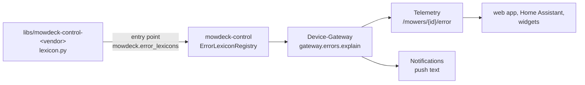

# Adding an error lexicon for a vendor

A mower reports faults as vendor codes (`MowerState.error_code`: Mammotion `1201`, the simulator `stuck`). MowDeck shows them in plain words, with a severity, the likely cause and the steps that fix them, in the web app, in the push texts and through the API ([ADR 0067](../adr/0067-error-code-lexicon.md)). The words come from the **error lexicon** of the vendor, which ships with its adapter package. Core services, contracts and the web app hold no code table; nothing there changes for a new vendor.

This guide is for the author of an adapter package `libs/mowdeck-control-<vendor>` (for example Husqvarna, Navimow or Worx). It assumes the connection adapter itself exists ([Writing a new adapter](https://github.com/lukislp/mowdeck/blob/main/libs/mowdeck-control/README.md#writing-a-new-adapter-checklist)).

## How it fits together



Only the Device-Gateway installs adapter packages. It answers lookups from every lexicon registered there; Telemetry and Notifications ask it over NATS and never import a vendor package. The lexicon is picked by the vendor key or by the mower's connection kind (`MowerState.connection`), so a lexicon lists the connection kinds its adapter registers.

## 1. Write the lexicon

The data model is `mowdeck_contracts.v1.ErrorLexicon`. One entry per code:

| Field | Meaning |
| --- | --- |
| `code` | the code exactly as your adapter puts it into `MowerState.error_code` |
| `aliases` | other spellings of the same code (with a sign, a prefix, upper case) |
| `category` | the manufacturer-neutral `MowerErrorCategory`: `trapped`, `obstacle`, `outside`, `wheel_slip`, `lift_tilt`, `collision`, `battery`, `blade_motor`, `rain`, `positioning`, `communication`, `docking`, `firmware`, `other` |
| `severity` | `info` (the mower handles it), `warning` (it stopped and waits), `error` (needs a repair or support), `critical` (a safety stop: lifted, tilted) |
| `user_action` | a person has to do something before the mower carries on |
| `texts` | per locale an `ErrorText`: `title` (short), `description`, `cause` (or null), `steps` (in order); `en` is required, write `de` too |
| `links` | optional `https://` links to the vendor's help |
| `verified` | false when you could not check the meaning against a vendor source |

Rules:

- **Category first.** The category drives behaviour beyond the words: `lift_tilt` raises the theft alarm (`MOWDECK_NOTIFICATIONS_LIFT_CATEGORIES`), and the recoverable categories (`trapped`, `obstacle`, `outside`, `wheel_slip`) are what your adapter marks `drive_recoverable`. Use `other` when unsure, never guess `lift_tilt`.
- **One language per entry.** If the vendor gives German titles but English steps, leave German out; the lookup falls back to English for the whole entry.
- **Honest provenance.** Set `source` on the lexicon; mark entries `verified: false` that come from reverse engineering or that you wrote without a vendor source. Clients show such texts with a note.
- **Write for the user.** Titles name the situation ("Lifted", "Wheels slipping"), steps start with a verb, the German uses "du" like the rest of the app.

Keep the lexicon in its own module of the adapter package, for example `lexicon.py`:

```python
from functools import cache

from mowdeck_contracts.v1 import (
    ConnectionKind,
    ErrorLexicon,
    ErrorLexiconEntry,
    ErrorSeverity,
    ErrorText,
    MowerErrorCategory,
)
from mowdeck_control.error_lexicons import ErrorLexiconProvider

LEXICON = ErrorLexicon(
    vendor="acme",  # the entry point name, lower case
    vendor_name="Acme",  # shown to users
    connection_kinds=[ConnectionKind("acme_cloud")],
    source="Acme service manual 2026, chapter 9",
    entries=[
        ErrorLexiconEntry(
            code="E-37",
            aliases=["37"],
            category=MowerErrorCategory.LIFT_TILT,
            severity=ErrorSeverity.CRITICAL,
            texts={
                "en": ErrorText(
                    title="Lifted",
                    description="The lift sensor stopped the blades.",
                    cause="Someone lifted the mower.",
                    steps=["Check on the mower now.", "Put it down and press OK on the mower."],
                ),
                "de": ErrorText(
                    title="Angehoben",
                    description="Der Hebesensor hat die Messer gestoppt.",
                    cause="Jemand hat den Mäher hochgehoben.",
                    steps=["Sieh sofort nach dem Mäher.", "Stell ihn ab und drück OK am Mäher."],
                ),
            },
        ),
    ],
)


def normalise(raw: str) -> str:
    """The vendor's raw code in the lexicon's spelling ("e37" gives "E-37")."""
    digits = "".join(c for c in raw if c.isdigit())
    return f"E-{digits}" if digits else raw.strip()


@cache
def acme_lexicon() -> ErrorLexiconProvider:
    return ErrorLexiconProvider(LEXICON, normalise=normalise)
```

The entry point object may be the `ErrorLexicon` itself (plain data), an `ErrorLexiconProvider` (data plus `normalise`) or a callable without arguments returning either. Use a callable when the lexicon is built from a table your vendor library ships (the Mammotion lexicon reads PyMammotion's bundled CSV at the first lookup): importing the package must stay cheap. `normalise` runs only for a code the lexicon does not know as given, and a failing `normalise` keeps the code unchanged.

## 2. Register the entry point

In the adapter package's `pyproject.toml`, next to the connection factories:

```toml
[project.entry-points."mowdeck.connections"]
acme_cloud = "mowdeck_control_acme:create_cloud_connection"

[project.entry-points."mowdeck.error_lexicons"]
acme = "mowdeck_control_acme.lexicon:acme_lexicon"
```

The entry point name must equal `ErrorLexicon.vendor`; a mismatch is logged and the lexicon skipped. Run `uv sync` after changing entry points. A new connection kind needs its value in `ConnectionKind` (`mowdeck-contracts`) as for any adapter.

## 3. Fill `error_category` in the state

Your mapping sets `MowerState.error_category` whenever it reports `activity: error`, from the same lexicon, so the state, the app and the rules agree:

```python
from mowdeck_control_acme.lexicon import acme_lexicon

category = acme_lexicon().category_of(raw_code)  # None for a code the lexicon does not know
```

`MowerState.raw["lifted"] = True` stays the generic lift flag where the vendor reports one directly. With `error_category` set, nobody has to add your codes to `MOWDECK_NOTIFICATIONS_LIFT_ERROR_CODES`.

## 4. Test it

In the adapter package's tests:

- every code your mapping can produce is in the lexicon, and `category_of` matches what the mapping puts into `error_category`;
- every entry has English, and German where you wrote it; curated entries have steps;
- the entry point is declared (`tomllib` on `pyproject.toml`) and `mowdeck_control.explain_error("<code>", "de", vendor="acme")` finds it once the package is installed.

`tools/repo-checks/tests/test_vendor_isolation.py` fails when an adapter package registers connections without a lexicon, when core code imports an adapter package or its vendor library, or when a service other than the Device-Gateway depends on an adapter package. Install the adapter only in the Device-Gateway image.

## 5. Check the result

With the stack running and a mower of the vendor in an error state:

```bash
curl -H "Authorization: Bearer $TOKEN" \
  "https://mowdeck.example/api/v1/telemetry/error-lexicons"
curl -H "Authorization: Bearer $TOKEN" \
  "https://mowdeck.example/api/v1/telemetry/error-codes/acme/E-37?locale=de"
curl -H "Authorization: Bearer $TOKEN" \
  "https://mowdeck.example/api/v1/telemetry/mowers/$MOWER/error?locale=de"
```

The mower page shows the card with severity, category, code, title, cause and steps; the push text of `mower_stuck` carries the title and the first step.

## What the core does for you

- Locale fallback to English, and a generic explanation for unknown codes ("Unbekannter Fehler 1234 von Acme" with advice for the state's category).
- Caching (Telemetry and Notifications keep answers for an hour) and graceful degradation when the gateway does not answer.
- The neutral words around the explanation (severity names, labels) in the web app's translations.
