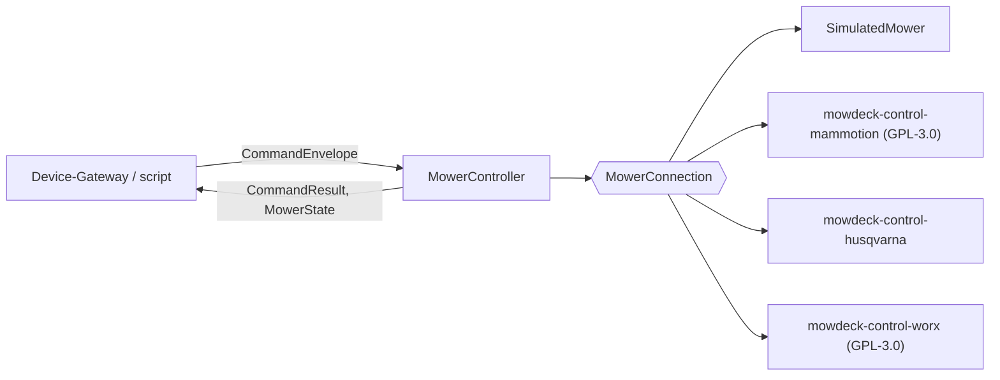

# Shared libraries

The libraries under `libs/` are independent Python packages in the uv workspace, Apache-2.0 except `mowdeck-control-mammotion` (GPL-3.0, [ADR 0011](../adr/0011-gpl-package-for-pymammotion-adapter.md)). Services depend on them with `{ workspace = true }` sources. Each library has its own README with the full reference; this page is the overview.

| Library | Status | Purpose |
| --- | --- | --- |
| `mowdeck-contracts` | 0.1.0 | API and event formats as Pydantic v2 models, NATS subjects, stream definitions, JSON Schemas |
| `mowdeck-service-kit` | 0.1.0 | Service skeleton: settings, logging, correlation ids, problem+json errors, health, metrics, module descriptor, event bus, tenancy, test utilities |
| `mowdeck-control` | 0.1.0 | Mower control without the platform: `MowerConnection` adapter interface, `MowerController` with the safety rules, simulated mower, native job translation, demo CLI |
| `mowdeck-authz` | 0.1.0 | Authorization: one question answered by OpenFGA, fail closed, decision cache, tuple writer for Identity and Fleet, in-memory fake that evaluates the real model, FastAPI dependencies |
| `mowdeck-auth` | 0.1.0 | Access tokens: EdDSA JWT verification against Identity's cached JWKS, the kit's principal resolver, token issuing, test keys and a fake JWKS endpoint |
| `mowdeck-control-mammotion` (GPL-3.0) | 0.1.0 | Mammotion adapter on PyMammotion 0.10.9: `cloud` and `ble_bridge` connections, owner test script |
| `mowdeck-control-husqvarna` | 0.1.0 | Husqvarna Automower cloud provider on aioautomower 3.1.0 (Automower Connect API), untested on real hardware and off by default ([ADR 0066](../adr/0066-cloud-provider-plugins-and-more-vendors.md)) |
| `mowdeck-control-worx` (GPL-3.0) | 0.1.0 | Worx Landroid, Kress and LandXcape cloud provider on pyworxcloud 6.4.2 (unofficial API, MQTT push), untested on real hardware and off by default ([ADR 0066](../adr/0066-cloud-provider-plugins-and-more-vendors.md)) |
| `mowdeck-provider-testkit` | 0.1.0 | Provider conformance kit, a test-only library: the vendor-neutral pytest suite every adapter package runs on its own fake vendor client, reference in `libs/mowdeck-provider-testkit/README.md` ([ADR 0069](../adr/0069-provider-conformance-kit-and-package-template.md), [Adding a provider](adding-a-provider.md)) |
| `mowdeck-ui` | 0.1.0 | Design system of the web app, a pnpm package (`@mowdeck/ui`) rather than a uv package: design tokens, Svelte 5 components, the frontend lint rules and the contrast check; reference in `libs/mowdeck-ui/README.md` and [Web app](web-app.md) |
| `mowdeck-patterns` | 0.1.0 | Mowing patterns as plug-ins (entry point group `mowdeck.patterns`), the validation chain, chains, coverage and gaps, preview; pure computation on Shapely, reference in `libs/mowdeck-patterns/README.md` ([ADR 0030](../adr/0030-mowing-patterns-and-planner.md)) |

## mowdeck-contracts

No I/O, only `pydantic`. Everything is versioned under `mowdeck_contracts.v1`:

- `envelopes`: `CommandEnvelope` (command id, expiry, priority), `CommandResult`, `EventEnvelope[Payload]`.
- `mower`: `MowerState` telemetry (`observed_at` is the time of the mower's report, `heartbeat_at` and `connected` the gateway's link, set by the Device-Gateway only, [ADR 0040](../adr/0040-link-heartbeat-for-online-status.md); its `position_source` says where the position comes from: `rtk`, `gnss` without an RTK fix, `dock` for the charging station while docked, `unknown`) and the commands `StartMow`, `PauseMow`, `ResumeMow`, `ReturnToDock`, `EmergencyStop`, `SetBladeHeight`, `SetSpeed`, `ManualDrive`.
- `capabilities`: `MowerCapabilities` (native patterns, manual drive, blades while driving, custom paths, camera access, RTK sources, blade height range, minimum and maximum speed, connection kinds).
- `maps`: `MowerMap` with areas, no-go zones, obstacles, paths and dock in local metres plus a `GeoReference` for WGS84.
- `fleet`: `MowerRegistration` (mower, account, name, connection kind and options), `MowerListRequest` / `MowerListReply` for `fleet.mowers.list`, `MowerConnectionEvent` for `mower.connected` and `mower.disconnected`.
- `commands`: Fleet's command API, `CommandRequest`, `CommandAccepted`, `CommandView` with `CommandState`, `BulkCommandAccepted` with one `BulkCommandItem` per visible mower.
- `notifications`: `NotificationSent` (payload of `notifications.sent`), `NotificationKind`, `NotificationSeverity` and `WebPushPayload`, the JSON a service worker receives ([ADR 0022](../adr/0022-notifications-rules-and-delivery.md)).
- `principal`: `Principal` mirrors the claims of the Identity access token.
- `module`: `ModuleDescriptor`, served by every service at `/.well-known/mowdeck-module`.
- `problem`: RFC 9457 `ProblemDetails`.
- `spot`: `SpotMowPlan` (segments as encoded polylines, SHA-256 `plan_hash`, optional `native` job) for `StartMow.spot_plan` and `SpotMow.plan`, `encode_polyline` / `decode_polyline` ([ADR 0030](../adr/0030-mowing-patterns-and-planner.md)); `SpotRunStatus` (`MowerState.spot_run`) and `MAX_SPOT_MOW_SPEED_MPS` for spot runs driven by MowDeck ([ADR 0039](../adr/0039-spot-mowing-by-mowdeck-driven-paths.md)).
- `calibration`: `DriveCalibration` (stored as link options), `DriveCalibrationStatus` (`MowerState.drive_calibration`), `DriveSpeedSetting` (`MowerCapabilities.drive_speed_setting`) for the drive calibration and the vendor's speed setting for manual driving ([ADR 0042](../adr/0042-drive-calibration.md)).
- `positions`: `PositionTrackRequest` / `PositionTrackReply` for the track query `tracks.positions.query` (Telemetry).
- `subjects`: `command_subject(id)`, `telemetry_subject(id)`, `event_subject(domain, name)`, wildcards, the request subject `FLEET_MOWERS_LIST` and the streams `COMMANDS`, `TELEMETRY`, `EVENTS`.

```python
from uuid import uuid4
from mowdeck_contracts.v1 import CommandEnvelope, EmergencyStop, PrincipalKind, PrincipalRef
from mowdeck_contracts.v1.subjects import command_subject

stop = CommandEnvelope.create(
    mower_id=uuid4(),
    account_id=uuid4(),
    issued_by=PrincipalRef(subject=uuid4(), kind=PrincipalKind.USER),
    command=EmergencyStop(),
)
assert stop.priority == "emergency"
subject = command_subject(stop.mower_id)  # "command.mower.<id>"
```

After changing a model, regenerate the committed JSON Schemas (a test fails otherwise):

```bash
uv run python -m mowdeck_contracts.schemas libs/mowdeck-contracts/schemas
```

The envelope, subject and versioning rules are recorded in [ADR 0009](../adr/0009-command-and-event-envelopes.md).

## mowdeck-patterns

Mowing patterns as plug-ins and the route validation chain, pure computation on Shapely (no network, no database). A pattern is a class with `key`, `name`, `settings_schema()` and `compute(area, mower, settings)`, registered through the entry point group `mowdeck.patterns`; `plan()` computes a chain and runs the validation chain (inside the area minus the safety margin, no blades on through zones or holes, blades off on transfers, turning radius):

```python
from mowdeck_patterns import Area, MowerSpec, plan, preview

area = Area.of(
    [(0, 0), (12, 0), (12, 8), (0, 8)], no_go_zones=[[(9, 5.5), (12, 5.5), (12, 8), (9, 8)]]
)
result = plan(area, MowerSpec(cutting_width_m=0.4), [("edge_only", {"laps": 2}), "diagonal"])
spot = result.to_spot_plan()  # StartMow(spot_plan=spot)
```

Built-in patterns, coverage and gaps, turn styles at lane ends (`TurnOptions`, `shape_turns`, [ADR 0043](../adr/0043-turn-styles.md)) and how to add a pattern: `libs/mowdeck-patterns/README.md`. The Planner service (`services/planner`) serves it over HTTP ([ADR 0030](../adr/0030-mowing-patterns-and-planner.md)).

## mowdeck-service-kit

A service is one `create_app` call:

```python
from fastapi import APIRouter
from mowdeck_contracts.v1 import ModuleDescriptor, PermissionDef
from mowdeck_service_kit import CurrentAccountId, ServiceSettings, create_app, run

router = APIRouter()


@router.get("/whoami")
async def whoami(account_id: CurrentAccountId) -> dict[str, str]:
    return {"account_id": str(account_id)}


settings = ServiceSettings.from_env()  # MOWDECK_* variables, *_FILE secrets
descriptor = ModuleDescriptor(
    name=settings.service_name,
    version="0.1.0",
    permissions=[PermissionDef(key="mower.view", description="View mowers")],
)
app = create_app(settings, descriptor, routers=[router])
run(app, settings)
```

What every service gets from it:

| Concern | Provided by the kit |
| --- | --- |
| Configuration | `ServiceSettings` from `MOWDECK_*` variables, any value also from `MOWDECK_<NAME>_FILE` |
| Logging | structlog JSON lines on stdout (console in `dev`) with service, level, timestamp, correlation id |
| Correlation | `X-Correlation-ID` (or `X-Request-ID`) read, generated if missing, echoed, logged, sent on bus messages |
| Errors | `ServiceError` hierarchy and handlers rendering `application/problem+json`; generic 500 without internals |
| Operations | `/healthz`, `/readyz` (registered checks, 503 on failure or while draining), `/metrics`, `/.well-known/mowdeck-module` |
| API | routers mounted under `/api/v1` (HTTP and WebSocket routes; the middlewares pass WebSocket scopes through), OpenAPI at `/api/v1/openapi.json` |
| Event bus | `JetStreamBus` (streams ensured on connect, `Nats-Msg-Id` de-duplication, ack/nak/term), `InMemoryBus` for tests |
| Tenancy | `CurrentPrincipal`, `CurrentAccountId`, `require_permission(...)` (delegates to a `PermissionChecker` on `app.state` when `mowdeck-authz` installs one); account id only from the verified principal |
| Tracing | OpenTelemetry via OTLP/HTTP when `MOWDECK_OTEL_EXPORTER_OTLP_ENDPOINT` is set (extra `otel`) |
| Database | async SQLAlchemy engine, readiness check and session dependency (extra `db`) |
| Shutdown | readiness turns 503, `on_shutdown` hooks within the grace period, bus drained and closed |
| Serving | `run(app, settings)` with uvicorn; extra uvicorn options (`ws_ping_interval`, `ws_max_size`, ...) and `server_class=` for a `uvicorn.Server` subclass that must act before uvicorn closes the connections (Realtime) |

Tests use `mowdeck_service_kit.testing`: `make_test_app`, `make_principal`, `StaticPrincipalResolver` and `lifespan_client`. Every endpoint that touches account data needs a cross-tenant test; the kit README shows the pattern.

Integration tests against a real NATS server run when `MOWDECK_TEST_NATS_URL` is set:

```bash
docker run -d --name mowdeck-test-nats -p 4222:4222 public.ecr.aws/docker/library/nats:2.15.0-alpine -js
MOWDECK_TEST_NATS_URL=nats://127.0.0.1:4222 uv run pytest libs/mowdeck-service-kit
docker rm -f mowdeck-test-nats
```

## mowdeck-control

Mower control without the platform, usable from scripts and other projects. Depends only on `mowdeck-contracts`; never imports PyMammotion (that adapter lives in the GPL-3.0 package `mowdeck-control-mammotion`, see [ADR 0011](../adr/0011-gpl-package-for-pymammotion-adapter.md)). The design is recorded in [ADR 0012](../adr/0012-mower-control-interface-and-safety-rules.md).



| Part | Purpose |
| --- | --- |
| `MowerConnection`, `DriveSession` | adapter protocol: connect, capabilities, state and state stream, map, `execute` for job commands, drive sessions for the joystick |
| `MowerController` | per mower: expiry, de-duplication by `command_id`, emergency stop before everything (also queued commands and drive sessions), serialized sends (a confirmation wait runs outside the queue and is superseded by the next job command, reported `accepted`), dead-man timer per `ManualDrive`, blade rules, capability and map checks, state forwarding |
| `SimulatedMower` | deterministic simulator (`tick(dt)`, `run(interval)`): default map, stripe paths that avoid no-go zones, battery, charging, RTK hook, error injection, lift sensor |
| registry | `register_connection`, `create_connection`; adapters from other packages via the entry point group `mowdeck.connections` |
| `plan_to_native_job` | neutral request (areas, pattern, angle, spacing, border laps) to a native job, `UnsupportedPattern` otherwise |
| `geo` | local metres to WGS84 and back, point in polygon |
| `testing` | `ManualClock` and `ManualTimers` to test timing without sleeping |
| `SpotMowRun` | spot mowing driven by MowDeck ([ADR 0039](../adr/0039-spot-mowing-by-mowdeck-driven-paths.md)): drives a Planner plan with joystick frames through the controller (`SpotMow`, rule 12), with a `Geofence` from the map, pure-pursuit steering, RTK pauses and aborts; reads only the neutral state; uses a drive calibration (`SpotRunConfig.calibrated`) and ends `stalled` without progress ([ADR 0042](../adr/0042-drive-calibration.md)); turns as the resolved turn style says, at most 15 °/s on shaped turns, reverse legs backwards with the blades off ([ADR 0043](../adr/0043-turn-styles.md)) |
| `DriveCalibrationRun` | drive calibration ([ADR 0042](../adr/0042-drive-calibration.md)): forward and turn steps over the drive channel (`DriveCalibrate`, rule 13), measures each step over its steady window (without the first 1.5 s, at least 4 reports in 3 s, else `invalid`), drops inconsistent turn pairs and outliers, fits full-scale speed, yaw rate and dead zones from at least two points per axis; blades off, room check, 1.5 m forward budget |

```python
from mowdeck_control import MowerController, SimulatedMower

mower = SimulatedMower()
async with MowerController(mower, mower_id=mower.mower_id, on_state=publish) as controller:
    result = await controller.handle(envelope)  # CommandEnvelope -> CommandResult
```

Try it from the command line:

```bash
uv run python -m mowdeck_control.demo --seconds 3 --interval 0.5 --time-scale 60
```

The library README covers the safety rules in detail, the simulator hooks and the checklist for writing a new adapter.

## mowdeck-control-mammotion

The real adapter for Mammotion mowers, **GPL-3.0-only** because it imports PyMammotion ([ADR 0011](../adr/0011-gpl-package-for-pymammotion-adapter.md)); transports, manual drive, secrets and pins are decided in [ADR 0019](../adr/0019-mammotion-adapter-transports.md). It registers two connection kinds through the entry point group `mowdeck.connections`, so the Device-Gateway uses them without code changes:

| Kind | Class | Link | Manual drive |
| --- | --- | --- | --- |
| `cloud` | `MammotionCloudConnection` | Mammotion cloud (PyMammotion `MQTTTransport`), account login, mower by `device_name` or `iot_id` | no (cloud remote drive unverified) |
| `ble_bridge` | `MammotionBleProxyConnection` (extra `esphome`) | ESPHome Bluetooth Proxy (`host`, `port`, `noise_psk`, `ble_address`), PyMammotion BLE only device | yes, `send_movement`; blades only with `allow_manual_blades` |

Only `port.py` imports `pymammotion`; everything else uses the small `MammotionPort` protocol, and the tests use `FakeMammotionPort`, built from the real PyMammotion data classes. Pins: `pymammotion==0.10.9` exactly plus `packaging`; the `esphome` extra pins `aioesphomeapi`, `bleak-esphome`, `habluetooth` and `bluetooth-adapters` to PyMammotion's lock file.

```python
from mowdeck_contracts.v1 import ConnectionKind
from mowdeck_control import ConnectionConfig, MowerController, create_connection

connection = create_connection(
    ConnectionKind.CLOUD,
    ConnectionConfig(
        mower_id=mower_id,
        account_id=account_id,
        options={
            "account": "second@example.com",
            "credential_ref": "env:MAMMOTION_PASSWORD",
            "device_name": "Luba-VP...",
        },
    ),
)
async with MowerController(connection, mower_id=mower_id) as controller:
    result = await controller.handle(envelope)
```

While a drive session is open the refresh loop keeps the report window open and polls for an undebounced report whenever none arrived for a second, so spot runs (ADR 0039) get a pose about once a second.

The owner script `libs/mowdeck-control-mammotion/scripts/try_real_mower.py` runs the adapter against the real mower (or `--dry-run` against the fake), including `--turn-check` and `--spot-dry-run` for spot mowing; see "Testing with a real mower" in `libs/mowdeck-control-mammotion/README.md`.

## mowdeck-control-husqvarna

A cloud provider plugin ([ADR 0066](../adr/0066-cloud-provider-plugins-and-more-vendors.md)) for Husqvarna Automower and Gardena smart mowers on the official Automower Connect API, built on aioautomower 3.1.0 (MIT, pinned exactly). It registers `husqvarna` in the entry point group `mowdeck.cloud_providers` and is **off by default** (never tested on a real mower): operators enable it with `MOWDECK_CLOUD_PROVIDERS_ENABLE=husqvarna`. The user links their own Husqvarna application (application key and secret from the developer portal); MowDeck gets a token with the OAuth2 client-credentials grant. One session per application key (token, websocket, a REST refresh every 30 minutes) serves the discovery and every mower of the account, which keeps it within Husqvarna's 1 request per second and 10,000 requests a month. The connection reports state, battery, errors with lift codes for the theft alarm, GPS positions and derived blade state, and translates pause, resume (the schedule), park and starts by plan reference (duration, work area); the emergency stop is a pause because the API has no hard stop. No map geometry, patterns, manual driving or camera. Its error lexicon (`mowdeck.error_lexicons`: `husqvarna`, [ADR 0067](../adr/0067-error-code-lexicon.md)) explains every Husqvarna code in English and German. All HTTP goes through a small transport port, so the tests and the fake cloud (`ProviderContext.fake`) run without network. Reference: `libs/mowdeck-control-husqvarna/README.md`.

## mowdeck-control-worx

A cloud provider plugin ([ADR 0066](../adr/0066-cloud-provider-plugins-and-more-vendors.md)) for Worx Landroid, Kress and LandXcape mowers (one cloud behind three brand endpoints), built on pyworxcloud 6.4.2, pinned exactly. pyworxcloud's sdist ships a GPL-3.0 `LICENSE` (its PyPI metadata says MIT), so the package is GPL-3.0 and isolated like the Mammotion adapter. It registers `worx` in `mowdeck.cloud_providers` and is **off by default**: operators enable it with `MOWDECK_CLOUD_PROVIDERS_ENABLE=worx`. The user enters the e-mail, password and brand of the app account; the descriptor warns of the unofficial API and the account block risk. One session per account (one login, MQTT push) serves the discovery and every mower; a login guard holds refused, rate limited and failed logins and never repeats a successful one within 60 seconds, and a dropped MQTT link is not a lost connection, so the gateway's reconnects never turn into logins. The connection declares start plans (now, zones, edge cut), pause, resume, home, the cutting height on models with the height module and the rain delay setting; lifted and upside down raise the theft alarm. pyworxcloud is imported only by the real session (`pyworx_session.py`); everything else, and the fake cloud, runs on plain JSON product items. Its error lexicon (`worx`) explains every code in English and German, all marked unverified. Reference: `libs/mowdeck-control-worx/README.md` and the user guide `docs/guides/worx-landroid.md`.

## mowdeck-authz

Services ask one question: may this subject do this on that object. The model is `infra/openfga/model.fga`; its design and the reasons are in [ADR 0014](../adr/0014-authorization-model-and-tuple-ownership.md) and the [design document](design-identity-authz.md).

```python
from mowdeck_authz import OpenFgaAuthorizer, Relation, mower, principal_subject

authz = OpenFgaAuthorizer.from_env(registry=app.state.metrics_registry)  # MOWDECK_OPENFGA_*
allowed = await authz.check(principal_subject(principal), Relation.CAN_CONTROL, mower(mower_id))
```

| Part | Purpose |
| --- | --- |
| `Subject`, `ObjectRef`, `user()`, `api_token()`, `account()`, `site()`, `group()`, `mower()` | OpenFGA string forms; `principal_subject(principal)` maps users and sub-users to `user:`, API tokens to `api_token:`; service principals have no object rights |
| `Authorizer` | `check`, `check_many`, `list_objects`; every implementation answers `False` when it cannot decide |
| `OpenFgaAuthorizer` | store found by name, latest model pinned at connect (lazy), `BatchCheck` for `check_many`, `current_time` in every context, 5 s decision cache with `invalidate()` and `invalidate_subject()`, Prometheus counters, `ping()` for readiness |
| `TupleWriter` | for Identity and Fleet only: ownership guard, idempotent writes (`on_duplicate`/`on_missing: ignore`), `replace_subject_grants` writes the diff, audit hook, cache invalidation |
| `bootstrap_model()` | create the store and write the model only when it changed (also `python -m mowdeck_authz bootstrap`) |
| `testing` | `InMemoryAuthorizer` (evaluates the packaged model, validates tuples, is also a tuple backend), `AllowAll`, `DenyAll`, `ManualClock` |
| `fastapi` | `require(relation, resolver)` (403), `require_or_not_found(...)` (404 unless visible), `authorize(request, relation, obj)` (same answers for a relation chosen at runtime, e.g. per command kind), `install_authz(app, authorizer, token_prefilter=...)`, `path_object()`, `principal_account()` |
| `events` | `subscribe_cache_invalidation(bus, authorizer)`: drop cached decisions on `identity.grants.changed` |

```python
from mowdeck_authz import Relation
from mowdeck_authz.fastapi import install_authz, path_object, require_or_not_found

CanControl = Annotated[
    Principal, Depends(require_or_not_found(Relation.CAN_CONTROL, path_object("mower", "mower_id")))
]
install_authz(app, authz)  # also makes the kit's require_permission() ask OpenFGA
```

Integration tests against a real OpenFGA run when `MOWDECK_TEST_OPENFGA_URL` is set:

```bash
docker run -d --name mowdeck-test-openfga -p 18080:8080 ghcr.io/openfga/openfga:v1.22.0 run   --datastore-engine memory --authn-method preshared --authn-preshared-keys test-key
MOWDECK_TEST_OPENFGA_URL=http://127.0.0.1:18080 MOWDECK_TEST_OPENFGA_TOKEN=test-key   uv run pytest libs/mowdeck-authz
docker rm -f mowdeck-test-openfga
```

Model tests: `uv run poe fga-test`. After editing `model.fga`, regenerate the packaged JSON with `uv run poe fga-json`.

## mowdeck-auth

Every service verifies Identity's access tokens locally; nothing calls Identity per request ([ADR 0015](../adr/0015-tokens-sessions-and-key-rotation.md)).

```python
from mowdeck_auth import principal_resolver_from_env

app = create_app(
    settings, DESCRIPTOR, routers=[router], principal_resolver=principal_resolver_from_env()
)
```

| Part | Purpose |
| --- | --- |
| `JwtVerifier` | allow list `EdDSA` only (no `none`, no HMAC), `typ: at+jwt`, known `kid` with an Ed25519 key, `iss`, `aud`, `exp`, `nbf`, `iat` with 30 s leeway, claims to `Principal`; `verify_token()` also returns `exp` (`VerifiedToken`) for long-lived connections such as Realtime's WebSockets |
| `JwksCache` | async JWKS fetch, 5 minute cache, one refresh on an unknown `kid`, at most one fetch per 30 s, stale keys for at most an hour while Identity is down |
| `JwtPrincipalResolver` | the kit's resolver: bearer token to principal, 401 problem details with one generic message (the reason is logged) |
| `TokenIssuer`, `SigningKey` | signing with Ed25519, `kid` = RFC 7638 thumbprint (Identity and tests) |
| `testing.TestKeys` | a key, `mint(principal)`, a fake JWKS endpoint on `httpx.MockTransport`, ready verifiers and resolvers |

Settings: `MOWDECK_AUTH_JWKS_URL` (Compose: `http://identity:8000/.well-known/jwks.json`), `MOWDECK_AUTH_ISSUER`, `MOWDECK_AUTH_AUDIENCE`, `MOWDECK_AUTH_LEEWAY_SECONDS`, `MOWDECK_AUTH_JWKS_CACHE_SECONDS`, `MOWDECK_AUTH_JWKS_REFRESH_COOLDOWN_SECONDS`. Full reference: `libs/mowdeck-auth/README.md`.
