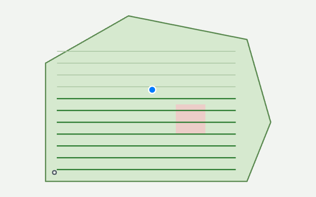
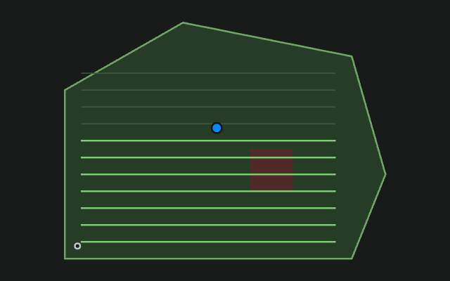

# iPhone widgets and the mowing Live Activity

MowDeck can show your mower on the iPhone home screen and lock screen and, while a job runs, on the Lock Screen and in the Dynamic Island. This needs the MowDeck app from TestFlight (a build with widgets), iOS 17 for the widgets and iOS 16.2 for the Live Activity. Your server's operator sets up the build once ([Widgets and the Live Activity](../ops/mobile-apps.md#widgets-and-the-live-activity)).

## Turn them on

1. Open the MowDeck app and sign in.
2. Go to **Einstellungen**, panel **This app** (the app panel), and choose **Turn on widgets**.

The app creates an access key for this iPhone that can only see and control mowers. It is valid for 90 days and the app renews it by itself. You find it in **Einstellungen -> API-Tokens** as "iOS widgets: ..." and can revoke it there at any time. **Turn off widgets**, or logging out, removes it from the phone and revokes it (if the server cannot be reached at that moment, the app revokes it after your next sign-in). Turning widgets on again replaces the key of this iPhone instead of adding a second one. You need the right to see all mowers of the account (every default role has it).

## Add a widget

Long-press the home screen, tap **+**, search for **MowDeck**, and pick one:

| Widget | Size | Shows |
| --- | --- | --- |
| Mower status | small | Icon and state (Mäht, Station, Fehler, Regenpause, ...), battery ring, progress while mowing; on an error what happened in plain words ("Angehoben", "Steckt fest") |
| Mower status | medium | The same plus area, next run, and the buttons **Start** (all areas with the mower's saved mowing defaults), **Pause** and **Station** |
| Mower on the lock screen | circular, rectangular, inline | Battery ring with the state glyph; "Mäht · 42 % · Großer Garten" or the error in plain words; "Nächster Lauf 14:00" or "Regenpause bis 16:00" |
| Map | large | The map with the mower, the mowed path and the dock, plus state, progress and battery |
| Schedule and weather | medium | The next three runs, whether the rain pause lets them start (will run, rain pause, uncertain) and the rain status |

Long-press a widget and choose **Edit Widget** to pick the mower. Tapping a widget opens the mower in the app.

The map is drawn by your server (about every 5 minutes while mowing):

*These two pictures are real output of the server's map renderer for an example garden. The widgets themselves are SwiftUI and could not be rendered without an iPhone or a Mac: their look on the device is not shown here.*

## The Live Activity

While the mower mows, is paused or drives home, a Live Activity shows the mower's name and state, the progress, the area, the remaining time (it counts down by itself) and the battery. It starts when you start a job in the app, and also when a schedule or Home Assistant starts one (your phone gets a push, the app does not have to be open). It ends when the job is over: finished jobs stay on the Lock Screen for five minutes, errors for thirty, with what happened in plain words ("Der Mäher wurde angehoben"). Swipe it away and MowDeck does not bring it back during that job. Turn Live Activities off for MowDeck under **Settings -> MowDeck** on the iPhone.

If the activity was started by a schedule while the app was closed, its progress starts updating once you have opened the app during the job (the phone needs to tell the server where to send updates).

## Good to know

- **Errors in plain words.** Widgets, the Live Activity and the Apple Watch show an error the way the mower page does: the title from the error code lexicon of your mower's maker ([Error codes in plain words](../dev/error-lexicon.md)), in the app's language (German or English). The server sends it with the state, so the widget also shows it from its last stored state while offline. For a code nobody has explained yet you see the general kind of problem ("Der Mäher steckt fest") or the maker's own message.
- Widgets show the last known data when the server cannot be reached ("Last known state"). The system decides how often widgets reload; the server also sends a silent hint when the mower's state changes, which iOS honours a few times an hour.
- **Start** from a widget is the same as Start in the app with the saved defaults. It does not ask for confirmation: use it when you would also tap Start.
- Widgets need iOS 17; on iOS 16 only the Live Activity is available.
