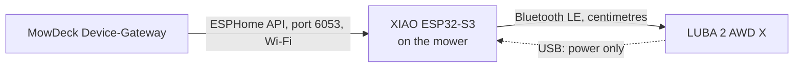

# Building the Bluetooth bridge (ESPHome on a XIAO ESP32-S3)

This guide builds the small board that MowDeck's Bluetooth bridge link (and the standalone `ble_bridge` connection kind) talks to. The board rides on the mower, listens to its Bluetooth radio and relays it over your Wi-Fi. You need no ESP32 experience; the steps assume you have never flashed one. The board is mounted on the mower and powered from the mower's USB port, so Bluetooth range never matters; MowDeck uses the stock ESPHome firmware.

## Overview

A Mammotion mower speaks Bluetooth LE to the phone app. MowDeck's Device-Gateway runs on your server, not next to the mower, so it cannot reach that radio directly. The ESP32 board is an *ESPHome Bluetooth proxy*: it sits on the mower, talks Bluetooth to it at a few centimetres, and exposes the radio over the ESPHome native API (TCP port 6053, encrypted with a key). The adapter connects to it through PyMammotion's ESPHome path (`bleak-esphome`) and registers the mower without any cloud login ([ADR 0019](../adr/0019-mammotion-adapter-transports.md), [adapter README](https://github.com/lukislp/mowdeck/blob/main/libs/mowdeck-control-mammotion/README.md)).



What the bridge gives you: the low-latency path for manual driving, which MowDeck offers over Bluetooth only, and state, map and job commands when it is the only link. There are two ways to use it ([ADR 0038](../adr/0038-dual-link-per-mower-and-firmware-updates.md)):

- **As the second link of a cloud mower (recommended).** The mower stays registered with the `cloud` connection (camera, firmware updates, everything else) and gets the bridge as an additional link from its settings page ([Add the bridge from the web app](#add-the-bridge-from-the-web-app)). The Device-Gateway keeps both open: commands take Bluetooth while the bridge is connected and the cloud otherwise, manual driving is offered only while the bridge is up, and a lost bridge does not interrupt anything else.
- **Standalone, as the connection kind `ble_bridge`.** For a mower without a cloud account. No camera and no firmware checks in MowDeck then ([ADR 0019](../adr/0019-mammotion-adapter-transports.md)).

## Shopping list

| Item | Notes |
| --- | --- |
| Seeed Studio XIAO ESP32-S3 | About 8 to 10 EUR. Take the plain board, not "Sense" or "Plus". The loose header pins are not needed, nothing is soldered. |
| The small flat antenna | Ships loose in the bag. It is needed for Wi-Fi reach on the mower (Bluetooth is only centimetres away). |
| USB-C **data** cable | For flashing, connected to your computer. A charge-only cable shows no serial port. |
| Short USB-C power cable | From the mower's USB port to the board, 20 to 30 cm, angled plug if possible. Carries power only. |
| Something to fix the board | Outdoor double-sided tape, or a small case plus cable ties. |
| Optional: small USB power bank | For a model without a usable USB port. Fix it to the mower and recharge it. Prefer one with an "always on" or low-current mode, or the board drops out. |

The LUBA 2 has a USB port that can supply the board; on models without one use the power bank. Do not wire the board to the mower's battery (owners report a false "cutting disc jammed" error when a board draws from it). Do not buy an ESP32-S2 (no Bluetooth) or other XIAO families (SAMD21, RP2040 and nRF52840 do not work). The older [purchase and setup guide](../guides/esp32-bridge-purchase-and-setup.md) has prices, enclosure ideas and the spike measurements.

## Flash the firmware

First generate the API key. Either let the ESPHome dashboard create it when you add the device, or run on any machine with OpenSSL:

```bash
openssl rand -base64 32
```

The result is the key (44 characters, base64 of 32 bytes). Keep it: it goes into the YAML and into MowDeck.

Clip the antenna on: seat the tiny plug on the round gold socket at the board's corner, one side first, then press the other side flat. Never pull it off by the lead.

### The configuration

```yaml
esphome:
  name: mowdeck-bridge
  friendly_name: MowDeck Bridge
  project:
    name: mowdeck.bridge
    version: "1"

esp32:
  board: seeed_xiao_esp32s3
  framework:
    type: esp-idf

logger:

api:
  encryption:
    key: !secret api_key

ota:
  - platform: esphome
    password: !secret ota_password

wifi:
  ssid: !secret wifi_ssid
  password: !secret wifi_password
  manual_ip:
    static_ip: 192.168.1.50
    gateway: 192.168.1.1
    subnet: 255.255.255.0
  ap:
    ssid: "MowDeck Bridge Fallback"
    password: !secret fallback_password

esp32_ble_tracker:

bluetooth_proxy:
  active: true
```

`secrets.yaml` (never commit or share it):

```yaml
wifi_ssid: "YourGardenSSID"
wifi_password: "..."
api_key: "<the output of openssl rand -base64 32>"
ota_password: "..."
fallback_password: "..."
```

| Placeholder | Meaning |
| --- | --- |
| `name: mowdeck-bridge` | Device name; also the host name `mowdeck-bridge.local`. Lowercase letters, digits and dashes. |
| `project: name: mowdeck.bridge`, `version: "1"` | Tells MowDeck which template version the firmware was built from. The mower's settings show the bridge firmware (ESPHome release, compile time, template version) and mark it "outdated" when the template is older than the current one, the ESPHome release is too old for the proxy API, or the project is missing (a bridge flashed from the stock proxy YAML still works). |
| `board: seeed_xiao_esp32s3` | The board definition. Do not change it. |
| `framework: type: esp-idf` | The framework recommended for the Bluetooth proxy. |
| `api_key` | The base64 key from above. MowDeck calls it `noise_psk`. |
| `ota_password` | Protects over-the-air updates. Any long random string. |
| `wifi_ssid`, `wifi_password` | A **2.4 GHz** network (the ESP32-S3 has no 5 GHz). |
| `static_ip`, `gateway`, `subnet` | A free address outside your router's DHCP range, so MowDeck's `host` never changes. Match your network. A DHCP reservation in the router works as well; then drop `manual_ip`. |
| `fallback_password` | Password of the setup access point the board opens if it cannot join Wi-Fi (at least 8 characters). |
| `active: true` | Lets clients open GATT connections through the proxy, not only listen to advertisements. MowDeck needs this. |

### Route A (primary): the ESPHome add-on in Home Assistant

1. In Home Assistant, install the *ESPHome Device Builder* add-on (Settings, Add-ons) and open it.
2. Create a new device with the board *Seeed Studio XIAO ESP32-S3* (or skip the wizard) and paste the YAML above. Put the secrets into the dashboard's *Secrets* editor.
3. Plug the board into the computer **that runs your browser** with the USB-C data cable. Choose *Install*, then *Plug into this computer*. This needs Chrome or Edge on a computer; the browser asks for the serial port. If the port does not appear or flashing fails, hold the BOOT button while plugging the board in and try again.
4. Later updates go over the air: *Install*, *Wirelessly*.

### Route B (alternative): ESPHome Web

1. Compile the YAML in the add-on (or with the `esphome` command line tool) and download the firmware (*Install*, *Manual download*, factory format).
2. Open [web.esphome.io](https://web.esphome.io) in Chrome or Edge, connect the board, choose *Connect*, then *Install* and select the downloaded file.

If Home Assistant offers to add the new ESPHome device, choose *Ignore*. The safe assumption is **one native-API client at a time**, and that client is MowDeck. If Home Assistant uses the same board or the same mower at the same time (for example through its Bluetooth integration or the old Mammotion integration), the clients fight over the mower's single Bluetooth link. Disable the old Mammotion integration while MowDeck uses the bridge, and close the phone app (see Troubleshooting).

## Find the IP and the API key

- **IP:** the static address you put in the YAML. Otherwise read it in your router's client list (host name `mowdeck-bridge`) or on the device page of the ESPHome dashboard. `mowdeck-bridge.local` also works as `host` if mDNS resolves from the Device-Gateway's network; in a container the IP is the safer choice.
- **API key:** the value of `api_key` in `secrets.yaml`. In the ESPHome dashboard, open *Secrets*.
- **Mower Bluetooth address (`ble_address`):** the mower's Bluetooth MAC, like `AA:BB:CC:DD:EE:FF`. Close the Mammotion app, wake the mower, and read the address with a Bluetooth scanner app on your phone (for example nRF Connect): the mower advertises under a name that starts with `Luba-`.

## Add the bridge from the web app

For a mower that is already registered with the `cloud` connection, open its settings, panel "Bluetooth bridge", and choose "Add Bluetooth bridge":

1. Enter the bridge's host (the IP or `mowdeck-bridge.local`), the port (6053 unless you changed it) and the API key (`api_key` from `secrets.yaml`), then "Look for the mower". MowDeck's Device-Gateway connects to the bridge, reads its firmware information and listens for the mower's Bluetooth advertisement (up to 30 s; the mower must be switched on and the phone app closed).
2. Pick the mower from the list (your mower is preselected by its name; others are marked as "another mower"), decide whether blades may run during manual driving, save.
3. The panel then shows the link: connected or not, the signal strength, the bridge firmware (`ESPHome 2026.x`, compile time, template version) and an "outdated" badge with the reason when the firmware should be rebuilt from the current template. "Check again" reads the bridge information again (through the open link when there is one), "Remove" deletes the link; the mower keeps its cloud connection either way.

Errors the dialog shows: "not reachable" (wrong host or port, the bridge is not on the same network or has no power), "key refused" (use the value of `api.encryption.key`), "no mower found" (the bridge answered but saw no advertisement: is it sitting at the switched-on mower, is the phone app closed?) and "the bridge is in use" (another mower of the installation holds it, or a scan is running; try again shortly). The key is stored encrypted in Fleet and shown as "set" afterwards; it never comes back from the API.

## Register the mower in MowDeck (standalone bridge)

For a mower without a cloud account the bridge is the connection itself. The Fleet service must accept the kind: set `FLEET_ALLOWED_CONNECTION_KINDS=simulated,cloud,ble_bridge` for Compose (`MOWDECK_ALLOWED_CONNECTION_KINDS` is the underlying Fleet setting; see [Compose](compose.md) and [Helm](helm.md)) and restart Fleet.

In the web app, add a mower, choose the connection kind `ble_bridge` and fill in:

| Field | Value |
| --- | --- |
| Name | What you want to see in lists. |
| `host` | The bridge's IP or host name. |
| `ble_address` | The mower's Bluetooth MAC, in the form `AA:BB:CC:DD:EE:FF`. |
| `noise_psk` | The base64 API key. Write-only: after saving, the form shows it as set and the API returns `***`. Sending `***` back keeps the stored value. |
| `port` (advanced) | Default 6053. |
| `device_name` (optional) | Advertised name; read from the advertisement when missing. |
| `allow_manual_blades` (optional) | Default off: blades stay off during manual driving. |

The same through the Fleet API (for scripts):

```bash
curl -X POST http://localhost/api/v1/fleet/mowers \
  -H "Authorization: Bearer $TOKEN" -H 'Content-Type: application/json' \
  -d '{
    "name": "Front lawn",
    "connection_kind": "ble_bridge",
    "connection_options": {
      "host": "192.168.1.50",
      "ble_address": "AA:BB:CC:DD:EE:FF",
      "noise_psk": "<base64 key>"
    }
  }'
```

Production setups can use `credential_ref` (`env:NAME` or `file:/run/secrets/name`) instead of the plain `noise_psk`; the Device-Gateway resolves it in its own environment ([ADR 0019](../adr/0019-mammotion-adapter-transports.md), [Fleet README](https://github.com/lukislp/mowdeck/blob/main/services/fleet/README.md)).

## Mount the board on the mower

1. Do the Wi-Fi setup and flashing indoors first.
2. Switch the mower on (sitting on its dock is fine). Connect the short USB-C power cable from the mower's USB port (or the power bank) to the board. Push both plugs in fully; the board's socket is small and stiff.
3. Fix the board in a **dry** spot (it is not waterproof), firmly so it cannot fall off or get caught, well away from blades and wheels. Lay the antenna flat and in the open. Do not pressure wash the mower, and switch it off before turning it over.
4. The cable carries power only. The board talks to the mower over Bluetooth, a few centimetres away.

Bluetooth range does not matter with this layout. **Wi-Fi coverage does**: the board needs 2.4 GHz Wi-Fi wherever the mower drives, and the clipped-on antenna is what gives it that reach. Walk the lawn with your phone on 2.4 GHz and a Wi-Fi analyser app; if the far end is worse than about -75 dBm, add an access point or extender near the lawn. Without Wi-Fi the bridge link drops. As the second link of a cloud mower that means: the mower's page shows the bridge as disconnected, manual driving is paused (an open drive session ends, the joystick page says so), commands take the cloud, and the Device-Gateway reconnects the bridge with its own backoff (5 s doubling to 60 s) once the board is back. For a standalone `ble_bridge` mower the connection itself ends: commands fail with "not connected" meanwhile, and the Device-Gateway reconnects with backoff. There is no automatic switch to the cloud for a mower registered as `ble_bridge`.

## Verify

1. After saving, the mower page should show the bridge link as connected (second link) or the connection kind `ble_bridge` and the mower connected (standalone), with battery, activity and RTK state shortly after.
2. The ESPHome device log (dashboard, *Logs*) should show a client connecting to the API.
3. The final proof is the owner's hardware test with the team: the ESPHome path, state, map, a job and manual driving over the bridge, run with the owner script (`scripts/try_real_mower.py --esphome HOST,KEY,MAC` for the standalone path, `--bridge HOST,KEY` for the second link next to the cloud, `--scan HOST,KEY` for the scan alone; see [Testing with a real mower](https://github.com/lukislp/mowdeck/blob/main/libs/mowdeck-control-mammotion/README.md#testing-with-a-real-mower)). Manual-drive latency and the behaviour on link loss are not measured yet ([spike 0001](../spikes/0001-ble-bridge-and-pymammotion.md)).

## Troubleshooting

| Symptom | What to check |
| --- | --- |
| No connection at all | Is the board powered (a small orange light beside the USB-C socket; none means no power)? Can the Device-Gateway reach `host:6053`? Is the mower on? Does `FLEET_ALLOWED_CONNECTION_KINDS` include `ble_bridge`? |
| Wrong or missing key | The API key in the YAML must be identical to the key in MowDeck (44 base64 characters). If you reflashed with a new key, enter the new one in the mower's settings (the bridge panel, or `noise_psk` of a standalone registration). |
| "Outdated" badge on the bridge | Rebuild the firmware from the current template above (it carries `esphome.project` with the template version) and install it over the air; a bridge without `esphome.project` works but cannot tell MowDeck its template version. |
| The mower is not found | Close the Mammotion phone app (the mower accepts one Bluetooth link at a time, so the phone blocks the bridge), wait a minute, check `ble_address`, and unplug and replug the board. Also disable the old Mammotion integration in Home Assistant. |
| Drops out while the mower works | Weak 2.4 GHz Wi-Fi at that spot (see above); a power bank that switches off at low current; the antenna not clipped on or lying under metal. |
| Cannot flash | Use a data cable, Chrome or Edge, and hold BOOT while plugging in. |
| Board no longer joins Wi-Fi | It opens the fallback access point `MowDeck Bridge Fallback`; join it and enter the new network, or reflash. |

## Why ESPHome and not a USB dongle

A USB Bluetooth dongle works only on a computer within Bluetooth range of the mower, which means a computer in the garden or on the mower. The Device-Gateway runs on your server or cluster. An ESP32 on the mower carries the radio to the mower and the Wi-Fi to the server; the ESPHome proxy is mature, already supported by PyMammotion and needs no custom firmware. A custom MowDeck firmware stays an option if the hardware test shows it is needed. Details and alternatives: [ADR 0019](../adr/0019-mammotion-adapter-transports.md) and [spike 0001](../spikes/0001-ble-bridge-and-pymammotion.md).
