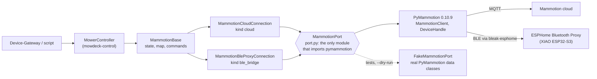

# mowdeck-control-mammotion

The real mower adapter for Mammotion mowers (LUBA, Yuka) on top of [PyMammotion](https://github.com/mikey0000/PyMammotion). It implements the `MowerConnection` interface of [`mowdeck-control`](../mowdeck-control/README.md), so the Device-Gateway drives a real LUBA exactly like the simulator, with the same `MowerController` safety rules.

**Licence: GPL-3.0-only** (see [`LICENSE`](LICENSE), a copy of `LICENSES/GPL-3.0.txt`). This package imports PyMammotion, which is licensed under GPL-3.0, so it is distributed under the GPL as well. It is kept apart from the Apache-2.0 library `mowdeck-control`, which never imports PyMammotion, so the interface and the simulator stay reusable without copyleft obligations ([ADR 0011](../../docs/adr/0011-gpl-package-for-pymammotion-adapter.md)). Anyone who uses this adapter outside MowDeck inherits the GPL-3.0 obligations of PyMammotion. The Device-Gateway (AGPL-3.0) depends on it, which is compatible.

Transports, secrets and pin policy: [ADR 0019](../../docs/adr/0019-mammotion-adapter-transports.md).

## Overview



| Module | Content |
| --- | --- |
| `port` | `MammotionPort` protocol, `ClientPort` on `MammotionClient` + `DeviceHandle`, cloud login with credential cache, BLE only registration; re-exports the PyMammotion types the rest uses |
| `mapping` | pure translation: work mode to activity, RTK fix and source, position, errors, capabilities per model, `HashList` to `MowerMap`, `StartMow` pattern to `OperationSettings`, joystick to `send_movement` units |
| `base` | `MammotionBase`: the `MowerConnection` implementation shared by both links |
| `cloud` | `MammotionCloudConnection`, `create_cloud_connection` (entry point `cloud`), `cloud_connection_factory(pool)`, `default_pool()` |
| `session` | `CloudSessionPool`: one logged-in client per set of credentials, shared by the mowers of an account and the discovery ([ADR 0034](../../docs/adr/0034-linked-cloud-accounts-and-device-discovery.md)) |
| `discovery` | `discover_devices`: the devices of an account as `DiscoveredDevice` (mowers first; `is_mower` false for RTK base stations and pool cleaners) |
| `fake_cloud` | the fake Mammotion cloud (`*@fake.mowdeck.test`, password `fake-cloud-password`) for development and the browser tests |
| `ble`, `drive`, `esphome` | `MammotionBleProxyConnection`, `BleDriveSession`, ESPHome proxy wiring, `create_ble_bridge_connection` (entry point `ble_bridge`) |
| `options` | `CloudOptions`, `BleProxyOptions`, secret references |
| `fake` | `FakeMammotionPort` and `sample_device()` (a LUBA 2 AWD 5000X: 25 to 70 mm, 0.2 to 0.6 m/s) for tests and the owner script's `--dry-run` |

`ConnectionKind.WIFI` is not registered: Mammotion restores control over Wi-Fi only from firmware 1.30.31.19 (spike 0001, section 3.1), and the owner's LUBA 2 AWD X runs 1.30.29.26.

## Install

```toml
dependencies = ["mowdeck-control-mammotion[esphome]"]   # [esphome] only for the BLE proxy
```

Pins (ADR 0019): `pymammotion==0.10.9` exactly, plus `packaging` which the 0.10.9 wheel imports without declaring it. The extra `esphome` pins the proxy helpers to PyMammotion's lock file: `aioesphomeapi==45.0.3`, `bleak-esphome==3.7.5`, `habluetooth==6.1.0`, `bluetooth-adapters==2.1.1` (all resolve on Python 3.13, Windows and the Linux image).

## Connection options

Options come from Fleet (`connection_options` of the mower registration) through the Device-Gateway into `ConnectionConfig.options`.

**cloud**

| Option | Required | Meaning |
| --- | --- | --- |
| `account` | yes | Mammotion account (e-mail). Use a second account with the mower shared to it: logging in with the main account logs the phone app out |
| `device_name` or `iot_id` | one of them | which mower of the account, for example `Luba-VP...` |
| `credential_ref` | one of `credential_ref`, `password` | `env:NAME` or `file:/run/secrets/name`, resolved in the Device-Gateway's environment |
| `password` | | plain password; accepted in Phase 2 with a warning, never returned by the Fleet API |
| `session_cache_path` | no | file for PyMammotion's credential cache (live tokens) on a private, writable volume; avoids a password login on every reconnect |
| `refresh_seconds` | no | how often the mower is asked for a fresh report while docked, charging, idle or offline, 10 to 300 s, default 20 (see **Fresh state** below) |
| `report_stream_seconds` | no | length of the continuous report window kept open while the mower is active (renewed every half window), 10 to 300 s or 0 for off, default 60 (see **Fresh state**) |
| `refresh_seconds_active` | no | the same while it mows, returns or is paused away from the dock, 2 to 60 s, default 5 (never longer than `refresh_seconds`) |
| `all_cameras` | no | ask the cloud for every camera of the mower (both front cameras of a LUBA 2 AWD X), default true; false: the front left camera only, as the vendor app does (see **Live camera** below) |
| `map_sync_timeout_s`, `confirm_timeout_s` | no | defaults 300 and 30 |
| `linked_account_id` | no | set by Fleet for mowers of a linked account (ADR 0034); their plain `password` then logs no warning |

**ble_bridge** (extra `esphome`)

| Option | Required | Meaning |
| --- | --- | --- |
| `host` | yes | ESPHome proxy host name or IP |
| `port` | no | ESPHome API port, default 6053 |
| `noise_psk` (or `credential_ref`) | yes | the API encryption key of the ESPHome YAML (base64, 32 bytes) |
| `ble_address` | yes | the mower's BLE MAC |
| `device_name` | no | advertised name; read from the advertisement when missing |
| `allow_manual_blades` | no | default false: blades stay off while driving manually |
| `manual_blade_height_mm`, `scan_timeout_s`, `map_sync_timeout_s`, `confirm_timeout_s` | no | defaults 60, 30, 300, 30 |
| `refresh_seconds`, `refresh_seconds_active`, `report_stream_seconds` | no | As for the cloud link: fresh-state requests while idle (10 to 300 s, default 20), while active (2 to 60 s, default 5) and the continuous report window while active (0 off, 10 to 300 s, default 60). The mower does not report by itself over Bluetooth either. |

Fleet validates both kinds (`fleet.domain.rules.validate_connection_options`) and masks `password` and `noise_psk` as `***` in every API response.

## Behaviour

**State.** `report_data.dev.sys_status` (`WorkMode`) gives the activity (working is `mowing`, pause and charging pause are `paused`, ready on the charger is `docked`, lock, system, location and boundary errors are `error`, sleeping and power off are `offline`, no report yet is `unknown`). RTK fix from `report_data.rtk.status` (`RTKStatus`: fix is `fixed`, float is `float`, single and none are `none`), correction source from `mqtt_rtk_info.rtk_switch` (`RTK_USED_NRTK` is `network`, LoRa and internet base stations are `base_station`). Position from `location.device` (degrees), or the dock pose while docked (`position_source`), battery, charging, blade height, working speed, firmware, and a trimmed `raw` dict (work mode, RTK details, network type and RSSI, the device blade counter; never IMEI or ICCID).

Mapped fields (PyMammotion `MowerDevice`, the same sources as Mammotion-HA's `sensor.py`):

| `MowerState` field | PyMammotion source |
| --- | --- |
| `activity` | `report_data.dev.sys_status` (`WorkMode`), `charge_state`, `online` |
| `battery_percent`, `charging` | `report_data.dev.battery_val` (clamped to 0..100), `charge_state != 0` and battery below 100 |
| `position` | `location.device` (degrees), heading from `location.orientation`, a compass course as reported (verified on the LUBA 2 AWD X against the RTK track); in the dock (activity `docked` or `charging`, or a job paused on the charger) with a known dock pose: the dock instead (see "Position in the dock") |
| `position_source` | `dock` for the dock pose; otherwise from the RTK fix: fixed or float is `rtk`, single or none is `gnss`, unknown (no report yet) is `unknown`; `unknown` without a position |
| `rtk_fix`, `rtk_source` | `report_data.rtk.status`, `report_data.rtk.mqtt_rtk_info.rtk_switch` |
| `blade_height_mm` | `report_data.work.knife_height` when 1..200 |
| `speed_mps` | `report_data.work.man_run_speed / 100` (cm/s, what the app and Mammotion-HA show) when in (0, 5] m/s, else the configured `mower_state.travel_speed` when in (0, 5] (both `raw.speed_source = reported`); when the mower reports neither (idle, docked: `man_run_speed` is 0) the setpoint the next job will use, the last `SetSpeed` of this connection or the default 0.3 m/s (`raw.speed_source = setpoint`), so the web app's speed stepper shows a value instead of "--". Mammotion-HA shows a locally stored setting there as well |
| `light_on` | the camera's headlamp ("fill light"; not the side LEDs): `mower_state.lamp_info.manual_light`, which PyMammotion's reducer sets from the answer `get_lamp_rsp` with `get_ids` 1126 or 1127 (`lamp_manual_ctrl == manual_power_on`), as Mammotion-HA's `manual_light` switch reads it; null until the mower answered a read (an "off" answer looks like PyMammotion's default `LampInfo`, so the answered read decides). `raw.manual_light` and `raw.lamp_bright` once reported |
| `error_code`, `error_message` | newest `errors.active_codes` entry in an error mode, else the work mode name |
| `firmware` | `device_firmwares.device_version` (filled by the device information requests, see below), else PyMammotion's `firmware_version` unless empty or the `1.0.0.0` placeholder, else `mower_state.swversion` |
| `raw.model`, `capabilities.model` | `extMod` of the sub model's entry in PyMammotion's model table (`mower_state.sub_model_id`, for example `LUBA 2 AWD 5000X`), else `mqtt_properties.params.items.extMod.value` when present (as Mammotion-HA), else `mower_state.model_id`, else `extMod` of the product key's table entry, else the device type name from the device name (`Luba VP`) |
| `raw.cutter_offset_m`, `raw.cutter_width_m`, `raw.pos_type` | `report_data.work.cutter_offset` and `.cutter_width` (RptWork fields 22 and 23), each only when > 0, and `location.position_type` (the position solution type, int, always). **The units of the cutter values are assumed to be metres and are unverified**; the owner will read the raw values on the real mower. When `cutter_width` > 0, `capabilities.cutting_width_mm` is that width in mm (rounded) instead of the family constant |
| `raw.blade_used_s`, `raw.blade_used_warn_s` | `report_data.maintenance.blade_used_time.blade_used_time` and `.blade_used_warn_time` (seconds), only when > 0; the device's own blade counter (reset in the Mammotion app), which Telemetry prefers for "blades since change" |

**Capabilities.** Native patterns `stripes`, `diagonal`, `checkerboard`, `edge_only` and `random_angle` (Luba 1 without `random_angle`), no custom paths, camera `cloud` over the cloud connection (every model except the Luba 1; `none` over BLE), RTK sources base station and network, `light` (the camera's headlamp) where PyMammotion's `DeviceType.is_support_fill_light(device_name)` says so (the app's own gate: true for the LUBA 2 AWD X (`Luba-VP…`) and the other Luba 2 variants VA, LD, MN, HM, ..., and the Yuka minis; false for the Luba 1 and the big Yuka). The side LEDs (`read_and_set_sidelight`) are a separate light and not offered; they may become a second control later. Manual driving only over BLE; over the cloud it is off because PyMammotion's `RemoteDriveSession` has never run against a mower.

**Blade height and speed limits.** From the entry of PyMammotion's model table (`data/model/device_capabilities.py`, read through `DeviceConfig.get_device_config`) for `mower_state.sub_model_id`, else for the product key: `blade_height_range_mm` from `blade_height_min/max`, `min_speed_mps`/`max_speed_mps` from `cutting_speed_min/max` (the speed while mowing; `working_speed_min/max` is the faster travel speed and only used when an entry has no cutting speed, as the product-key entries of the Luba 1), the StartMow path spacing from `path_spacing_min/max`. A LUBA 2 AWD 5000X (sub model `HM030070LB2PAWD50OMNI`) gets 25 to 70 mm and 0.2 to 0.6 m/s. Without an entry the limits stay null and the controller rejects `set_blade_height` and `set_speed`: the Luba VP product keys are not in the table, and PyMammotion's own fallback (`MowerDevice.device_limits`) would use the Yuka default for them. Speeds above 5 m/s are dropped as implausible.

**Cutting width.** PyMammotion's model table has no blade or cutting width (`path_spacing` is the spacing of the mowing lines), so `cutting_width_mm` is a per-family constant from the device type: Luba 1, LUBA 2 AWD (`Luba-VS`) and LUBA 2 AWD X (`Luba-VP`) 400 mm, Yuka 320 mm, other families (minis, newer models) null. Telemetry uses it for the coverage heatmap (400 mm when null).

**Device information requests.** The cloud only forwards the firmware and model answers when asked, so a cloud connect sends `get_device_version_info`, `get_device_base_info` (firmware, `device_firmwares`) and `get_device_product_model` (answer `device_product_type_info` sets `mower_state.model_id` and `sub_model_id`, which select the limits above), then the dock buffer request `read_write_device(rw_id=5, context=1, rw=1)`, all with background priority. Mowers with a headlamp (both links) then read it, `get_car_light(ids=1126)` as PyMammotion's `mower_api.py` does after a switch, waiting for the answer `get_lamp_rsp` (the leaf of `SocMul`'s oneof, which is the name PyMammotion's broker matches; `send_and_wait`, 5 s per attempt, PyMammotion sends twice). While the firmware, the model, the RTK origin, the dock or the light state is still unknown, only the missing ones are requested again every 30 s (`device_info_retry_s`), at most four rounds in all (`DEVICE_INFO_ATTEMPTS`); failures are ignored. Every connect (so every reconnect of the Device-Gateway) starts the rounds again. BLE connections send only the dock buffer request and the light read (same retries).

**Dock and RTK origin.** The mower answers `read_write_device(rw_id=5, context=1, rw=1)` with a `system_update_buf` frame whose first value is 1; PyMammotion's `MowerDevice.buffer` reads the RTK origin (`location.RTK` latitude and longitude, index 5 and 6) with its yaw (index 13) and the dock pose (`location.dock`: x index 7, y index 8, rotation index 3) from it. Nothing else fills them: without the buffer the map has no dock and the origin is PyMammotion's fallback from `report_data.rtk.mqtt_rtk_info` without yaw. Mammotion-HA sends the same command whenever the RTK or dock latitude is 0 (`coordinator.py`, `async_rtk_dock_location`, also its "resync RTK dock" button); PyMammotion's own `homeassistant/mower_api.py` has it too. `get_map` asks once more after the map sync when dock or origin are still unknown and waits up to 15 s (`DOCK_WAIT_S`) for them, because the connect-time request may still be queued behind the sync; the map snapshot then carries the dock and the true reference. When the buffer arrives later still, `current_map()` (`mowdeck_control.MapRebuildable`) rebuilds the map from the device data without a sync, and the Device-Gateway's snapshot recheck republishes it.

**Position in the dock.** A docked, charging mower often has no RTK fix (status single) and its raw position scatters by metres, so it would float between the areas, while the vendor app shows it at the dock. In the dock (activity `docked` or `charging`, or a job paused with `charge_state != 0`) with a known dock pose the state therefore reports the dock: its local `(x, y)` rotated by the RTK yaw and converted with PyMammotion's `CoordinateConverter.enu_to_lla` (the same forward transform as the mower position in `update_report_data`), the heading from the dock rotation (a compass course like the orientation; the map's `DockPose` carries it as a local frame angle), and `position_source = dock`. With the dock unknown the raw position stays, with `position_source` `gnss` (no fix) or `rtk`, so the UI can show its quality.

**Map.** `start_map_sync` fills `device.map` (`HashList`); areas, paths, no-go zones (`no_go_zone`, `no_go_zone_variant`) and obstacles (`obstacle`, `visual_obstacle_zone`) are copied in their local metres, ids are the zone hashes. The reference is the RTK origin (`location.RTK`, radians) with its yaw as `rotation_deg`; PyMammotion's own GeoJSON uses the same rotation, which a test checks. Virtual walls and dump zones are not represented. The map is synced on first use and again after five minutes.

**Commands.**

| Command | PyMammotion |
| --- | --- |
| `StartMow` | (end a paused job with `cancel_job`), `generate_route_information` waiting at most 10 s per attempt for its reply `bidire_reqconver_path` (the wait holds the command queue), then `start_job` sent once with `Priority.USER` and no reply awaited (Mammotion-HA order; Mammotion-HA also sends `start_job` without waiting) |
| `PauseMow`, `ResumeMow`, `ReturnToDock` | `pause_execute_task`, `resume_execute_task`, `return_to_dock` |
| `ReturnToDock(end_job=True)` | `cancel_job`, a wait of at most 15 s until the work mode left working/paused, then `return_to_dock` confirmed as above; the job does not resume later (without `end_job` it stays paused on the mower). The emergency stop is unchanged and still pauses |
| `EmergencyStop` | `Priority.EMERGENCY`: `pause_execute_task`, `send_movement(0, 0)` and `operate_on_device` with blades off, every step tried |
| `SetBladeHeight`, `SetSpeed` | `set_blade_height` (mm), `set_speed` (m/s), `accepted` |
| `SetLight` | the headlamp: `set_car_manual_light(manual_ctrl=on)` (`SetHeadlamp` with `set_ids` 1125 on or 1127 off, `lamp_power_ctrl=2`; user priority), then the read `get_car_light(ids=1126)` waiting for `get_lamp_rsp` (PyMammotion's `async_set_manual_light`: write, then read); `executed` when the answer shows the wanted state within 3 s, else `accepted`. Runs also while the mower reports an error (no sensor stop check: AI assist lights up a stuck mower); `CommandRejected` for a model without `light` |
| `ManualDrive` (BLE) | `BleDriveSession`: one `send_movement` per frame (PyMammotion's scaling: 15 % dead zone, full stick 850 linear, 382 angular), `stop()` sends zero movement and blades off |

**Confirmation.** The adapter implements `mowdeck_control.TwoPhaseExecution`: `dispatch()` sends, the `confirm` it returns only watches the reported state (it never sends and may be cancelled at any point). The controller holds its queue only for the send, so a pause or return issued while a start waits for its confirmation runs at once and ends that wait (the start then reports `accepted`, see the controller rules).

| Command | Confirmed by | Without confirmation within `confirm_timeout_s` (default 30 s) |
| --- | --- | --- |
| `StartMow` | the state mapping reports `mowing` (every work mode `mapping.activity_of` maps to mowing, today `MODE_WORKING`), so the result agrees with the published state | `accepted` ("command sent; the mower did not report mowing within 30 s") |
| `PauseMow` | work mode `MODE_PAUSE` | `accepted` |
| `ResumeMow` | work mode `MODE_WORKING` | `accepted` |
| `ReturnToDock` | `MODE_RETURNING`, `MODE_CHARGING` or the activity `docked` | `accepted` |
| `EmergencyStop`, `SetBladeHeight`, `SetSpeed` | not confirmed | `accepted` at once |

`failed` only means the command did not go out: no route reply (`start_job` is then not sent), a transport error, a missing link (`NotConnected`). A mower that does the job but reports it late is never `failed`.

**No automatic resend of job commands.** PyMammotion's `send_command_and_wait` drives `DeviceMessageBroker.send_and_wait` (`pymammotion/messaging/broker.py`, `retries=2`), which calls the send again on every attempt that gets no reply within `send_timeout`. Until 2026-10-10 the adapter sent `start_job` that way, waiting for `zone_start_precent_t`; the LUBA 2 never answered with it, so the start was re-sent after 30 s and restarted the mower the owner had just paused in the app, and the command was reported `failed` after 60 s while the mower was mowing. `MammotionPort.send_and_wait` is therefore reserved for idempotent requests (reads and the route request: planning the same route twice is harmless). Commands that change what the mower does go through `MammotionPort.send` (`send_command_with_args`, `Priority.USER`): sent once on the caller's task; PyMammotion's `execute_command` repeats it only when the cloud answers with a gateway timeout.

Pattern settings in `StartMow.pattern`: `name`, `angle_deg`, `spacing_m`, `border_laps`, `order` (validated, not sent: no field for it could be verified), plus `angle_mode` (`absolute`, `relative`, `random`), `obstacle_laps`, `blade_height_mm` and `speed_mps`.

Why the emergency stop pauses instead of `cancel_job`: pausing is what the app uses to halt a running job; it stops in place and keeps the job, so a person decides what happens next, while what `cancel_job` does with a mower out on the lawn is not documented.

**Mow path** (`mowdeck_control.MowPathSource`, `mowdeck_control.PathPreviewCapable`). The LUBA plans its route on board; PyMammotion's `MowPathSaga` (`messaging/mow_path_saga.py`, the APK's `HashDataManager`) hands it back: (1) only when planning, `generate_route_information` and the wait for the mower's `bidire_reqconver_path` confirmation (3 s per attempt), (2) the route's line hash list (`get_all_boundary_hash_list(sub_cmd=3)`, every frame acknowledged), (3) `get_line_info_list` for up to 20 missing lines at a time and (4) their `cover_path_upload` frames (6 s for the first frame, 4 s between frames, up to ten re-requests), stored in `HashList.current_mow_path[transaction][frame]`. `MammotionPort.fetch_mow_path` enqueues that saga itself (`TrackedMowPathSaga`, the same construction and MQTT gate `mow_path_fetch_enabled` as `MammotionClient.start_mow_path_saga`), because the client only calls back on success and a waiting caller needs the end either way; the saga's own ceiling is set to 90 s (`MOW_PATH_SAGA_CEILING_S`, PyMammotion's default is 300 s) so an abandoned fetch frees the device queue. The saga is an exclusive queue item, but user and emergency commands bypass the queue (direct sends), so a pause or stop is never delayed by it; PyMammotion pauses its rapid report stream while a saga runs. `mapping.mow_path_of` turns the result into a `MowPath`: one polyline per line of the current line list (in driving order, packets joined by `path_cur`, points in the map's local metres, the same frame as the areas), `kinds` from `path_type` (0 `mow`, 2 `edge`, else `other`), `area_ids` from the packets' zone hashes, `path_hash` = `HashList.computed_path_hash` as text (it equals the report's `work.path_hash` when the list is current; 64-bit, so a string for JavaScript). Frames of an older route and incomplete transactions are ignored.

* **Running job.** Once the work mode shows a job (working, paused, returning, charging or corridor pause) and the report names a route (`work.path_hash` above 1) the adapter does not hold, a background task fetches it with `skip_planning` (the route the mower already planned is fetched, it is never planned again; the job settings come from the last `StartMow`, or after a reconnect from `work`). It never blocks a command, waits at most 90 s (`PATH_FETCH_TIMEOUT_S`), logs a failure and tries again after 30 s (`PATH_RETRY_S`), three times per route (`PATH_ATTEMPTS`); a route with a missing line counts as not arrived. A reconnect during a job fetches it by the same rule. `current_path()` returns it with the progress of every report: `work.ub_path_hash` names the line being driven and `now_index` (`real_path_num` bits 8 to 23) the point within it, the lines before it are done, so `progress.index` = points of the earlier lines + `now_index`; `direction` is `path_direction` (bits 0 to 7). Once the work mode leaves the job the path is forgotten (`None`).
* **Preview.** `preview_path(area_ids, pattern)` runs the same saga with planning and no `start_job`, as the vendor app does when it shows a route before a start: the areas and pattern are checked and turned into route settings exactly like `StartMow`, a running or paused job, a sensor stop or unknown areas are refused (`CommandRejected`), one preview runs at a time, and the wait is bounded by 90 s (`PATH_PREVIEW_TIMEOUT_S`; `PathUnavailable` with `timed_out`, the Device-Gateway cuts it at 75 s). A start afterwards plans the same route again (the request is idempotent) and the job's own fetch then finds its lines cached.
* **Timing and 4G.** A garden of a few areas plans a few hundred to a few thousand points; a frame carries a few lines, so the fetch is a handful of request/frame round trips: typically 5 to 20 s over the cloud, longer on a weak 4G link (each stall costs the 4 to 6 s frame timers). The frames are a few kilobytes each, once per job; nothing is polled while mowing (the progress comes with the normal reports).
* **Unverified on hardware.** That the LUBA 2 AWD X answers the line list and cover path requests over MQTT while mowing, that the confirmation's `path_hash` equals the hash of the line list (a mismatch is only logged), the meaning of `now_index` per line (taken from PyMammotion's GeoJSON code), and the plan-then-start sequence of the preview leaving the mower idle.

The fake port plans `SAMPLE_PATH_LINES` (one border lap and three stripes on the front lawn): `start_job` reports its hash in `work.path_hash`, and `fetch_mow_path` writes its frames with `install_mow_path`; `path_error`, `path_gate` and `path_lines = None` simulate failures, a slow mower and an empty answer.

**Live camera** ([ADR 0032](../../docs/adr/0032-live-camera-over-agora.md)). `MammotionCloudConnection.get_camera_session()` (the optional `mowdeck_control.CameraCapable` capability) calls PyMammotion's `get_stream_subscription(device_name, iot_id, all_cameras=True)`, which fetches an Agora stream token from the Mammotion cloud and makes the mower publish; `all_cameras` sends `cameraStates` `1, 1` (plus the rear slot on a Yuka) to `device-server/v1/stream/token` instead of `1, 0, 0`, so both front cameras publish, slot n under Agora uid n + 1 (without it only the front left camera, uid 1, publishes: the web app then shows "no data" for the right one; option `all_cameras: false` restores that), and `get_video_resource(iot_id)` for the 4G video budget (best effort, 3 s). It returns a `CameraSession`: `provider` `agora`, `app_id`, `channel`, the viewer `token` and `uid`, `cameras` (`id` = `cameraId`, a name, the publisher `uid` = slot + 1, and the `placement` `front_left`, `front_right` or `rear` for slots 0, 1, 2; the web app pairs the two front cameras for its side-by-side view and stereo frames), `encryption` (`aes-256-gcm2` with the `key` verbatim and the base64 `salt`) when `openEncrypt` is set, `expires_at` from the AccessToken2 claims (issue time plus the shortest token or privilege lifetime; ten minutes when unreadable, at most 24 hours) and `quota` from the video budget (`totalTime` and `availableTime` read as seconds, unverified). No stream token, a closed session or a cloud error raise `NotConnected` (the gateway answers `unavailable`); the Luba 1 and the BLE bridge answer `None` (`unsupported`). The token is never logged; `CameraSession.redacted()` gives a printable dump. The browser joins the channel itself; no media passes through MowDeck.

**Still photos** ([ADR 0035](../../docs/adr/0035-server-side-camera-frames-and-automatic-analysis.md)). PyMammotion 0.10.9 has no snapshot or photo command (no protobuf message returns an image; `MulSetVideo` only switches a camera stream, the HTTP API only gives the stream token and the video budget), so the adapter does not implement `PhotoCapture`. When AI assist needs a picture without an open browser, the Device-Gateway takes the camera session from `get_camera_session()` and lets the capture worker (`vision-capture`, headless Chromium with the Agora Web SDK) grab one frame of the front left camera. Each such photo requests a stream token, so the mower publishes for a few seconds and uses the 4G video budget.

**Fresh state.** The Mammotion broker forwards reports only when someone asks for them; without asking, the state stays as old as the last command (the owner saw "19 min ago"). The cloud connection therefore runs a refresh loop (`MammotionBase(refresh_interval_s=..., active_refresh_interval_s=...)`, from `refresh_seconds`, default 20 s, and `refresh_seconds_active`, default 5 s; 0 disables it, the BLE bridge has no refresh loop and ignores both): the interval is adaptive. While the mower is active (activity mowing, returning or paused, i.e. off the dock) the loop uses `refresh_seconds_active`, otherwise (docked, charging, idle, error, offline) `refresh_seconds`; the active interval is capped at the idle one. The loop re-reads the activity on every tick and a change of the activity wakes it, so a start cuts the running idle wait short (counted from the last request) and a return to the dock lengthens it again at once. **Budget:** the extra requests happen only while the mower works; a docked mower costs exactly what it did before, which matters on the 4G/cloud budget (and a long mowing session at 5 s is up to four times the idle traffic). PyMammotion debounces one-shot requests to 15 s (a drive test showed 4 positions in 27 s), so while the mower is active the loop does not send one-shots but keeps PyMammotion's continuous report stream open: `MammotionPort.start_report_stream(duration_ms)` (`client.start_report_stream`, RPT_START with count 0, about 1 report per second, with a stop timer) is called when the mower becomes active and then every `report_stream_seconds / 2`; each call resets the window. When the mower docks the window is simply left to expire (no explicit stop) and the idle one-shot requests resume. **Command boost:** PyMammotion only streams once its own state is active and falls back to a one-shot (debounced to 15 s) while it still says docked, which delayed the first `mowing` state by 37 s on the hardware. So every sent `start_job`, `pause_execute_task`, `resume_execute_task` and `return_to_dock` (and a BLE drive session start) boosts the loop at once for at least 30 s or one window (`MammotionBase.boost_refresh`): `start_report_stream` right after the send, before the confirmation wait, plus an undebounced `MammotionPort.refresh()` (`refresh_status`, the user path) every 3 s while the state is not yet active; the first active state renews the window immediately. A docked mower without commands sees none of this. **Budget:** about one report per second, only while mowing, like the vendor app with the map open; docked costs nothing more. `report_stream_seconds: 0` turns the stream off and `refresh_seconds_active` is the one-shot cadence again (bounded by the 15 s debounce). PyMammotion skips RPT_START while a BLE stream is live. Each tick sleeps one interval, then calls `MammotionPort.ensure_fresh(interval / 2)`, which is PyMammotion's `ensure_fresh_state(device_name, max_age_s=...)` with `wait=False`: a queued `Priority.BACKGROUND` one-shot `request_iot_sys(count=1)` (all report channels, maintenance included) only when the last report is older than half the interval; PyMammotion also skips it while a map sync runs, while a BLE stream is live and when a report arrived within 15 s. Half the interval because the answer to the previous request lands a moment after it was sent, so at the next tick it is a little younger than one interval and a check against the full interval would skip every other request. Failures are logged at debug level; the loop stops on disconnect. Every device update publishes the state when it changed, and an unchanged state again once 5 s passed since the last publish, so `observed_at` says when the mower last reported, not when its state last changed (the Device-Gateway heartbeat repeats that time; it never stamps a new one).

Send quota: PyMammotion's own limit of 600 sends per 12 h applies only to firmware below 1.30.25.1 (the move to the Mammotion MQTT broker, spike 0001); the owner's 1.30.29.26 is past it, so 20 s (at most 2 160 requests per 12 h, fewer while the mower reports by itself) is fine. The server side 429 ban (12 h) applies to everyone, which is why the option does not go below 10 s; owners of older firmware should set 300.

Mammotion-HA comparison: its report coordinator (`coordinator.py`, `REPORT_INTERVAL` 30 min for the first run, then `DEFAULT_INTERVAL` / `WORKING_INTERVAL` of 5 min) sends `get_report_cfg` every 5 min. MowDeck does not add a separate 5 min request: the 20 s `ensure_fresh` already asks for the same report channels, and a second periodic request would only spend quota. Decision recorded here; revisit if a field turns out to arrive only through `get_report_cfg`.

**Shared cloud session** ([ADR 0034](../../docs/adr/0034-linked-cloud-accounts-and-device-discovery.md)). PyMammotion's `MammotionClient` holds every device of the account it logged in with, and a second login with the same account supersedes the first one at the Mammotion cloud. `CloudSessionPool` therefore keeps one logged-in client per set of credentials (an HMAC with a random key of the process over the lower-case e-mail and over the password; neither value is kept in the key, the log shows a short tag of the address), reference counted: `create_cloud_connection` borrows it through `open_pooled_cloud_client` (select the device handle, wait 3 s for MQTT only after a fresh login, ask for a report) and `ClientPort` releases its share on close instead of stopping the client (`OpenedClient`). The last release stops the client after `linger_seconds` (120 s), so a discovery followed by the registration of the listed mowers logs in once; a session whose login died (`reauth_required`) is replaced on the next acquire; a successful login with a new password stops the old password's unused sessions at once and the others on their last release; after `close()` acquires raise `PoolClosedError` (also a login that finishes after the close). With `cache_dir` each address gets its own credential cache file (`<cache_dir>/<sha256 tag>.json`); the per-mower `session_cache_path` option is not used by shared sessions. `discover_devices` lists `client.device_registry.all_devices` of the borrowed session (login refused: `CloudLoginRefused`; anything else: `CloudUnavailable`, only the exception type in the message). Unverified against the real cloud: several mowers on one client over MQTT at the same time, the `online` flag right after login, and the superseding of a second login.

**Link loss.** Cloud: a transient MQTT loss keeps the connection (PyMammotion reconnects by itself, commands raise `NotConnected` meanwhile); only a dead login makes `is_connected` false. BLE: a lost proxy or BLE link makes `is_connected` false and commands raise `NotConnected`, so the Device-Gateway reconnects with backoff.

## Testing with a real mower

The owner script connects through this adapter exactly as the Device-Gateway does, prints capabilities, state (battery, activity, RTK status and source, firmware) and a map summary (areas with names and sizes), and optionally sends one command through the `MowerController`. Every step is appended to a JSON lines log (default `out/try_real_mower.jsonl`) for the results table of [spike 0001](../../docs/spikes/0001-ble-bridge-and-pymammotion.md).

```powershell
$env:MAMMOTION_ACCOUNT = "second-account@example.com"   # the account the mower is shared with
$env:MAMMOTION_PASSWORD = "..."
$env:MAMMOTION_DEVICE_NAME = "Luba-VP..."               # as shown in the app or by spike step 1
uv run python libs/mowdeck-control-mammotion/scripts/try_real_mower.py
uv run python libs/mowdeck-control-mammotion/scripts/try_real_mower.py --start-area "Front lawn"
uv run python libs/mowdeck-control-mammotion/scripts/try_real_mower.py --dock
uv run python libs/mowdeck-control-mammotion/scripts/try_real_mower.py --estop
uv run python libs/mowdeck-control-mammotion/scripts/try_real_mower.py --camera
uv run python libs/mowdeck-control-mammotion/scripts/try_real_mower.py --light on   # then --light off
# BLE through the ESPHome proxy, once the XIAO ESP32-S3 is flashed:
uv run python libs/mowdeck-control-mammotion/scripts/try_real_mower.py --esphome mowdeck-bridge.local,<noise_psk>,AA:BB:CC:DD:EE:FF
# Without credentials or hardware (fake port):
uv run python libs/mowdeck-control-mammotion/scripts/try_real_mower.py --dry-run --start-area "Front lawn"
```

Light check (`--light on`, then `--light off`): look at the camera headlamp and compare it with `light=` in the state lines and with `raw.manual_light` / `raw.lamp_bright` in the log.

Safety: the script prints a safety notice, asks for `yes` before every command (unless `--yes`), never drives manually and never switches blades on outside a mowing job. Keep the lawn clear and someone at the red STOP button; close the phone app and disable the old Home Assistant integration first. The credential cache (`--session-cache`, default `out/mammotion_session.json`) holds live tokens: never commit it.

**Camera (owner test, one step).** `--camera` requests a live camera session exactly as the Device-Gateway does and prints it with the token, the encryption key and the salt redacted, plus the camera list (`0: Front left (uid 1)`, ...); the log gets the same redacted record. Note what it shows: whether `encryption` is set, the cameras and uids, `expires_at` (the token lifetime) and the `quota` numbers against the app's 4G allowance. Requesting a session makes the mower publish video for a while (over 4G it counts against the allowance). To see the picture, run the stack with `WEB_CAMERA_ENABLED=true`, register the mower with the `cloud` connection, open the web app over HTTPS (or `http://localhost`) and press "Live camera" on the mower page ([web app guide](../../docs/dev/web-app.md#live-camera)). `--dry-run --camera` shows the output on a fake encrypted session.

What the run verifies (unverified until then): the work modes and RTK fields the LUBA 2 AWD X really reports, the map reference with network RTK, the dock position and heading convention, the heading of the position, the StartMow sequence and pattern mapping (`channel_mode`, `toward_mode`, border laps), the emergency stop sequence over MQTT, the ESPHome path, and for the camera the stream token fields, the camera uid mapping, the token lifetime and the units of the video budget.

## Development

```bash
uv run pytest libs/mowdeck-control-mammotion --cov=mowdeck_control_mammotion
```

Tests build fakes from the real PyMammotion data classes (`MowerDevice`, `HashList`, `NavGetCommData`), so a renamed field in a PyMammotion upgrade breaks them. Test helpers live in `tests/mammotion_support.py` (no `conftest.py`).
