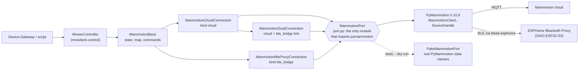

# mowdeck-control-mammotion

The real mower adapter for Mammotion mowers (LUBA, Yuka) on top of [PyMammotion](https://github.com/mikey0000/PyMammotion). It implements the `MowerConnection` interface of [`mowdeck-control`](../mowdeck-control/README.md), so the Device-Gateway drives a real LUBA exactly like the simulator, with the same `MowerController` safety rules.

**Licence: GPL-3.0-only** (see [`LICENSE`](LICENSE), a copy of `LICENSES/GPL-3.0.txt`). This package imports PyMammotion, which is licensed under GPL-3.0, so it is distributed under the GPL as well. It is kept apart from the Apache-2.0 library `mowdeck-control`, which never imports PyMammotion, so the interface and the simulator stay reusable without copyleft obligations ([ADR 0011](../../docs/adr/0011-gpl-package-for-pymammotion-adapter.md)). Anyone who uses this adapter outside MowDeck inherits the GPL-3.0 obligations of PyMammotion. The Device-Gateway (AGPL-3.0) depends on it, which is compatible.

Transports, secrets and pin policy: [ADR 0019](../../docs/adr/0019-mammotion-adapter-transports.md).

## Overview



| Module | Content |
| --- | --- |
| `port` | `MammotionPort` protocol, `ClientPort` on `MammotionClient` + `DeviceHandle`, cloud login with credential cache, BLE only registration; re-exports the PyMammotion types the rest uses |
| `errors` | manufacturer-neutral categories for every code of PyMammotion's error table, the warning event decoding and the self-check names |
| `mapping` | pure translation: work mode to activity, RTK fix and source, position, errors, capabilities per model, `HashList` to `MowerMap`, `StartMow` pattern to `OperationSettings`, joystick to `send_movement` units |
| `base` | `MammotionBase`: the `MowerConnection` implementation shared by both links |
| `cloud` | `MammotionCloudConnection` (also the `FirmwarePort` and `BridgeScanCapable` of a Mammotion mower), `create_cloud_connection` (entry point `cloud`), `cloud_connection_factory(pool)` (a registration with a `ble_bridge` link gets the dual connection), `default_pool()` |
| `dual` | `MammotionDualConnection` and `BridgeWatcher`: the cloud plus a Bluetooth bridge as the second link ([ADR 0038](../../docs/adr/0038-dual-link-per-mower-and-firmware-updates.md), see [Dual link](#dual-link-cloud-plus-bluetooth-bridge)) |
| `session` | `CloudSessionPool`: one logged-in client per set of credentials, shared by the mowers of an account and the discovery ([ADR 0034](../../docs/adr/0034-linked-cloud-accounts-and-device-discovery.md)) |
| `discovery` | `discover_devices`: the devices of an account as `DiscoveredDevice` (mowers first; `is_mower` false for RTK base stations and pool cleaners; `device_type` `rtk_base` for base stations, ADR 0047) |
| `fake_cloud` | the fake Mammotion cloud (`*@fake.mowdeck.test`, password `fake-cloud-password`) for development and the browser tests |
| `cloud_drive` | `CloudDriveSession`: manual driving over the vendor's cloud remote drive ([ADR 0049](../../docs/adr/0049-manual-driving-over-the-mammotion-cloud.md), see [Cloud driving](#cloud-driving)) |
| `ble`, `drive`, `esphome` | `MammotionBleProxyConnection`, `BleDriveSession`, ESPHome proxy wiring (`open_proxy`, `scan_proxy`, `proxy_info_of` with the bridge firmware constants `BRIDGE_MIN_ESPHOME` and `BRIDGE_TEMPLATE_VERSION`), `create_ble_bridge_connection` (entry point `ble_bridge`) |
| `options` | `CloudOptions`, `BleProxyOptions`, secret references |
| `fake` | `FakeMammotionPort` and `sample_device()` (a LUBA 2 AWD 5000X: 25 to 70 mm, 0.2 to 0.6 m/s) for tests and the owner script's `--dry-run` |

`ConnectionKind.WIFI` is not registered: driving over Wi-Fi and 4G (firmware 1.30.31.19 or newer) is the cloud connection's remote drive ([Cloud driving](#cloud-driving)).

## Install

```toml
dependencies = ["mowdeck-control-mammotion[esphome]"]   # [esphome] only for the BLE proxy
```

Pins (ADR 0019): `pymammotion==0.10.9` exactly, plus `packaging` which the 0.10.9 wheel imports without declaring it. The extra `esphome` pins the proxy helpers to PyMammotion's lock file: `aioesphomeapi==45.0.3`, `bleak-esphome==3.7.5`, `habluetooth==6.1.0`, `bluetooth-adapters==2.1.1` (all resolve on Python 3.13, Windows and the Linux image).

## Connection options

Options come from Fleet (`connection_options` of the mower registration) through the Device-Gateway into `ConnectionConfig.options`.

**cloud**

| Option | Required | Meaning |
| --- | --- | --- |
| `account` | yes | Mammotion account (e-mail). Cloud driving needs the account that **owns** the mower (a shared account is refused with code 50803); a shared account runs everything else. The same account in the phone app and in MowDeck at once can drop each other's MQTT session |
| `device_name` or `iot_id` | one of them | which mower of the account, for example `Luba-VP...` |
| `credential_ref` | one of `credential_ref`, `password` | `env:NAME` or `file:/run/secrets/name`, resolved in the Device-Gateway's environment |
| `password` | | plain password; accepted in Phase 2 with a warning, never returned by the Fleet API |
| `session_cache_path` | no | file for PyMammotion's credential cache (live tokens) on a private, writable volume; avoids a password login on every reconnect |
| `links` | no | the registration's additional links as the Device-Gateway passes them (`{"ble_bridge": {...}}`, the `ble_bridge` options below with `noise_psk` merged); present: the connection is a `MammotionDualConnection` |
| `refresh_seconds` | no | how often the mower is asked for a fresh report while docked, charging, idle or offline, 10 to 300 s, default 20 (see **Fresh state** below) |
| `report_stream_seconds` | no | length of the continuous report window kept open while the mower is active (renewed every half window), 10 to 300 s or 0 for off, default 60 (see **Fresh state**) |
| `refresh_seconds_active` | no | the same while it mows, returns or is paused away from the dock, 2 to 60 s, default 5 (never longer than `refresh_seconds`) |
| `all_cameras` | no | ask the cloud for every camera of the mower (both front cameras of a LUBA 2 AWD X), default true; false: the front left camera only, as the vendor app does (see **Live camera** below) |
| `cloud_drive` | no | manual driving over the cloud remote drive when the mower supports it and no bridge carries the drive, default true ([Cloud driving](#cloud-driving)) |
| `allow_manual_blades`, `manual_blade_height_mm`, `manual_drive_speed_mps` | no | blades and `max_run_speed` of a cloud drive session, as for the bridge: default off, 60 mm, the mower's own speed setting (at most 1.0 m/s) |
| `map_sync_timeout_s`, `confirm_timeout_s` | no | defaults 300 and 30 |
| `linked_account_id` | no | set by Fleet for mowers of a linked account (ADR 0034); their plain `password` then logs no warning |

**ble_bridge** (extra `esphome`)

| Option | Required | Meaning |
| --- | --- | --- |
| `host` | yes | ESPHome proxy host name or IP |
| `port` | no | ESPHome API port, default 6053 |
| `noise_psk` (or `credential_ref`) | yes | the API encryption key of the ESPHome YAML (base64, 32 bytes) |
| `ble_address` | yes | the mower's BLE MAC |
| `device_name` | no | advertised name; read from the advertisement when missing |
| `allow_manual_blades` | no | default false: blades stay off while driving manually |
| `manual_blade_height_mm`, `scan_timeout_s`, `map_sync_timeout_s`, `confirm_timeout_s` | no | defaults 60, 30, 300, 30 |
| `manual_drive_speed_mps` | no | `max_run_speed` a drive session sends when it opens, 0.1 to 1.0 m/s; default the mower's own speed setting for manual driving (`mower_state.travel_speed`), at most 1.0 (see "max_run_speed of a drive session") |
| `refresh_seconds`, `refresh_seconds_active`, `report_stream_seconds` | no | As for the cloud link: fresh-state requests while idle (10 to 300 s, default 20), while active (2 to 60 s, default 5) and the continuous report window while active (0 off, 10 to 300 s, default 60). The mower does not report by itself over Bluetooth either. |

Fleet validates both kinds (`fleet.domain.rules.validate_connection_options`) and masks `password` and `noise_psk` as `***` in every API response.

## Behaviour

**State.** `report_data.dev.sys_status` (`WorkMode`) gives the activity (working is `mowing`, pause and charging pause are `paused`, ready on the charger is `docked`, lock, system, location and boundary errors are `error`, sleeping and power off are `offline`, no report yet is `unknown`). RTK fix from `report_data.rtk.status` (`RTKStatus`: fix is `fixed`, float is `float`, single and none are `none`), correction source from `mqtt_rtk_info.rtk_switch` (`RTK_USED_NRTK` is `network`, LoRa and internet base stations are `base_station`). Position from `location.device` (degrees), or the dock pose while docked (`position_source`), battery, charging, blade height, working speed, firmware, and a trimmed `raw` dict (work mode, RTK details, network type and RSSI, the device blade counter; never IMEI or ICCID).

Mapped fields (PyMammotion `MowerDevice`, the same sources as Mammotion-HA's `sensor.py`):

| `MowerState` field | PyMammotion source |
| --- | --- |
| `activity` | `report_data.dev.sys_status` (`WorkMode`), `charge_state`, `online` |
| `battery_percent`, `charging` | `report_data.dev.battery_val` (clamped to 0..100), `charge_state != 0` and battery below 100 |
| `position` | `location.device` (degrees), heading from `location.orientation`, a compass course as reported (verified on the LUBA 2 AWD X against the RTK track); in the dock (activity `docked` or `charging`, or a job paused on the charger) with a known dock pose: the dock instead (see "Position in the dock") |
| `position_source` | `dock` for the dock pose; otherwise from the RTK fix: fixed or float is `rtk`, single or none is `gnss`, unknown (no report yet) is `unknown`; `unknown` without a position |
| `rtk_fix`, `rtk_source` | `report_data.rtk.status`, `report_data.rtk.mqtt_rtk_info.rtk_switch` |
| `blade_height_mm` | `report_data.work.knife_height` when 1..200 |
| `speed_mps` | while working `report_data.work.man_run_speed / 100` (cm/s, what the app and Mammotion-HA show) when in (0, 5] m/s (`raw.speed_source = reported`); otherwise (idle, docked: `man_run_speed` is 0) the speed the next area start sends (see "Job speed and blade height of a start"): a `SetSpeed` the mower has not confirmed yet (`setpoint`), the mower's own speed setting (`device`), or the default 0.3 m/s while the mower reported none (`default`) |
| `drive_speed_mps` | the speed setting for manual driving, `mower_state.travel_speed` (PyMammotion's reducer stores the answer `bidire_speed_read_set` there) when in (0, 5] m/s, else null (see "Speed setting for manual driving") |
| `light_on` | the camera's headlamp ("fill light"; not the side LEDs): `mower_state.lamp_info.manual_light`, which PyMammotion's reducer sets from the answer `get_lamp_rsp` with `get_ids` 1126 or 1127 (`lamp_manual_ctrl == manual_power_on`), as Mammotion-HA's `manual_light` switch reads it; null until the mower answered a read (an "off" answer looks like PyMammotion's default `LampInfo`, so the answered read decides). `raw.manual_light` and `raw.lamp_bright` once reported |
| `error_code`, `error_message` | the fault that holds the mower (see "Faults"): in an error mode the fault of the current window, else the newest `errors.active_codes` entry, else the work mode name; a pause off the charger with a fault of the current window is `error` too. The sign is dropped (`-1201` is `1201`), the message is PyMammotion's English text |
| `drive_recoverable`, `error_category`, `raw.error_category`, `raw.error_source`, `raw.lifted`, `raw.self_check` | see "Faults"; `error_category` is the typed copy of `raw.error_category` |
| `job` | while a job runs (work mode working, paused, returning, charging pause, corridor pause; else null). `report_data.work` packs two 16-bit halves per field, read as Mammotion-HA's `sensor.py` does: `area` high half is `progress_percent` (PyMammotion's `mow_percent`, also `raw.progress_percent`), low half `mowed_m2` (square metres); `progress` high half the minutes left (`remaining_s` = minutes x 60), low half the job's total minutes (`elapsed_s` = (total - left) x 60), both times null while the total is 0. So the times have minute resolution. `area_id` is `location.work_zone` as text when that zone hash is one of the map's areas (`MowerMap.areas[].id` are the hashes as text), else null (`raw.work_zone` keeps the raw hash). **The area and time halves are unverified on the LUBA 2 AWD X**; they follow Mammotion-HA |
| `gnss` | `satellites` = `report_data.rtk.gps_stars`, `correction_age_s` = `rtk.age` (seconds, null while 0), `rtk_status` from `rtk.status` (`RTKStatus`: none, single (1 and 2), float, fix is `fixed`, else `unknown`); null before the first report. Raw copies: `raw.satellites`, `raw.correction_age_s`, `raw.rtk_status` |
| `signal` | `wifi_dbm` = `report_data.connect.wifi_rssi`, `mobile_dbm` = `connect.mnet_rssi` (dBm, null when 0 or outside -150..-1), `network` as PyMammotion's `device_connection` decides it: `used_net` (`WIFI`, `MNET` or `TC_MNET`, with or without the `NET_USED_TYPE_` prefix), else `connect_type` (2 Wi-Fi, 1 mobile), else `ble` with a Bluetooth RSSI, else `none`; null before the first report. Raw copies: `raw.wifi_rssi`, `raw.mnet_rssi`, `raw.used_net` |
| `self_check` | `report_data.dev.self_check_status`: 0 and 10 are `ok`, any other value `blocked` with the name of `errors.SELF_CHECK_STATES` (`other_<n>` for an unknown one) as `detail`, the same key as `raw.self_check`; null before the first report |
| `firmware` | `device_firmwares.device_version` (filled by the device information requests, see below), else PyMammotion's `firmware_version` unless empty or the `1.0.0.0` placeholder, else `mower_state.swversion` |
| `raw.model`, `capabilities.model` | `extMod` of the sub model's entry in PyMammotion's model table (`mower_state.sub_model_id`, for example `LUBA 2 AWD 5000X`), else `mqtt_properties.params.items.extMod.value` when present (as Mammotion-HA), else `mower_state.model_id`, else `extMod` of the product key's table entry, else the device type name from the device name (`Luba VP`) |
| `raw.cutter_offset_m`, `raw.cutter_width_m`, `raw.pos_type` | `report_data.work.cutter_offset` and `.cutter_width` (RptWork fields 22 and 23), each only when > 0, and `location.position_type` (the position solution type, int, always). **The units of the cutter values are assumed to be metres and are unverified**; the owner will read the raw values on the real mower. When `cutter_width` > 0, `capabilities.cutting_width_mm` is that width in mm (rounded) instead of the family constant |
| `raw.blade_used_s`, `raw.blade_used_warn_s` | `report_data.maintenance.blade_used_time.blade_used_time` and `.blade_used_warn_time` (seconds), only when > 0; the device's own blade counter (reset in the Mammotion app), which Telemetry prefers for "blades since change" |
| `raw.work_time_s`, `raw.mileage_m` | `report_data.maintenance.work_time` (seconds) and `.mileage` (metres) from the maintenance block of the device report, falling back to `report_data.dev.work_time_sec` and `.mileage` (`deviceOtherInfo` / `networkInfo` properties), only when > 0; the mower's lifetime working time and distance (the Mammotion app's totals), which Telemetry shows next to its own mowing hours and distance |
| `raw.bat_cycles` | `report_data.maintenance.bat_cycles` (maintenance block of the device report and the `networkInfo` property), falling back to `mower_state.charge_settings.bat_cycle_times` (BMS settings), only when > 0; the battery's lifetime charge cycle counter, which Telemetry prefers over its own cycle count |

**Faults.** A trapped mower does not report an error mode: the LUBA 2 AWD X stuck on the lawn (2026-10-18) reported `MODE_PAUSE`, while the vendor app and Mammotion-HA showed 1201 "The robot is stuck". The fault is only in the mower's error log (`errors.err_code_list` with `err_code_list_time`, the last ten faults, newest first), which the cloud never pushes, and in the `thing/event` warning posts. Mammotion-HA reads the log with `read_write_device(rw_id=5, context=2, rw=1)` when the mower enters a mode a fault is logged with (pause among them) and when a warning event arrives, and shows the newest entry as "last error code". The adapter does the same: a **fault window** opens when the mower pauses off the charger or reports an error mode (it starts 120 s earlier, `FAULT_TOLERANCE_S`, or 30 min earlier when the mower already stood like that at connect) and closes when it leaves. Opening it reads the log after 10 s (the firmware first stamps an entry with its uptime and replaces it with the real time), again after 30 and 60 s while no dated fault was found; three reads at most per window, background priority. Warning posts (`device_warning_event` `{"code": 1201}`, `device_warning_code_event` with `[{"c": -1201, ...}]`, through `MammotionPort.subscribe_notifications`) name the fault at once and also trigger the read. The newest log entry dated inside the window, or a newer warning of the window, is the fault: a pause with one is `error` with that code (`raw.error_source` `error_log` or `warning_event`; `work_mode` when an error mode has no code). A pause without one stays `paused`; a log entry from before the window is history and never counts.

Every code gets a manufacturer-neutral category in `raw.error_category` (`errors.category_of`): `trapped` (1201, 1421, 11112, 2000701), `obstacle` (1206, 1214 channel or recharge route obstructed, 11113, 11121, 11122), `outside` (100, 1100, 1145, 1411, 1422), `wheel_slip` (1032, 1218, 11132, 11134); these curated codes are the only recoverable ones and set `drive_recoverable` (manual driving and the job commands stay allowed instead of a sensor stop, and Vision's automatic analysis may start). Every other code is never recoverable: `lift_tilt` (1004, 1030, 2502, 2801, 11131, 11133 and the lift sensor, tilt or turned over texts; sets `raw.lifted`), `collision` (bumper), `blade_motor` (blades, cutter, wheel and other motors, also the cutting height lift motor), `battery`, `rain`, `positioning` (RTK, satellites, visual positioning) from the English text and the module of PyMammotion's table (about 660 codes), and `other`. `raw.self_check` names the condition the self-check reports as stopping the mower from starting (`report_data.dev.self_check_status`, as Mammotion-HA lists them: `rain`, `lifted`, `low_battery`, `outside_task_area`, ...; `other_<n>` for an unknown one), only when not normal.

**Capabilities.** Native patterns `stripes`, `diagonal`, `checkerboard`, `edge_only` and `random_angle` (Luba 1 without `random_angle`), no custom paths, camera `cloud` over the cloud connection (every model except the Luba 1; `none` over BLE), RTK sources base station and network, `light` (the camera's headlamp) where PyMammotion's `DeviceType.is_support_fill_light(device_name)` says so (the app's own gate: true for the LUBA 2 AWD X (`Luba-VP…`) and the other Luba 2 variants VA, LD, MN, HM, ..., and the Yuka minis; false for the Luba 1 and the big Yuka). The side LEDs (`read_and_set_sidelight`) are a separate light and not offered; they may become a second control later. Manual driving over BLE (with reverse) and over the cloud remote drive where the mower supports it (forwards and turns only, see [Cloud driving](#cloud-driving)).

**Blade height and speed limits.** From the entry of PyMammotion's model table (`data/model/device_capabilities.py`, read through `DeviceConfig.get_device_config`) for `mower_state.sub_model_id`, else for the product key: `blade_height_range_mm` from `blade_height_min/max`, `min_speed_mps`/`max_speed_mps` from `cutting_speed_min/max` (the speed while mowing; `working_speed_min/max` is the faster travel speed and only used when an entry has no cutting speed, as the product-key entries of the Luba 1), the StartMow path spacing from `path_spacing_min/max`. A LUBA 2 AWD 5000X (sub model `HM030070LB2PAWD50OMNI`) gets 25 to 70 mm and 0.2 to 0.6 m/s. Without an entry the limits stay null and the controller rejects `set_blade_height` and `set_speed`: the Luba VP product keys are not in the table, and PyMammotion's own fallback (`MowerDevice.device_limits`) would use the Yuka default for them. Speeds above 5 m/s are dropped as implausible.

**Cutting width.** PyMammotion's model table has no blade or cutting width (`path_spacing` is the spacing of the mowing lines), so `cutting_width_mm` is a per-family constant from the device type: Luba 1, LUBA 2 AWD (`Luba-VS`) and LUBA 2 AWD X (`Luba-VP`) 400 mm, Yuka 320 mm, other families (minis, newer models) null. Telemetry uses it for the coverage heatmap (400 mm when null).

**Device information requests.** The cloud only forwards the firmware and model answers when asked, so a cloud connect sends `get_device_version_info`, `get_device_base_info` (firmware, `device_firmwares`) and `get_device_product_model` (answer `device_product_type_info` sets `mower_state.model_id` and `sub_model_id`, which select the limits above), then the dock buffer request `read_write_device(rw_id=5, context=1, rw=1)`, all with background priority. Mowers with a headlamp (both links) then read it, `get_car_light(ids=1126)` as PyMammotion's `mower_api.py` does after a switch, waiting for the answer `get_lamp_rsp` (the leaf of `SocMul`'s oneof, which is the name PyMammotion's broker matches; `send_and_wait`, 5 s per attempt, PyMammotion sends twice). While the firmware, the model, the RTK origin, the dock or the light state is still unknown, only the missing ones are requested again every 30 s (`device_info_retry_s`), at most four rounds in all (`DEVICE_INFO_ATTEMPTS`); failures are ignored. Every connect (so every reconnect of the Device-Gateway) starts the rounds again. BLE connections send only the dock buffer request and the light read (same retries).

**Dock and RTK origin.** The mower answers `read_write_device(rw_id=5, context=1, rw=1)` with a `system_update_buf` frame whose first value is 1; PyMammotion's `MowerDevice.buffer` reads the RTK origin (`location.RTK` latitude and longitude, index 5 and 6) with its yaw (index 13) and the dock pose (`location.dock`: x index 7, y index 8, rotation index 3) from it. Nothing else fills them: without the buffer the map has no dock and the origin is PyMammotion's fallback from `report_data.rtk.mqtt_rtk_info` without yaw. Mammotion-HA sends the same command whenever the RTK or dock latitude is 0 (`coordinator.py`, `async_rtk_dock_location`, also its "resync RTK dock" button); PyMammotion's own `homeassistant/mower_api.py` has it too. `get_map` asks once more after the map sync when dock or origin are still unknown and waits up to 15 s (`DOCK_WAIT_S`) for them, because the connect-time request may still be queued behind the sync; the map snapshot then carries the dock and the true reference. When the buffer arrives later still, `current_map()` (`mowdeck_control.MapRebuildable`) rebuilds the map from the device data without a sync, and the Device-Gateway's snapshot recheck republishes it.

**Position in the dock.** A docked, charging mower often has no RTK fix (status single) and its raw position scatters by metres, so it would float between the areas, while the vendor app shows it at the dock. In the dock (activity `docked` or `charging`, or a job paused with `charge_state != 0`) with a known dock pose the state therefore reports the dock: its local `(x, y)` rotated by the RTK yaw and converted with PyMammotion's `CoordinateConverter.enu_to_lla` (the same forward transform as the mower position in `update_report_data`), the heading from the dock rotation (a compass course like the orientation; the map's `DockPose` carries it as a local frame angle), and `position_source = dock`. With the dock unknown the raw position stays, with `position_source` `gnss` (no fix) or `rtk`, so the UI can show its quality.

**Map.** `start_map_sync` fills `device.map` (`HashList`); areas, paths, no-go zones (`no_go_zone`, `no_go_zone_variant`) and obstacles (`obstacle`, `visual_obstacle_zone`) are copied in their local metres, ids are the zone hashes. The reference is the RTK origin (`location.RTK`, radians) with its yaw as `rotation_deg`; PyMammotion's own GeoJSON uses the same rotation, which a test checks. Virtual walls and dump zones are not represented. The map is synced on first use and again after five minutes.

**Commands.**

| Command | PyMammotion |
| --- | --- |
| `StartMow` | (end a paused job with `cancel_job`), `generate_route_information` waiting at most 10 s per attempt for its reply `bidire_reqconver_path` (the wait holds the command queue), then `start_job` sent once with `Priority.USER` and no reply awaited (Mammotion-HA order; Mammotion-HA also sends `start_job` without waiting) |
| `PauseMow`, `ResumeMow`, `ReturnToDock` | `pause_execute_task`, `resume_execute_task`, `return_to_dock` |
| `ReturnToDock(end_job=True)` | `cancel_job`, a wait of at most 15 s until the work mode left working/paused, then `return_to_dock` confirmed as above; the job does not resume later (without `end_job` it stays paused on the mower). The emergency stop is unchanged and still pauses |
| `EmergencyStop` | `Priority.EMERGENCY`: `pause_execute_task`, `send_movement(0, 0)` and `operate_on_device` with blades off, every step tried |
| `SetBladeHeight`, `SetSpeed` | `set_blade_height` (mm), `set_speed` (m/s), `accepted`; the next area start uses the value until the mower reports it (see "Job speed and blade height of a start") |
| `SetLight` | the headlamp: `set_car_manual_light(manual_ctrl=on)` (`SetHeadlamp` with `set_ids` 1125 on or 1127 off, `lamp_power_ctrl=2`; user priority), then the read `get_car_light(ids=1126)` waiting for `get_lamp_rsp` (PyMammotion's `async_set_manual_light`: write, then read); `executed` when the answer shows the wanted state within 3 s, else `accepted`. Runs also while the mower reports an error (no sensor stop check: AI assist lights up a stuck mower); `CommandRejected` for a model without `light` |
| `ManualDrive` (cloud) | `CloudDriveSession`: opens with the control token (`start`, `confirm`) and the same `operate_on_device` as over BLE, then the newest frame per send in the same wire units through PyMammotion's remote-drive session (one frame in flight, about 0.25 s per acknowledgement); a watchdog zeroes when a frame's ttl passed; `stop()` sends a zero frame and blades off, `close()` also releases the token |
| `ManualDrive` (BLE) | `BleDriveSession`: opens with `operate_on_device` (blades off, `max_run_speed`, see below), then one `send_movement` per frame (PyMammotion's scaling: 15 % dead zone, full stick 850 linear, 382 angular), `stop()` sends zero movement and blades off with the same `max_run_speed` |

**Confirmation.** The adapter implements `mowdeck_control.TwoPhaseExecution`: `dispatch()` sends, the `confirm` it returns only watches the reported state (it never sends and may be cancelled at any point). The controller holds its queue only for the send, so a pause or return issued while a start waits for its confirmation runs at once and ends that wait (the start then reports `accepted`, see the controller rules).

| Command | Confirmed by | Without confirmation within `confirm_timeout_s` (default 30 s) |
| --- | --- | --- |
| `StartMow` | the state mapping reports `mowing` (every work mode `mapping.activity_of` maps to mowing, today `MODE_WORKING`), so the result agrees with the published state | `accepted` ("command sent; the mower did not report mowing within 30 s") |
| `PauseMow` | work mode `MODE_PAUSE` | `accepted` |
| `ResumeMow` | work mode `MODE_WORKING` | `accepted` |
| `ReturnToDock` | `MODE_RETURNING`, `MODE_CHARGING` or the activity `docked` | `accepted` |
| `EmergencyStop`, `SetBladeHeight`, `SetSpeed` | not confirmed | `accepted` at once |

`failed` only means the command did not go out: no route reply (`start_job` is then not sent), a transport error, a missing link (`NotConnected`). A mower that does the job but reports it late is never `failed`.

**No automatic resend of job commands.** PyMammotion's `send_command_and_wait` drives `DeviceMessageBroker.send_and_wait` (`pymammotion/messaging/broker.py`, `retries=2`), which calls the send again on every attempt that gets no reply within `send_timeout`. Until 2026-10-10 the adapter sent `start_job` that way, waiting for `zone_start_precent_t`; the LUBA 2 never answered with it, so the start was re-sent after 30 s and restarted the mower the owner had just paused in the app, and the command was reported `failed` after 60 s while the mower was mowing. `MammotionPort.send_and_wait` is therefore reserved for idempotent requests (reads and the route request: planning the same route twice is harmless). Commands that change what the mower does go through `MammotionPort.send` (`send_command_with_args`, `Priority.USER`): sent once on the caller's task; PyMammotion's `execute_command` repeats it only when the cloud answers with a gateway timeout.

**Job speed and blade height of a start** ([ADR 0042 amendment 2026-10-25](../../docs/adr/0042-drive-calibration.md)). The route settings of an area start carry a speed and a blade height. The speed is, in order: `pattern.speed_mps`; a `SetSpeed` the mower has not confirmed yet; the mower's own speed setting, `mower_state.travel_speed` (the answer to `get_speed`, which `set_speed` writes; read at connect and again before every start that names no speed, 3 s per attempt; a mower that never answered is asked once per connection), else the echoed `work.speed` of a paused job, each only within the model's mowing speed range; else 0.3 m/s with a warning in the log and `raw.speed_source = default`. The blade height is a `SetBladeHeight` the mower has not reported yet, else the reported `report_data.work.knife_height`, else 60 mm (logged). An explicit value counts until the report shows it or the next start sent it; after that the mower's value wins again (a change in the vendor app is not overridden by an old MowDeck command). Nothing is persisted: after a gateway restart the values come from the mower. **Unverified on hardware**: that `get_speed` is the mowing speed the vendor app shows.

Pattern settings in `StartMow.pattern`: `name`, `angle_deg`, `spacing_m`, `border_laps`, the job options `obstacle_detection`, `obstacle_laps`, `order` and `start_progress_pct` (ADR 0030 amendment 2026-10-24, checked against `capabilities.start_options`), plus `angle_mode` (`absolute`, `relative`, `random`), `blade_height_mm` and `speed_mps`.

**Job options** (`mapping.start_options_of`, `mapping.route_plan`). The Mammotion app's "task assignment" offers them under "Mehr"; the adapter declares them for the LUBA 2 AWD (`Luba-VS`) and AWD X (`Luba-VP`) only, other models keep just `obstacle_laps` (0 to 4, as before). Where each one goes, as Mammotion-HA sends it:

| `MowPattern` | Values | PyMammotion | Left out |
| --- | --- | --- | --- |
| `obstacle_detection` | the app's options for model and firmware (`DetectionStrategy.for_device`): `off` (1), `standard` (10), `sensitive` (11) from firmware 1.12.0 and on the AWD X; below 1.12.0 on the AWD `off` (0), `slow_touch` (1), `less_touch` (2), `standard` (10) | `ultra_wave` | PyMammotion's default 2, as the adapter always sent |
| `obstacle_laps` | 0 to 4 | `obstacle_laps`, byte 1 of `path_order` | 1, as before |
| `order` | `border_first` (0), `grid_first` (1) | `border_mode`, byte 0 of `path_order` | the border laps, as the adapter sent since its first release |
| `start_progress_pct` | 0 to 99 (the cloud caps it at 99) | `start_progress`, byte 3 of `path_order` | 0 |

Verified against PyMammotion 0.10.9 (`OperationSettings`, `create_path_order`, `DetectionStrategy`, `MowOrder`) and Mammotion-HA (`lawn_mower.py` start schema, `select.py`, translations); not verified on a mower: whether the firmware reads byte 0 of `path_order` as the order (PyMammotion's `PathOrderSettings` docstring calls it "boundary laps") and that `start_progress` is a percentage. Without `order` the adapter keeps sending the border laps there, so existing starts behave as before.

Why the emergency stop pauses instead of `cancel_job`: pausing is what the app uses to halt a running job; it stops in place and keeps the job, so a person decides what happens next, while what `cancel_job` does with a mower out on the lawn is not documented.

**Mow path** (`mowdeck_control.MowPathSource`, `mowdeck_control.PathPreviewCapable`). The LUBA plans its route on board; PyMammotion's `MowPathSaga` (`messaging/mow_path_saga.py`, the APK's `HashDataManager`) hands it back: (1) only when planning, `generate_route_information` and the wait for the mower's `bidire_reqconver_path` confirmation (3 s per attempt), (2) the route's line hash list (`get_all_boundary_hash_list(sub_cmd=3)`, every frame acknowledged), (3) `get_line_info_list` for up to 20 missing lines at a time and (4) their `cover_path_upload` frames (6 s for the first frame, 4 s between frames, up to ten re-requests), stored in `HashList.current_mow_path[transaction][frame]`. `MammotionPort.fetch_mow_path` enqueues that saga itself (`TrackedMowPathSaga`, the same construction and MQTT gate `mow_path_fetch_enabled` as `MammotionClient.start_mow_path_saga`), because the client only calls back on success and a waiting caller needs the end either way; the saga's own ceiling is set to 90 s (`MOW_PATH_SAGA_CEILING_S`, PyMammotion's default is 300 s) so an abandoned fetch frees the device queue. The saga is an exclusive queue item, but user and emergency commands bypass the queue (direct sends), so a pause or stop is never delayed by it; PyMammotion pauses its rapid report stream while a saga runs. `mapping.mow_path_of` turns the result into a `MowPath`: one polyline per line of the current line list (in driving order, packets joined by `path_cur`, points in the map's local metres, the same frame as the areas), `kinds` from `path_type` (0 `mow`, 2 `edge`, else `other`), `area_ids` from the packets' zone hashes, `path_hash` = `HashList.computed_path_hash` as text (it equals the report's `work.path_hash` when the list is current; 64-bit, so a string for JavaScript). Frames of an older route and incomplete transactions are ignored.

* **Running job.** Once the work mode shows a job (working, paused, returning, charging or corridor pause) and the report names a route (`work.path_hash` above 1) the adapter does not hold, a background task fetches it with `skip_planning` (the route the mower already planned is fetched, it is never planned again; the job settings come from the last `StartMow`, or after a reconnect from `work`). It never blocks a command, waits at most 90 s (`PATH_FETCH_TIMEOUT_S`), logs a failure and tries again after 30 s (`PATH_RETRY_S`), three times per route (`PATH_ATTEMPTS`); a route with a missing line counts as not arrived. A reconnect during a job fetches it by the same rule. `current_path()` returns it with the progress of every report: `work.ub_path_hash` names the line being driven and `now_index` (`real_path_num` bits 8 to 23) the point within it, the lines before it are done, so `progress.index` = points of the earlier lines + `now_index`; `direction` is `path_direction` (bits 0 to 7). Once the work mode leaves the job the path is forgotten (`None`).
* **Preview.** `preview_path(area_ids, pattern)` runs the same saga with planning and no `start_job`, as the vendor app does when it shows a route before a start: the areas and pattern are checked and turned into route settings exactly like `StartMow`, a running or paused job, a sensor stop or unknown areas are refused (`CommandRejected`), one preview runs at a time, and the wait is bounded by 90 s (`PATH_PREVIEW_TIMEOUT_S`; `PathUnavailable` with `timed_out`, the Device-Gateway cuts it at 75 s). A start afterwards plans the same route again (the request is idempotent) and the job's own fetch then finds its lines cached.
* **Timing and 4G.** A garden of a few areas plans a few hundred to a few thousand points; a frame carries a few lines, so the fetch is a handful of request/frame round trips: typically 5 to 20 s over the cloud, longer on a weak 4G link (each stall costs the 4 to 6 s frame timers). The frames are a few kilobytes each, once per job; nothing is polled while mowing (the progress comes with the normal reports).
* **Unverified on hardware.** That the LUBA 2 AWD X answers the line list and cover path requests over MQTT while mowing, that the confirmation's `path_hash` equals the hash of the line list (a mismatch is only logged), the meaning of `now_index` per line (taken from PyMammotion's GeoJSON code), and the plan-then-start sequence of the preview leaving the mower idle.

The fake port plans `SAMPLE_PATH_LINES` (one border lap and three stripes on the front lawn): `start_job` reports its hash in `work.path_hash`, and `fetch_mow_path` writes its frames with `install_mow_path`; `path_error`, `path_gate` and `path_lines = None` simulate failures, a slow mower and an empty answer.

**Live camera** ([ADR 0032](../../docs/adr/0032-live-camera-over-agora.md)). `MammotionCloudConnection.get_camera_session()` (the optional `mowdeck_control.CameraCapable` capability) calls PyMammotion's `get_stream_subscription(device_name, iot_id, all_cameras=True)`, which fetches an Agora stream token from the Mammotion cloud and makes the mower publish; `all_cameras` sends `cameraStates` `1, 1` (plus the rear slot on a Yuka) to `device-server/v1/stream/token` instead of `1, 0, 0`, so both front cameras publish, slot n under Agora uid n + 1 (without it only the front left camera, uid 1, publishes: the web app then shows "no data" for the right one; option `all_cameras: false` restores that), and `get_video_resource(iot_id)` for the 4G video budget (best effort, 3 s). It returns a `CameraSession`: `provider` `agora`, `app_id`, `channel`, the viewer `token` and `uid`, `cameras` (`id` = `cameraId`, a name, the publisher `uid` = slot + 1, and the `placement` `front_left`, `front_right` or `rear` for slots 0, 1, 2; the web app pairs the two front cameras for its side-by-side view and stereo frames), `encryption` (`aes-256-gcm2` with the `key` verbatim and the base64 `salt`) when `openEncrypt` is set, `expires_at` from the AccessToken2 claims (issue time plus the shortest token or privilege lifetime; ten minutes when unreadable, at most 24 hours) and `quota` from the video budget (`totalTime` and `availableTime` read as seconds, unverified). No stream token, a closed session or a cloud error raise `NotConnected` (the gateway answers `unavailable`); the Luba 1 and the BLE bridge answer `None` (`unsupported`). The token is never logged; `CameraSession.redacted()` gives a printable dump. The browser joins the channel itself; no media passes through MowDeck.

**Camera release** ([ADR 0045](../../docs/adr/0045-camera-relay.md)). The mower keeps publishing after the last viewer left (frames still arrived 120 s later in the spike), which costs 4G volume and battery. `MammotionCloudConnection.release_camera_session()` (the optional `mowdeck_control.CameraSessionRelease` capability, also on the dual connection) calls PyMammotion 0.10.9's `MammotionClient.stop_stream(device_name)`, which sends `device_agora_join_channel_with_position(enter_state=0)` (Agora `vi_switch=0`, "stop publishing video"; PyMammotion's only sender of it) through the device's command queue. The stop is per mower, so the session's `channel` is ignored. It is sent on every call (idempotent, harmless without a running stream), not at all for models without a camera (Luba 1), and bounded by 10 s; a closed session, a timeout or any send error raise `NotConnected` (the error text is not passed on, only its type is logged) and the connection stays up. The BLE connection does not implement it. Nothing calls it on the direct browser path of ADR 0032; the camera relay does through the Device-Gateway.

**Still photos** ([ADR 0035](../../docs/adr/0035-server-side-camera-frames-and-automatic-analysis.md)). PyMammotion 0.10.9 has no snapshot or photo command (no protobuf message returns an image; `MulSetVideo` only switches a camera stream, the HTTP API only gives the stream token and the video budget), so the adapter does not implement `PhotoCapture`. When AI assist needs a picture without an open browser, the Device-Gateway asks the camera relay's frame tap ([ADR 0045](../../docs/adr/0045-camera-relay.md)): it reuses the session a viewer holds or starts one (through `get_camera_session()`) within the Vision limits, so the mower publishes for a few seconds and uses the 4G video budget. The capture worker of ADR 0035 (a headless browser per frame) is removed.

**Fresh state.** The Mammotion broker forwards reports only when someone asks for them; without asking, the state stays as old as the last command (the owner saw "19 min ago"). The cloud connection therefore runs a refresh loop (`MammotionBase(refresh_interval_s=..., active_refresh_interval_s=...)`, from `refresh_seconds`, default 20 s, and `refresh_seconds_active`, default 5 s; 0 disables it; the BLE bridge runs the same loop): the interval is adaptive. While the mower is active (activity mowing, returning or paused, i.e. off the dock) the loop uses `refresh_seconds_active`, otherwise (docked, charging, idle, error, offline) `refresh_seconds`; the active interval is capped at the idle one. The loop re-reads the activity on every tick and a change of the activity wakes it, so a start cuts the running idle wait short (counted from the last request) and a return to the dock lengthens it again at once. **Budget:** the extra requests happen only while the mower works; a docked mower costs exactly what it did before, which matters on the 4G/cloud budget (and a long mowing session at 5 s is up to four times the idle traffic). PyMammotion debounces one-shot requests to 15 s (a drive test showed 4 positions in 27 s), so while the mower is active the loop does not send one-shots but keeps PyMammotion's continuous report stream open: `MammotionPort.start_report_stream(duration_ms)` (`client.start_report_stream`, RPT_START with count 0, about 1 report per second, with a stop timer) is called when the mower becomes active and then every `report_stream_seconds / 2`; each call resets the window. When the mower docks the window is simply left to expire (no explicit stop) and the idle one-shot requests resume. **Command boost:** PyMammotion only streams once its own state is active and falls back to a one-shot (debounced to 15 s) while it still says docked, which delayed the first `mowing` state by 37 s on the hardware. So every sent `start_job`, `pause_execute_task`, `resume_execute_task` and `return_to_dock` (and a BLE drive session start) boosts the loop at once for at least 30 s or one window (`MammotionBase.boost_refresh`): `start_report_stream` right after the send, before the confirmation wait, plus an undebounced `MammotionPort.refresh()` (`refresh_status`, the user path) every 3 s while the state is not yet active; the first active state renews the window immediately. A docked mower without commands sees none of this. **Budget:** about one report per second, only while mowing, like the vendor app with the map open; docked costs nothing more. `report_stream_seconds: 0` turns the stream off and `refresh_seconds_active` is the one-shot cadence again (bounded by the 15 s debounce). PyMammotion skips RPT_START while a BLE stream is live. Each tick sleeps one interval, then calls `MammotionPort.ensure_fresh(interval / 2)`, which is PyMammotion's `ensure_fresh_state(device_name, max_age_s=...)` with `wait=False`: a queued `Priority.BACKGROUND` one-shot `request_iot_sys(count=1)` (all report channels, maintenance included) only when the last report is older than half the interval; PyMammotion also skips it while a map sync runs, while a BLE stream is live and when a report arrived within 15 s. Half the interval because the answer to the previous request lands a moment after it was sent, so at the next tick it is a little younger than one interval and a check against the full interval would skip every other request. Failures are logged at debug level; the loop stops on disconnect. Every device update publishes the state when it changed, and an unchanged state again once 5 s passed since the last publish, so `observed_at` says when the mower last reported, not when its state last changed (the Device-Gateway heartbeat repeats that time; it never stamps a new one). PyMammotion signals only changed states, and a docked mower's reports often repeat; so every refresh tick also publishes when `MammotionPort.report_received_at()` (the handle's `last_report_data_at`) advanced since the last tick, so a mower that answers stays fresh. **Closing:** `disconnect` runs every step even when one fails (a background task that had failed, a drive session that does not close) and closes the port whenever it was opened, also after a connect that failed or was cancelled half way; `ClientPort.close` always runs its closer, so the ESPHome proxy, its habluetooth scanner and the Bluetooth connection are released and the mower advertises again.

Send quota: PyMammotion's own limit of 600 sends per 12 h applies only to firmware below 1.30.25.1 (the move to the Mammotion MQTT broker, spike 0001); the owner's 1.30.29.26 is past it, so 20 s (at most 2 160 requests per 12 h, fewer while the mower reports by itself) is fine. The server side 429 ban (12 h) applies to everyone, which is why the option does not go below 10 s; owners of older firmware should set 300.

Mammotion-HA comparison: its report coordinator (`coordinator.py`, `REPORT_INTERVAL` 30 min for the first run, then `DEFAULT_INTERVAL` / `WORKING_INTERVAL` of 5 min) sends `get_report_cfg` every 5 min. MowDeck does not add a separate 5 min request: the 20 s `ensure_fresh` already asks for the same report channels, and a second periodic request would only spend quota. Decision recorded here; revisit if a field turns out to arrive only through `get_report_cfg`.

**Shared cloud session** ([ADR 0034](../../docs/adr/0034-linked-cloud-accounts-and-device-discovery.md)). PyMammotion's `MammotionClient` holds every device of the account it logged in with, and a second login with the same account supersedes the first one at the Mammotion cloud. `CloudSessionPool` therefore keeps one logged-in client per set of credentials (an HMAC with a random key of the process over the lower-case e-mail and over the password; neither value is kept in the key, the log shows a short tag of the address), reference counted: `create_cloud_connection` borrows it through `open_pooled_cloud_client` (select the device handle, wait 3 s for MQTT only after a fresh login, ask for a report) and `ClientPort` releases its share on close instead of stopping the client (`OpenedClient`). The last release stops the client after `linger_seconds` (120 s), so a discovery followed by the registration of the listed mowers logs in once; a session whose login died (`reauth_required`) is replaced on the next acquire; a successful login with a new password stops the old password's unused sessions at once and the others on their last release; after `close()` acquires raise `PoolClosedError` (also a login that finishes after the close). With `cache_dir` each address gets its own credential cache file (`<cache_dir>/<sha256 tag>.json`); the per-mower `session_cache_path` option is not used by shared sessions. `discover_devices` lists `client.device_registry.all_devices` of the borrowed session (login refused: `CloudLoginRefused`; anything else: `CloudUnavailable`, only the exception type in the message). Unverified against the real cloud: several mowers on one client over MQTT at the same time, the `online` flag right after login, and the superseding of a second login.

**Undocking** ([ADR 0041](../../docs/adr/0041-spot-runs-from-the-dock-undock-transit-return.md)). Every Mammotion connection reports `capabilities.undock` and implements `UndockCapable`: `leave_dock()` sends PyMammotion's `leave_dock` (`MctlNav(todev_one_touch_leave_pile=1)`, the app's one-touch undocking) once with `Priority.USER`, only while the mower is docked or charging (otherwise `CommandRejected`), and boosts the refresh loop like the other job commands. On the dual connection it goes over the cloud (only the drive channel uses the bridge). A spot run from the dock watches the state after it; nothing is confirmed here.

**Maintenance commands** ([ADR 0048](../../docs/adr/0048-maintenance-commands.md)). Every Mammotion connection lists them in `capabilities.maintenance` (`mapping.maintenance_actions_of`, the buttons Mammotion-HA offers: all five for every model, except `restart_mower` on the Luba 1) and implements `MaintenanceCapable.run_maintenance`; `leave_dock` is the undocking above. What goes out, all with `Priority.USER` through `send` (once, never `send_and_wait`):

| Command | PyMammotion 0.10.9 | Result |
| --- | --- | --- |
| `restart_mower` | `remote_restart` (`MctlSys.to_dev_remote_reset`, `force_reset=1`), Mammotion-HA `async_restart_mower` | `accepted`: no reply; the mower is offline for a minute or two and the connection reconnects |
| `relocate_dock` | `delete_charge_point` (`NavGetCommData(pver=1, action=6, type=5)`), Mammotion-HA `async_relocate_charging_station` | `accepted`: no reply; the mower learns the station again in the dock |
| `resync_rtk` | `read_write_device(rw_id=5, context=1, rw=1)` (the dock buffer, Mammotion-HA `async_rtk_dock_location`) | `executed` when a new RTK origin or dock pose arrives within `RTK_RESYNC_WAIT_S` (10 s), else `accepted` (an unchanged answer looks like none); the map is rebuilt from it |
| `sync_map` | the map sync saga (`MammotionPort.sync_map`, `start_map_sync` as Mammotion-HA's button), also when the held map is fresh | `executed` (`map read again: N areas`) or `accepted` after `map_sync_timeout_s`; the next `get_map()` does not sync again |

The adapter applies `maintenance_problem` once more for direct callers (a restart only at rest, the dock relocation only in the dock). On the dual connection everything goes over the cloud. **Unverified on hardware**: that the LUBA 2 learns its station again on the next docking after `delete_charge_point`, and how long a remote restart takes.

**Speed setting for manual driving** ([ADR 0042](../../docs/adr/0042-drive-calibration.md)). The mower scales the stick by a speed setting (the vendor app's movement speed), so the same `send_movement` value covers more or less ground. Every Mammotion connection declares `capabilities.drive_speed_setting` and implements `DriveSpeedCapable`: `get_drive_speed()` sends PyMammotion's `get_speed` (`MctlDriver(bidire_speed_read_set=DrvSrSpeed(rw=0))`) as a read through `send_and_wait` (reply `bidire_speed_read_set`, 5 s per attempt, PyMammotion sends twice) and returns `mower_state.travel_speed` (None without an answer); `set_drive_speed(v)` sends `set_speed(speed=v)` (`DrvSrSpeed(speed, rw=1)`) once with `Priority.USER` and reads the value back (best effort). It is a setting, not a drive frame: the dual connection sends both over the cloud, also while Bluetooth carries a drive session. The range is the model's travel speed (`working_speed_min/max` of PyMammotion's model table, 0.2 to 0.8 m/s for the LUBA 2 AWD 5000X), else the model's speed range, else 0.2 to 1.2 m/s, in steps of 0.1 m/s. **Unverified on hardware**: that `DrvSrSpeed` is the app's manual-driving speed, and its exact range. `SetSpeed` writes the same message, so the mowing speed and this setting may be one value on the mower.

**Stick scale.** `movement_wire` (`mapping.py`) matches PyMammotion 0.10.9: `move_forward(1.0)` gives `get_percent(100) = 85`, `transfrom3(90, 85) = [85, 0]` and `85 * 10 = 850`; `move_left(1.0)` gives `int(-85 * 4.5) = -382`. The cloud remote drive (`RemoteDriveSession`, `session_ctrl`) passes the caller's values on in the same units and names no other range. What 850 means on the ground depends on the speed setting above; the drive calibration (`DriveCalibrate`, owner script `--calibrate`) measures it.

**Turn setting and reverse** ([ADR 0043](../../docs/adr/0043-turn-styles.md)). `MowerState.turn_style` is the mower's own turn setting for its jobs, PyMammotion's `mower_state.turning_mode` (read/write parameter 6; 0 zero-turn → `in_place`, 1 multipoint → `multi_point`, anything else none). Since ADR 0046 it can be changed as the setting `turn_style` (below), and the connect-time settings read (`read_write_device(rw_id=6, context=1, rw=0)`) fills it; until the mower answers it reads as zero-turn (PyMammotion starts at 0). `capabilities.drive_reverse` is the drive link's: a Bluetooth session (`send_movement`) takes a negative linear speed, the cloud remote drive does not (false on a cloud connection, and on a dual connection while its bridge is down).

**Mower settings and rain sensor** ([ADR 0046](../../docs/adr/0046-device-settings-as-capabilities.md)). `settings.py` declares the mower's own settings for every `DeviceType.is_luba_pro` model, the LUBA 2 family and (since 2026-10-25) the Yuka family, and implements `mowdeck_control.SettingsCapable`: `rain_detection` (`read_write_device` parameter 3), `turn_style` (`turning_mode`, parameter 6), `traversal_mode` (`traverse_mode`, parameter 7), `side_led` (`read_and_set_sidelight`), `night_light` (`set_car_light`, read `get_car_light(ids=1123)`; models with the fill light, not the Yuka MV), `blade_speed` (`slow`, `normal`, `fast`: `set_cutter_mode`, read `get_cutter_mode`, answer `current_cutter_mode`; models of `DeviceType.is_support_blade_speed`: the LUBA 2 AWD X and other LUBA variants, not the LUBA 2 AWD, and every Yuka but the original one; group `mowing`), `wildlife_safety` (`set_animal_protection_mode`; `supports_wildlife_safety`), `recharge_level`/`smart_recharge_level` and `resume_level`/`smart_resume_level` (`set_recharge_level`, `set_resume_level`, -1 for smart; `supports_charge_limit`, firmware 2.1.1.5 or newer), `voice_enabled`/`voice_volume`/`voice_gender` (`set_car_volume`, `set_car_volume_sex`) and `non_work_hours` (`job_do_not_disturb` with minutes after midnight, `job_do_not_disturb_del`). These are the commands and replies Mammotion-HA uses. The declared settings are read at connect with the device information rounds (background priority, `send_and_wait`, again while unanswered); `MowerState.settings` only holds keys the mower answered. `set_setting` sends the write(s) once with `Priority.USER`, reads the setting back and answers `executed` when the answer shows the new value, else `accepted`; it is allowed in every activity (no setting moves the mower). `MowerState.rain_detected` is `report_data.dev.self_check_status == 20` ("Mowing is disabled on rainy days", Mammotion-HA's `rain_detected` binary sensor), which the mower reports only while `rain_detection` is on. **Yuka.** The Yuka models (`DeviceType.is_yuka`: YUKA, YUKA mini, mini 2, VP, MV, ML, Ezy VT/LD, HS) declare the same settings with PyMammotion's gates, plus `blade_speed` where PyMammotion has it (every Yuka but the original one): PyMammotion routes the read/write parameters of every `is_luba_pro` model, the Yuka included, over `nav_sys_param_cmd`, and Mammotion-HA creates these entities for the Yuka too. Per model at firmware 2.1.1.5: the original Yuka has no night light and no blade speed; the YUKA VP no night light; the YUKA MV neither night light nor wildlife safety; the Ezy VT (MN100) no wildlife safety. These follow PyMammotion 0.10.9 and Mammotion-HA and are not verified on a Yuka. Not offered: the rain delay and protection modes (X5 only), the charge limit and smart charging (a read-modify-write of the off-peak window), `auto_change_direction` (excluded for the LUBA 2), the Yuka's grass collector (the manual sweep and dump move the collector; the dump interval and the mow, dump and edge switches are job options), and Spino settings. Not yet tried on the real mower.

**Driving and spot runs** ([ADR 0039](../../docs/adr/0039-spot-mowing-by-mowdeck-driven-paths.md)). A spot run steers the mower with joystick frames and needs a pose about once a second, but the mower may not count manual driving as an active work mode, so the report stream alone is not enough. While a drive session is open (`_drive_active()`: a BLE, dual or cloud drive session) the refresh loop is in `drive` mode: it opens PyMammotion's report window at once and renews it every half window (`report_stream_seconds`), and whenever no device update arrived for 1 s (`DRIVE_POLL_S`) it asks for an undebounced report (`MammotionPort.refresh()`, the user path). Every device update is published while driving, also an unchanged one, so `observed_at` stays fresh for a mower that stands still (the run pauses on a pose older than 2.5 s). The loop leaves `drive` mode when the session closes. A drive calibration ([ADR 0042](../../docs/adr/0042-drive-calibration.md)) measures from these reports and asks for them faster while it runs (`set_drive_report_interval`, the generic `ReportRateCapable`): the drive interval drops to 0.5 s (`MIN_DRIVE_POLL_S`, the floor so undebounced requests do not queue up behind each other on the Bluetooth link) and returns to 1 s when the calibration ends; over the cloud it stays at 1 s (`CLOUD_MIN_DRIVE_POLL_S`, the vendor's server bans clients that ask too often). A spot run keeps the 1 s interval. Nothing here knows about spot runs: the generic `SpotMowRun` in `mowdeck-control` only needs the drive session and the state (position, heading, RTK fix).

**Link loss.** Cloud: a transient MQTT loss keeps the connection (PyMammotion reconnects by itself, commands raise `NotConnected` meanwhile); only a dead login makes `is_connected` false. BLE: a lost proxy or BLE link makes `is_connected` false and commands raise `NotConnected`, so the Device-Gateway reconnects with backoff.

### max_run_speed of a drive session

`operate_on_device` (`MctlDriver.mow_ctrl_by_hand`, `DrvMowCtrlByHand{main_ctrl, cut_knife_ctrl, cut_knife_height, max_run_speed}`) is the vendor app's manual-mowing message; its joystick sends it with the manual-driving speed as `max_run_speed`, while the movement frames (`send_movement`, `DrvMotionCtrl{set_linear_speed, set_angular_speed}`) carry no speed limit. What the code did before ADR 0042's fix, checked against PyMammotion 0.10.9:

- `BleDriveSession` sent nothing when it opened and only `send_movement` per frame. `operate_on_device` went out only when the blades changed (never with the blades off, so never in a spot run or a calibration) and in `stop()`, both with `max_run_speed` 1.2 copied from PyMammotion's blade helper.
- The emergency stop sends `operate_on_device` with `max_run_speed` 0.0.
- PyMammotion's own manual-drive helpers (`move_forward`, `move_back`, `move_left`, `move_right` in `mammotion_command.py`, used by its `mower_api.py`) send only `send_movement`; its `mower_api.py` sends `operate_on_device` only to start or stop the blades, with `max_run_speed` 1.2.

So during the first real spot run the mower drove with whatever `max_run_speed` it held from an earlier command (possibly 0.0 from an emergency stop, or its minimum), which fits the observed crawl of about 0.05 m/s at stick 0.5 and about 1 °/s at angular 0.4. A drive session now opens with one `operate_on_device` (blades off, `main_ctrl` 0, `cut_knife_ctrl` 0, the manual blade height) carrying `max_run_speed` = the link option `manual_drive_speed_mps`, else the mower's own speed setting for manual driving (`mower_state.travel_speed`, read by `get_speed` after connecting, see "Job speed and blade height of a start"), else 1.0, never above 1.0 m/s; the blade changes and `stop()` repeat the same value. On a dual link the message goes over the bridge with the frames. An open that fails on the link closes the session and raises `NotConnected`. The stick-to-wire constants are unchanged, and whether `max_run_speed` scales the stick or only caps it is not assumed: the drive calibration measures the result.

### Dual link: cloud plus Bluetooth bridge

[ADR 0038](../../docs/adr/0038-dual-link-per-mower-and-firmware-updates.md). A cloud mower whose registration carries a `ble_bridge` link gets a `MammotionDualConnection` (`dual.py`), one PyMammotion client with two transports:

- A `BridgeWatcher` task holds the ESPHome proxy (`esphome.open_proxy`: API client, `bleak-esphome` scanner, the mower's `BLEDevice` by `ble_address`) and reconnects it with its own backoff (5 s doubling to 60 s), independent of the cloud session. It attaches the BLE transport to the registered cloud device (`MammotionPort.attach_bridge`: `client.add_ble_to_device(name, ble_device, account_id, rssi)`, `connect_ble`, no BLE preference) only while a link role needs it, and removes it again (`detach_bridge`: `handle.remove_transport(BLE)`) when none does. A failed attach keeps the proxy and is retried with the same backoff. The device id equals the cloud device name, which is also the advertised Bluetooth name.
- **Link roles** ([ADR 0038, Link roles](../../docs/adr/0038-dual-link-per-mower-and-firmware-updates.md#link-roles)). Cloud first: state, reads, the map, the fresh-state polling and every command but the drive channel go over the cloud. `drive` (a drive session is open or opening: manual driving, spot runs): the drive frames and the session's fast report polling use Bluetooth. `fast_position` (mowing or returning, link option `fast_position`, default true): Bluetooth also carries PyMammotion's continuous report stream, on top of the cloud polling (the refresh loop stays in `poll` mode at the active interval over the cloud). Docked or idle: no Bluetooth, no bridge polling; the mower keeps advertising. PyMammotion always picks a connected BLE transport, so `ClientPort.route_bridge(drive_open)` turns on cloud-first routing (`port.bridge_route`): a command outside `BRIDGE_DRIVE_COMMANDS` goes through `handle.send_cloud` (a read through `handle.broker.send_and_wait` with a cloud send), a report request outside a drive session is a one-shot `request_iot_sys(count=1)` over the cloud. `MammotionDualConnection.bridge_roles()` names the active roles.
- `MowerState.connection` is `ble_bridge` while Bluetooth carries traffic, `cloud` otherwise; `raw.link` keeps the label. `MowerState.links.ble_bridge` reports `connected` (the bridge holds the proxy link), `since`, the mower's RSSI at the bridge (from the scanner's advertisement data, refreshed on every publish) and the bridge firmware from ESPHome's `device_info`: `esphome_version`, `compiled_at`, `project_version` of MowDeck's template, and `outdated` with the reason `esphome_version` (older than `BRIDGE_MIN_ESPHOME`), `project_version` (an older template) or `no_project` (flashed from the stock proxy YAML). Every link change publishes a state.
- `is_connected` stays the cloud rule: a lost bridge does not end the connection (the cloud goes on, the Device-Gateway does not reconnect), a dead cloud login does; with both down commands raise `NotConnected`. The camera and the firmware service stay with the cloud.
- Manual driving prefers the bridge ([ADR 0049](../../docs/adr/0049-manual-driving-over-the-mammotion-cloud.md)): while the bridge's proxy link is down a session opens over the cloud remote drive when the mower offers it (no reverse, `capabilities.drive_reverse` false; blades follow the cloud connection's `allow_manual_blades`), otherwise as before: `capabilities.manual_drive` is true only while the bridge holds the link (the Device-Gateway republishes the capabilities on a link change), `start_drive_session` raises `NotConnected` without it ("the Bluetooth bridge is not connected"), connects Bluetooth on demand and raises `NotConnected` when it does not come up within 45 s (a weak signal at the bridge: at -97 dBm it did not attach, at -74 dBm it did), so a spot run or calibration ends `link_lost` instead of `frame_rejected`, and an open session ends when Bluetooth drops: a frame never falls back to the cloud transport (`BleDriveSession(link_up=...)`). Blades while driving follow the link's `allow_manual_blades`.
- Bridge scans (`BridgeScanCapable`, the web app's "add a bridge" dialog through Fleet and the Device-Gateway): `scan_bridge(host, port, secret, expected_name, timeout_s)` runs `esphome.scan_proxy` (connect, `device_info`, collect `Luba-*`/`Yuka-*` advertisements until the expected name shows up or the timeout passes; `APIConnectionError` and its kin map to `unreachable`, `InvalidEncryptionKeyAPIError` to `auth_failed`, a mower that did not advertise to `timeout` with the proxy description). A dual connection answers a scan for the bridge it holds from its live scanner, so a re-check never opens a second API client to the proxy (one native API client per proxy at a time). The plain cloud connection scans too, so a bridge can be added to a mower that has none yet.

### Cloud driving

[ADR 0049](../../docs/adr/0049-manual-driving-over-the-mammotion-cloud.md). The cloud connection offers `manual_drive` while the option `cloud_drive` is on, `MammotionPort.remote_drive_supported()` (PyMammotion's `supports_wifi_movement`: firmware 1.30.31.19 or newer on a LUBA 2, function code 002.002) and the mower has a map (`locations[0].bol_hash` above 1 or a complete map). `drive_reverse` is false.

- **Session.** `CloudDriveSession.begin()` requests the control token (`start`), confirms the vendor's safety notice at once and sends `operate_on_device` (blades off, `max_run_speed`). The token goes only to the mower's owner account: code 50803 becomes `CommandRejected` with `OWNER_ACCOUNT_REQUIRED`. Grant seen on the owner's LUBA: 300 s token (PyMammotion renews it), 180 s server idle exit, 2000 ms latency threshold.
- **Frames.** `update()` stores the newest wire values (`movement_wire`) and returns; a sender task hands them to the vendor session, which keeps one frame in flight and sends the newest after the acknowledgement. A backwards frame raises `CommandRejected` (the controller refuses it first).
- **Zero frames.** PyMammotion repeats the last non-zero speed every 150 ms after every acknowledgement, so MowDeck sends zero frames itself: `stop()` (the controller's dead-man), the watchdog when a frame's ttl passed (`expect_next_frame_within`, the controller's `FrameDeadlineCapable`; 1 s without), `close()` (plus the vendor's forced stop and the token release), every vendor end, `disconnect`, and the emergency stop, which closes the session before its own steps.
- **Blades** as over BLE: `operate_on_device` over the cloud transport, only with `allow_manual_blades`; a failed switch-on refuses the frame, every stop and end switches them off.
- **Blade height when switching on** (both links): `cut_knife_height` is 0 for the Yuka family (Yuka, Yuka mini, mini 2, ML) and the configured `manual_blade_height_mm` otherwise (`mapping.manual_blades_on_height`), as PyMammotion's `async_start_stop_blades` and Mammotion-HA send it; switching off keeps the configured height. The Luba 1 switches its blades with `set_blade_control` in PyMammotion's helper; MowDeck's drive sessions do not special-case it (not tested on a Luba 1).
- **Vendor ends** (another driver, slow network, token expired, out of the map, idle exit, the app over Bluetooth) end the session; the next frame raises `NotConnected` (link lost) or `CommandRejected` with the reason. **Fence warning** (5 m or more beyond the map): the session ends with `FENCE_WARNING`; a new session within 300 s acknowledges the next warning at once so the mower can be driven back.
- **Reports.** While a cloud session is open the refresh loop is in `drive` mode (an undebounced report request when the last one is older than 1 s; no faster for a calibration).
- **Fakes.** `FakeRemoteDrive` (`FakeMammotionPort.remote`, switched on with `FakeMammotionPort.cloud_drive`) plays the vendor session; the fake cloud offers cloud driving and refuses accounts starting with `shared` with code 50803.

### Firmware

The cloud connection is the `FirmwarePort` of a Mammotion mower (`capabilities.firmware_update`); the BLE-only connection has none (the vendor's firmware service is HTTPS). `check_firmware()` calls `MammotionHTTP.get_device_ota_firmware([iot_id])` (`POST /device-server/v1/devices/version/check`) and maps the `CheckDeviceVersion` to a `FirmwareInfo`: `installed` (the adapter's firmware version, else the check's `current_version`), `available` and `release_notes` from `product_version_info_vo` when `upgradeable`, `update_state` `available`, `idle`, `installing` (`isupgrading`) or `unknown`. The Device-Gateway asks once after the connect and daily, and on `gateway.mower.<id>.firmware.check`.

A `FirmwareUpdate {version}` passes the controller's safety rules (the adapter applies them once more for direct callers), then `MowerDevice.clear_version_info()` and `MammotionHTTP.start_ota_upgrade(iot_id, version)` (`POST /device-server/v1/ota/device/upgrade`); the command is confirmed by `update_check.isupgrading` or the work mode `MODE_UPDATING` (mapped to the activity `updating`, during which the controller refuses everything but the emergency stop). A `FirmwareTracker` (`mapping.py`) follows the update through the device updates: progress from `update_check` (the MQTT property `otaProgress` and the BLE `toapp_upgrade_report` both land there, PyMammotion's `Device.apply_ota_progress`), the end on a report with a new firmware version or a completed OTA frame (`idle`, then the device information rounds run again and the vendor is asked once more after 60 s), a failed frame (`failed` with the mower's message), or 45 minutes without either (`unknown`). An update started in the vendor app is picked up the same way. The MQTT drop while the mower reboots is PyMammotion's normal reconnect. Nothing here talks to Aliyun directly.

### RTK base station

[ADR 0047](../../docs/adr/0047-rtk-base-station-as-a-fleet-device.md). A registration with a linked base station (connection option `base_station`, a `BaseStationRef`) reports it in `MowerState.base_station`, from the mower's side only (the base station's own cloud device is not opened):

| Field | Source (LUBA 2 family; inferred from PyMammotion and Mammotion-HA, not yet verified on hardware) |
| --- | --- |
| `correction_link` | `report_data.rtk.mqtt_rtk_info.rtk_switch`: `RTK_USED_LORA` `lora`, `RTK_USED_INTERNET` `internet`, `RTK_USED_NRTK` `network` (the base station is not used) |
| `link_up` | over LoRa: `rtk.lora_info.lora_connection_status > 0`; null otherwise |
| `lora_channel` | the `basestation_info` answer's `lora_channel`, else `rtk.lora_info.pair_code_channel` |
| `position` | `rtk.mqtt_rtk_info.latitude`/`longitude` in degrees; `0, 0` (unknown) and `-1, -1` (no GGA) are null |
| `moved` | `rtk.score_info.base_moved` or `base_moving` |
| `firmware` | `report_data.basestation_info.ver_major.ver_minor.ver_patch.ver_build` (`rpt_basestation_info`) |
| `satellites`, `rtk_status`, `wifi_dbm`, `details_at` | the answer to `basestation_info` sent to the mower (reply field `to_app`, `ResponseBasestationInfoT`; `rtk_status` read with PyMammotion's `RTKStatus`), 20 s after the connect, then hourly (every five minutes while an update runs); the adapter keeps it, since the next report resets PyMammotion's copy |
| `firmware_info` | the vendor's version check with the base station's IoT id (`get_device_ota_firmware([iot_id])`) through the mower's cloud session (cloud and dual connections; `capabilities.base_station_firmware_update`) |

`start_base_station_firmware_update(version)` (`BaseStationPort`) applies `base_station_firmware_update_problem` and calls `start_ota_upgrade(base_iot_id, version)`; the mower's own firmware state is not touched. The update ends `idle` when the vendor's check or the mower's report shows the target version, `unknown` after 45 minutes. Resetting the base station, switching its correction source and the LoRa pairing are out of scope. The fake cloud lists `RTK-FAKE0001` as `rtk_base`; a fake mower with that base station linked reports it over LoRa, answers `basestation_info` and gets the base station firmware `1.2.5.0` offered.

### Fake cloud: bridge and firmware

The fake cloud (`fake_cloud.py`, `MOWDECK_FAKE_MAMMOTION_CLOUD`) offers every mower the firmware `1.30.31.19` (`upgradeable`); a started update progresses to the new version by itself within 8 s. A fake bridge scan answers any host with `Luba-FAKE0001` at -62 dBm (a host containing `unreachable` is `unreachable`, a key that is not 32 base64 bytes `auth_failed`), and a mower registered with a `ble_bridge` link gets a dual connection whose bridge holds the link at once (Bluetooth attaches when a role needs it), so the web app's flows run end to end without hardware.

## Testing with a real mower

The owner script connects through this adapter exactly as the Device-Gateway does, prints capabilities, state (battery, activity, RTK status and source, firmware) and a map summary (areas with names and sizes), and optionally sends one command through the `MowerController`. Every step is appended to a JSON lines log (default `out/try_real_mower.jsonl`) for the results table of [spike 0001](../../docs/spikes/0001-ble-bridge-and-pymammotion.md).

```powershell
$env:MAMMOTION_ACCOUNT = "second-account@example.com"   # the account the mower is shared with
$env:MAMMOTION_PASSWORD = "..."
$env:MAMMOTION_DEVICE_NAME = "Luba-VP..."               # as shown in the app or by spike step 1
uv run python libs/mowdeck-control-mammotion/scripts/try_real_mower.py
uv run python libs/mowdeck-control-mammotion/scripts/try_real_mower.py --start-area "Front lawn"
uv run python libs/mowdeck-control-mammotion/scripts/try_real_mower.py --dock
uv run python libs/mowdeck-control-mammotion/scripts/try_real_mower.py --estop
uv run python libs/mowdeck-control-mammotion/scripts/try_real_mower.py --camera
uv run python libs/mowdeck-control-mammotion/scripts/try_real_mower.py --light on   # then --light off
# BLE through the ESPHome proxy, once the XIAO ESP32-S3 is flashed:
uv run python libs/mowdeck-control-mammotion/scripts/try_real_mower.py --esphome mowdeck-bridge.local,<noise_psk>,AA:BB:CC:DD:EE:FF
# Dual link (ADR 0038): the cloud plus the bridge, watching the link state for 90 s
$env:MAMMOTION_BLE_ADDRESS = "AA:BB:CC:DD:EE:FF"
uv run python libs/mowdeck-control-mammotion/scripts/try_real_mower.py --bridge mowdeck-bridge.local,<noise_psk> --wait 90
# Only look through the bridge for mowers (no cloud login), or only ask the cloud for firmware
uv run python libs/mowdeck-control-mammotion/scripts/try_real_mower.py --scan mowdeck-bridge.local,<noise_psk>
uv run python libs/mowdeck-control-mammotion/scripts/try_real_mower.py --firmware-check
# Spot mowing checks (ADR 0039), blades always off, over the bridge:
uv run python libs/mowdeck-control-mammotion/scripts/try_real_mower.py --bridge mowdeck-bridge.local,<noise_psk> --turn-check
uv run python libs/mowdeck-control-mammotion/scripts/try_real_mower.py --bridge mowdeck-bridge.local,<noise_psk> --spot-dry-run
# The whole cycle from the dock (ADR 0041): undock, transit, a 1 m circle, return; blades off:
uv run python libs/mowdeck-control-mammotion/scripts/try_real_mower.py --bridge mowdeck-bridge.local,<noise_psk> --spot-dry-run --from-dock --spot-at 6.5,4
# Drive calibration (ADR 0042) over the bridge, blades off: steps table, fit, options JSON
uv run python libs/mowdeck-control-mammotion/scripts/try_real_mower.py --bridge mowdeck-bridge.local,<noise_psk> --calibrate --step-s 6 --calibration-out out/calibration.json
# ... and save it to Fleet (bearer token in MOWDECK_TOKEN); without URL, id or token it prints the JSON to paste
$env:MOWDECK_TOKEN = "..."
uv run python libs/mowdeck-control-mammotion/scripts/try_real_mower.py --bridge mowdeck-bridge.local,<noise_psk> --calibrate --save --fleet-url https://<host>/api/v1/fleet --mower-id <mower uuid>
uv run python libs/mowdeck-control-mammotion/scripts/try_real_mower.py --save --use-calibration out/calibration.json --fleet-url https://<host>/api/v1/fleet --mower-id <mower uuid>
# A spot dry run that steers with a stored calibration (the --calibration-out file or the options JSON)
uv run python libs/mowdeck-control-mammotion/scripts/try_real_mower.py --bridge mowdeck-bridge.local,<noise_psk> --spot-dry-run --use-calibration out/calibration.json
# The speed setting for manual driving (over the cloud)
uv run python libs/mowdeck-control-mammotion/scripts/try_real_mower.py --get-speed
uv run python libs/mowdeck-control-mammotion/scripts/try_real_mower.py --set-speed 0.4
# Without credentials or hardware (fake port):
uv run python libs/mowdeck-control-mammotion/scripts/try_real_mower.py --dry-run --start-area "Front lawn"
```

Light check (`--light on`, then `--light off`): look at the camera headlamp and compare it with `light=` in the state lines and with `raw.manual_light` / `raw.lamp_bright` in the log.

Safety: the script prints a safety notice, asks for `yes` before every command (unless `--yes`), drives manually only for `--turn-check`, `--spot-dry-run` and `--calibrate` (blades always off) and never switches blades on outside a mowing job. Keep the lawn clear and someone at the red STOP button; close the phone app and disable the old Home Assistant integration first. The credential cache (`--session-cache`, default `out/mammotion_session.json`) holds live tokens: never commit it.

**Camera (owner test, one step).** `--camera` requests a live camera session exactly as the Device-Gateway does and prints it with the token, the encryption key and the salt redacted, plus the camera list (`0: Front left (uid 1)`, ...); the log gets the same redacted record. Note what it shows: whether `encryption` is set, the cameras and uids, `expires_at` (the token lifetime) and the `quota` numbers against the app's 4G allowance. Requesting a session makes the mower publish video for a while (over 4G it counts against the allowance). To see the picture, run the stack with `WEB_CAMERA_ENABLED=true`, register the mower with the `cloud` connection, open the web app over HTTPS (or `http://localhost`) and press "Live camera" on the mower page ([web app guide](../../docs/dev/web-app.md#live-camera)). `--dry-run --camera` shows the output on a fake encrypted session.

What the run verifies (unverified until then): the work modes and RTK fields the LUBA 2 AWD X really reports, the map reference with network RTK, the dock position and heading convention, the heading of the position, the StartMow sequence and pattern mapping (`channel_mode`, `toward_mode`, border laps), the emergency stop sequence over MQTT, the ESPHome path, and for the camera the stream token fields, the camera uid mapping, the token lifetime and the units of the video budget.

**Dual link and firmware (owner run, ADR 0038).** `--bridge HOST,KEY --wait 90` prints a `link` line every two seconds: expect `connection=ble_bridge bridge=up rssi=...` within the scan timeout, `connection=cloud bridge=down` a few seconds after the bridge is unplugged (the cloud lines go on; nothing reconnects) and `ble_bridge` again after the backoff once it is powered. Unverified until then: that `add_ble_to_device` plus `connect_ble` brings the BLE transport up on the cloud handle and that `set_prefer_ble` makes the drive frames take it (the Device-Gateway's drive path), the RSSI values of `bleak-esphome`'s advertisements, and the `device_info` fields of the bridge (`project_name`/`project_version` once the template carries `esphome.project`). `--firmware-check` shows the `CheckDeviceVersion` mapping (`installed`, `available`, release notes) on the real account; an update itself is sent only from the web app, with the mower docked and at least 70 % battery. `--scan HOST,KEY` shows the advertisement list and the error mapping against the real proxy (wrong key, wrong host).

**Spot mowing checks (owner run, ADR 0039).** All run the generic drive path of `mowdeck-control` (frames through `MowerController`, 5 per second, `ttl_ms` 1000) over the bridge, with the blades off. Before checks 1 and 2: drive the mower off the dock onto open lawn with the vendor app's joystick (they need an idle mower; check 3 starts docked), wait for a fixed RTK position, keep the bridge in range (both checks wait up to `--wait` seconds, default 20, for the bridge to attach), stay within reach of the mower and keep the vendor app open for its stop.

1. `--turn-check` turns in place with `angular` +0.3 for 2 s and prints `start_heading_deg`, `end_heading_deg`, `heading_change_deg` (compass degrees, must be negative: left positive turns the compass heading down), `latency_s` (first frame to the first report that shows at least 2 degrees of turn), the report interval (`min`/`median`/`max` of `observed_at` gaps) and a verdict: `OK`, `SIGN ERROR` (do not start a spot run), `NO TURN SEEN` (no heading change reached MowDeck: check the link and the report rate) or `NO HEADING`.
2. `--spot-dry-run` builds a closed circle of 1 m diameter that starts at the mower's position along its heading and turns left, sends it as `SpotMow` (`--spot-speed`, default 0.2 m/s, at most 0.3) and prints one status line per second (`spot <state> <progress>% points=i/n rtk=... heading=... observed=...`). It ends with the run's report (`done`, or `aborted` with the reason: `rtk_lost`, `geofence`, `heading_mismatch`, `timeout`, `frame_rejected`, `link_lost`, `stopped_by_user`, ...). Ctrl-C sends `spot_stop` (zero frame, blades off, session closed); leaving the script closes the controller, which stops a run as well.

3. `--spot-dry-run --from-dock` (the mower docked) prints the transit planned from the dock (`transit_m`, the route points), then runs the whole cycle as the web app does: `leave_dock` over the cloud (`undocking`), the wait for a fixed RTK position out of the dock (`waiting_rtk`), the transit (`transit`, blades off), the circle around `--spot-at X,Y` (local metres; default: the centre of `--spot-area` or of the area nearest to the dock) and `return_to_dock` (`returning`, `sent_home` in the report). Ctrl-C sends `spot_stop`: the mower stops where it is and is not sent home.

What to watch: a report interval near 1 s while driving (3 s or more means the `drive` mode polls are not answered over BLE; the run then pauses as `paused_rtk` with `position_stale`), a latency below 1.5 s, the `observed` time advancing every line, the progress rising steadily and the mower staying within about 0.5 m of the circle. Not for this run: blades, speeds above 0.2 m/s and the web app's spot mode.

**Drive calibration (owner run, ADR 0042).** Same preparation as the spot checks (idle on open lawn, fixed RTK, bridge in range), plus about 2 m of free lawn ahead of the mower. `--calibrate` sends `DriveCalibrate(step_s)` (`--step-s`, default 6, 5 to 12 s) through the `MowerController`: forward steps at `linear` 0.3, 0.5, 0.7 and 1.0 (at most 1.5 m in all; a step that would pass this budget is shortened, or skipped when too little would remain for a steady window) and turns in place at `angular` ±0.3, ±0.6 and ±1.0, blades off, 2 s of standstill after each step. Each step is measured without its first 1.5 s (the mower reacts late) and needs at least 4 reports in at least 3 s, otherwise it is `invalid`. It prints one status line per second, then a table with step number, kind, command (`linear`/`angular`), the measured ground speed (m/s) or yaw rate (deg/s, left positive), the reports in the steady window and their mean interval, the window's length, the distance or the heading change and the outcome (`measured`, `skipped`, `invalid`, `inconsistent` or `outlier`, with the reason), followed by the fit (`full_speed_mps`, `full_yaw_rate_dps`, `dead_zone`, `turn_dead_zone`, the speed setting it was measured at) and the link options JSON (`calibration.to_options()`) to paste into the drive link. Ctrl-C sends `spot_stop`. `--calibration-out FILE` writes `{"calibration", "options", "steps"}`; `--use-calibration FILE` reads that file, the options JSON or the plain fields, and hands it to the controller (`drive_calibration`), so `--spot-dry-run` steers with it. `--save` sends `PUT {fleet-url}/mowers/{id}/drive-calibration` with the calibration's fields (`full_speed_mps`, `full_yaw_rate_dps`, `dead_zone`, `turn_dead_zone`, `drive_speed_setting`, `calibrated_at`) and the bearer token from `MOWDECK_TOKEN` (standard library `urllib`, http or https only); without `--fleet-url`, `--mower-id` or the token it prints the JSON and says it was not saved. `--get-speed` prints the speed setting for manual driving and its range; `--set-speed X` sends `SetDriveSpeed` through the controller (clamped to the range, over the cloud on a dual link) and prints the read-back. Record the speed setting next to each calibration: the fit only holds for the setting it was measured at (a spot run rescales the full speed when the setting changed).

## Development

```bash
uv run pytest libs/mowdeck-control-mammotion --cov=mowdeck_control_mammotion
```

Tests build fakes from the real PyMammotion data classes (`MowerDevice`, `HashList`, `NavGetCommData`), so a renamed field in a PyMammotion upgrade breaks them. Test helpers live in `tests/mammotion_support.py` (no `conftest.py`).
