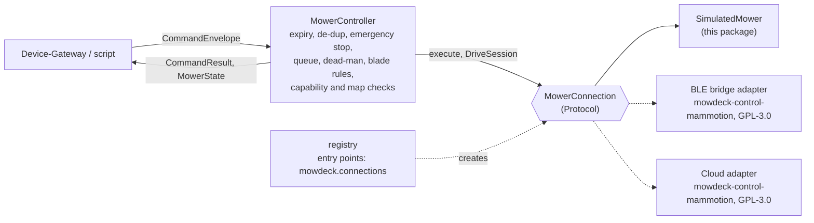

# mowdeck-control

Mower control without the platform: one interface for every way of talking to a mower, a controller that enforces the safety rules for all of them, and a fully simulated mower so that development and Phase 1 need no hardware. Licence: Apache-2.0. Depends only on `mowdeck-contracts` and the standard library: no network code, no PyMammotion, no FastAPI.

## Overview



| Module | Content |
| --- | --- |
| `connection` | `MowerConnection` and `DriveSession` protocols, `Outcome`, `ConnectionConfig`, `JobCommand` |
| `controller` | `MowerController`: the rules below, state forwarding (`watch_state()`, `on_state` callback) |
| `safety` | `decide_manual_blade`: blade rules for manual driving as a pure function; `firmware_update_problem` and `maintenance_problem` ([ADR 0048](../../docs/adr/0048-maintenance-commands.md)): when an update or a maintenance command may run |
| `spot_run` | `SpotMowRun`, `Geofence`, `SpotRunConfig`, `SpotRunReport`, `SpotActions`: spot mowing driven by MowDeck along a Planner route ([ADR 0039](../../docs/adr/0039-spot-mowing-by-mowdeck-driven-paths.md)), from the dock with undocking, transit and return ([ADR 0041](../../docs/adr/0041-spot-runs-from-the-dock-undock-transit-return.md)); `SpotRunConfig.calibrated()` applies a drive calibration and the time limit is progress based (`stalled`, [ADR 0042](../../docs/adr/0042-drive-calibration.md)); turn styles and reverse legs ([ADR 0043](../../docs/adr/0043-turn-styles.md)) |
| `calibration` | `DriveCalibrationRun`, `CalibrationConfig`, `calibration_start_problem`, `room_ahead_problem`: the drive calibration that measures full-scale speed, yaw rate and dead zones over the generic drive channel ([ADR 0042](../../docs/adr/0042-drive-calibration.md)) |
| `transit` | `plan_transit`, `DrivableSpace`, `TransitConfig`, `TransitRoute`, `NoRouteError`: the pure transit planner on the neutral map (paths, areas, no-go zones, dock), A* across several paths and areas (ADR 0041) |
| `simulator` | `SimulatedMower`, `SimulatedDriveSession`, `SimulationConfig`, `default_map()` |
| `registry` | `register_connection`, `create_connection`, `available_kinds`, `ConnectionRegistry` |
| `translation` | `MowRequest`, `NativeJob`, `plan_to_native_job`, `UnsupportedPattern` |
| `geo` | `to_wgs84`, `from_wgs84`, `to_geo_position`, `point_in_polygon`, scanline helpers |
| `paths` | `stripe_path`: the simulator's boustrophedon path, always inside the area and outside zones |
| `broadcast` | `StateBroadcaster`: bounded fan-out of `MowerState` snapshots for `watch_state()` |
| `timers`, `testing` | injectable timers (`AsyncioTimerFactory`) and `ManualClock` / `ManualTimers` for tests |
| `demo` | `python -m mowdeck_control.demo` |

The contract models `MowerCapabilities`, `CameraAccess`, `MowerMap`, `MapArea`, `MapZone`, `MapPath`, `DockPose` and `GeoReference` live in `mowdeck-contracts` (`mowdeck_contracts.v1`), because the Device-Gateway publishes them to other services.

## The interface

```python
class MowerConnection(Protocol):
    kind: ConnectionKind                       # property
    is_connected: bool                         # property
    async def connect(self) -> None
    async def disconnect(self) -> None
    async def capabilities(self) -> MowerCapabilities
    async def get_state(self) -> MowerState
    def watch_state(self) -> AsyncIterator[MowerState]   # current state first, then changes
    async def get_map(self) -> MowerMap                    # local metres plus GeoReference
    async def execute(self, command: JobCommand) -> Outcome  # everything except ManualDrive
    async def start_drive_session(self) -> DriveSession

class DriveSession(Protocol):
    is_open: bool                              # property
    async def update(self, linear: float, angular: float, blade_on: bool) -> None
    async def stop(self) -> None               # wheels and blades stop, session stays open
    async def close(self) -> None              # stop and release
```

- **Capabilities are explicit.** `MowerCapabilities` says which patterns run natively, whether manual driving (and blades while driving) is allowed, whether the mower can follow custom paths (False for LUBA today), how the camera is reached (`none`, `cloud`, `local`), whether the light can be switched (`light`), RTK sources, the blade height range, the maximum speed and the connection kinds.
- **Maps are local metres.** `MowerMap` holds areas, no-go zones, obstacles, paths and the dock in the mower's own east-north frame plus a `GeoReference` (origin and rotation). `mowdeck_control.geo.to_wgs84(map, x, y)` converts for display. This matches what PyMammotion delivers and what the Planner needs.
- **Manual driving is a session**, not a stream of independent commands: it is opened once, receives frames, and is stopped and closed by the controller.
- **Links and firmware are optional capabilities** ([ADR 0038](../../docs/adr/0038-dual-link-per-mower-and-firmware-updates.md)). A connection may consist of its primary link plus additional ones it declares in `capabilities.links_supported` (today `ble_bridge`, a Bluetooth bridge next to the mower) and reports in `MowerState.links` (`LinkStatus` per kind: connected, since, RSSI, bridge firmware, `outdated`); `MowerState.connection` names the link in use. `FirmwarePort` (`check_firmware() -> FirmwareInfo | None`, `start_firmware_update(version)`, flag `capabilities.firmware_update`) wraps the manufacturer's firmware service; `BridgeScanCapable` (`scan_bridge(host, port, secret, expected_name, timeout_s) -> BridgeScanReply`) looks for the mower through a bridge. `firmware_port_of(connection)` and `bridge_scanner_of(connection)` find them; services route by the capability flags and never by the manufacturer.
- **Send and confirm are two phases** for adapters that confirm through the state: `TwoPhaseExecution.dispatch(command) -> Dispatch` sends and returns either a final `Outcome` (`Dispatch.done`) or a `confirm` coroutine (`Dispatch.awaiting(sent, confirm)`) that only watches the state, never re-sends, is safe to cancel and yields `accepted` on timeout. `execute` stays the one-call form (`await (await dispatch(c)).settle()`); `dispatch_of(connection, command)` falls back to `execute` for adapters without the split. Subclasses that wrap commands override `dispatch`, because the controller calls it.
- **Optional capabilities are separate protocols.** A connection with a camera also implements `CameraCapable` (`async def get_camera_session() -> CameraSession | None`, ADR 0032): short-lived credentials for a viewer to join the vendor's video itself; `None` means no camera on this connection. `camera_session_of(connection)` answers `None` for connections without the protocol. The session's token is a secret: never log it. A connection that can tell the mower to stop publishing its camera stream implements `CameraSessionRelease` (`async def release_camera_session(channel: str | None = None) -> None`, ADR 0045): idempotent and safe without a running stream, `channel` is the session's channel when known (adapters that stop per mower ignore it), and a stop that could not be sent raises `NotConnected`. `release_camera_session_of(connection, channel)` answers `False` (nothing sent) for connections without the protocol and `True` once the stop went out. A connection that can rebuild its map from data it already holds implements `MapRebuildable` (`def current_map() -> MowerMap | None`, no traffic to the mower); `MowerController.mower_map(rebuild=True)` uses it (the Device-Gateway's snapshot recheck), so a dock or geo reference learned after `get_map` reaches the map snapshot without a full re-read. A connection that knows the route the mower planned for its job implements `MowPathSource` (`def current_path() -> MowPath | None`, the route in local metres with the progress of the latest state, `None` without a job; no traffic, so it is read on every state; `current_path_of(connection)`), and one that can ask the mower to plan a start's route without starting implements `PathPreviewCapable` (`async def preview_path(area_ids, pattern) -> MowPath`; raises `CommandRejected`, `NotConnected` or `PathUnavailable`, with `timed_out` when the route did not arrive in time). A connection with maintenance commands ([ADR 0048](../../docs/adr/0048-maintenance-commands.md)) lists them in `capabilities.maintenance` and implements `MaintenanceCapable` (`async def run_maintenance(command: RestartMower | SyncMap | RelocateDock | ResyncRtk) -> Outcome`; `maintenance_port_of(connection)`): state-changing actions are sent once and answered `accepted`, `sync_map` reads the whole map again even when the held one is fresh, `resync_rtk` reads the RTK origin and dock pose (`executed` when they arrived). `leave_dock` stays `UndockCapable`.

## Safety rules (enforced by `MowerController`)

| Rule | Behaviour |
| --- | --- |
| Expiry | `envelope.is_expired(now)` before execution and again after waiting in the queue: status `expired`, nothing reaches the mower. Only sends wait in the queue (see Serialization), so a command does not expire behind another command's confirmation |
| De-duplication | same `command_id` returns the first result again (bounded LRU, default 1024 ids); an in-flight duplicate waits for the first |
| Emergency stop priority | `EmergencyStop` skips the queue, ends the drive session, runs at once, and every command queued before it is rejected (`preempted by an emergency stop`) |
| Serialization | all other commands are sent one at a time per mower, in arrival order; a non-drive command ends an open drive session, except `SetLight`. The queue is held only while a command is sent: an adapter that confirms through the mower's state implements `TwoPhaseExecution`, and its confirmation wait runs outside the queue. Adapters without it hold the queue for the whole `execute` |
| Superseding | `StartMow`, `PauseMow`, `ResumeMow`, `ReturnToDock` (also with `end_job`) and `EmergencyStop` end the confirmation wait of every earlier command before they are sent; that command reports `accepted` (`"start_job sent ...; confirmation interrupted by pause_mow"`), never `failed`, because it went out. `SetBladeHeight`, `SetSpeed` and `SetLight` leave a pending confirmation alone; a `ManualDrive` frame is rejected while one is pending |
| Dead-man switch | each `ManualDrive` re-arms a timer of `ttl_ms`; when it fires the controller calls `stop()` and `close()` on the session |
| Blades | off unless a frame asks for them; forced off when `manual_drive_blades` is False, while leaving the dock (transfer move) and during a sensor stop |
| Sensor stops | a state with `activity = error` ends the drive session; adapters raise `SensorStop` and never let a command clear it |
| Limits | `SetBladeHeight` and `SetSpeed` are checked against the capabilities, `StartMow` against the map (area ids must exist, reloaded once) and the native patterns |
| Light | `SetLight` needs `capabilities.light` ("this mower has no switchable light" otherwise); allowed in every activity, also during an error or a stuck state (adapters skip their sensor stop check for it: AI assist lights up a stuck mower at night) and while driving manually. Always sent, even when `MowerState.light_on` already matches: the reported state can be stale and a second switch is harmless |
| Spot plans | a `StartMow` with a `spot_plan` (a Planner route) runs as a route only when `capabilities.custom_paths` is true; otherwise its `native` job is checked like an area start and sent instead, and a plan without one is rejected ("custom paths not supported ...") |
| Firmware updates | `FirmwareUpdate {version}` needs `capabilities.firmware_update` and passes `safety.firmware_update_problem`: a check must have happened, `firmware_info.update_state` is `available` and `version` is the offered one (a stale client is refused: "check again"), the mower is docked (activity `docked` or `charging`; it need not be charging, a full mower stops) with at least `FIRMWARE_MIN_BATTERY_PERCENT` (70) battery, no job runs (the activity rule covers paused jobs), no drive session is open (checked before the command would end it), nothing is already installing. While the mower reports `updating` every command but `EmergencyStop` is rejected with `firmware update running`, drive frames included; the controller reads the adapter's current state for that, not only the last pushed one |
| RTK base station updates | `BaseStationFirmwareUpdate {version}` (ADR 0047) needs `capabilities.base_station_firmware_update` and a connection implementing `BaseStationPort`, and passes `safety.base_station_firmware_update_problem`: a base station check happened, its `update_state` is `available` and `version` is the offered one, nothing installs, the mower neither mows, is paused, returns, updates nor drives (rejected with an open drive session, which it does not end); answered `accepted` once the vendor took it |
| Spot runs | `SpotMow` (ADR 0039) starts a `SpotMowRun` that drives the plan with `ManualDrive` frames sent through `handle()` (`correlation_id = spot:<command_id>`, 5 Hz, `ttl_ms` 1000), so the dead-man switch, the blade rules and the sensor stop apply unchanged. It needs `capabilities.manual_drive`, no open drive session or pending confirmation, an idle mower with a state at most 60 s old (`SPOT_START_MAX_STATE_AGE_S`: a standing mower on a cloud-first connection reports about every 20 s; the run then waits for live positions), more than 20 % battery, a fixed RTK position, every plan point inside the geofence, a transit route on the map from the mower to the plan (`no_route: ...` otherwise) and no additional link (`MowerState.links`, the drive link of a bridge) that reports the mower's signal below `LINK_MIN_RSSI_DBM` (-90 dBm, `weak_link_problem`; an unknown signal does not block). A docked or charging mower is accepted when the connection has `capabilities.undock` and implements `UndockCapable` (ADR 0041): the run sends `leave_dock`, waits until the mower stands idle out of the dock with a fixed RTK position (`undocking`, `waiting_rtk`, 90 s, `undock_failed` or `rtk_lost`), plans the transit again from there and drives it with the blades off (`transit`, geofence = the drivable space). With `SpotMow.return_to_dock` (default true) the run sends `ReturnToDock` after `done` and after an abort that left the mower healthy, never after a stop (`returning`). The command is answered `accepted` at once; `spot_run_result(command_id)` returns the `SpotRunReport` at the end (`report.command_status` is `executed` for `done`, `failed` otherwise). Blades only with `blades` and `confirm_blades` on a mower with `manual_drive_blades`, otherwise forced off and the run is a dry run. While a run is active every other command except `EmergencyStop`, `SpotStop` and `SetLight` is rejected (`spot run active; stop it first`); `SpotStop` without a run is rejected (`no spot run is active`). An emergency stop, a sensor stop and an activity other than idle end the run (while undocking only an error, an update or a lost mower do). A frame that cannot go out because the drive link is not available or was lost ends it `link_lost`: the adapter raised `NotConnected` (the frame is then `failed` with the adapter's words, also for the joystick), or the frame was refused while the state reports the connection or a link down; any other refused frame ends it `frame_rejected`. The run's `SpotRunStatus` is merged into every published `MowerState.spot_run`, and `current_path()` returns the plan with its progress while it drives. The run's stick scale comes from the stored drive calibration (`MowerController(drive_calibration=...)`, rescaled when `MowerState.drive_speed_mps` differs from the calibration's speed setting); it ends `stalled` after 60 s without progress along the plan and `timeout` at `max(20 min, 3 x the estimate at the reachable speed)`. Turns (ADR 0043): the run's turn style is `resolve_turn_style(command.turn_style, state.turn_style, reverse=capabilities.drive_reverse)` (the command's, else the mower's, else `arc`; `multi_point` only with `drive_reverse`). Shaped `turn` segments are followed at most at `turn_rate_dps` (15 °/s) and slowed to `turn_rate × radius`; a heading error above 35° rotates in place only with `in_place`, where no shaped turn applies or when a tight forward arc would leave the geofence (otherwise the run drives that arc); `reverse` segments are driven with a negative `linear` (pure pursuit on the reversed heading, blades off, the geofence on every report and estimate, three reports moving forwards abort `heading_mismatch`). A plan with reverse segments is refused without `drive_reverse`. `SpotRunReport` carries `turn_style` and `in_place_turns` |
| Drive calibration | `DriveCalibrate` (ADR 0042) starts a `DriveCalibrationRun` (`correlation_id = calibration:<command_id>`): forward at `linear` 0.3, 0.5, 0.7, 1.0 and turns in place at `angular` ±0.3, ±0.6, ±1.0, each up to `step_s` (6 s, 5 to 12 s) with 2 s of zero frames after each, blades off; the forward steps stop once 1.5 m were covered (low to high, shortened or skipped by the speeds measured so far). Each step is measured over its steady window only (without its first 1.5 s): the distance between the window's first and last report over the time between them, or the unwrapped heading change over that time; fewer than 4 reports or a window under 3 s make the step `invalid` (no value, never 0). A turn pair whose directions disagree by more than 50 % or share a sign is `inconsistent`, a value that falls as the stick grows is an `outlier`; both are left out of the fit. While it runs a `ReportRateCapable` connection is asked for reports every 0.5 s. It needs `capabilities.manual_drive`, no drive session or pending confirmation, an idle mower out of its dock with a state at most 60 s old, a fixed RTK position, more than 20 % battery, no link signal below `LINK_MIN_RSSI_DBM` and 2 m of room straight ahead inside the geofence. `accepted` at once; `calibration_result(command_id)` returns the run (`state`, `reason`, `result`, `summary()`); the status is merged into `MowerState.drive_calibration`. Rule 12 applies while it runs (`drive calibration active; stop it first`); `SpotStop`, `EmergencyStop`, a sensor stop, an activity change, a lost fix, a geofence violation or a lost drive link (`link_lost`, as for spot runs) end it. A fit needs two moving points per axis and a turn direction with left positive (`no_fit` with the axis and why, `turn_direction`) |
| Drive speed setting | `SetDriveSpeed` needs `capabilities.drive_speed_setting` and a connection implementing `DriveSpeedCapable`; the value is snapped to the range and step. The controller reads the setting once after `start()`. Like `SetLight` it keeps an open drive session |
| Mower settings | `SetSetting {key, value}` (ADR 0046) needs a key declared in `capabilities.settings` (looked up once more with fresh capabilities before refusing) and a connection implementing `SettingsCapable` (`settings_port_of`); the value must fit the `SettingSpec` (`value_problem`: type, range, step, options), otherwise it is rejected before the adapter sees it. A setting never moves the mower: it keeps an open drive session and pending confirmations and is allowed in every activity, also during an error; firmware updates, spot runs and drive calibrations refuse it like every other command. The adapter's `Outcome` is the result (`executed` when the mower confirmed the value, else `accepted`) |
| Maintenance | `RestartMower`, `SyncMap`, `RelocateDock`, `LeaveDock` and `ResyncRtk` ([ADR 0048](../../docs/adr/0048-maintenance-commands.md)) need their kind in `capabilities.maintenance` and a connection implementing `MaintenanceCapable` (`LeaveDock`: `capabilities.undock` and `UndockCapable`); otherwise `this connection does not support <kind>`. `safety.maintenance_problem` decides on the adapter's current state: a restart only docked, charging or idle; `relocate_dock` (no job either) and `leave_dock` only docked or charging; none of the three during an error or while a command waits for its confirmation; restart, relocate and `sync_map` not during an open drive session; `resync_rtk` always. A firmware update, spot run or calibration refuses them like every other command. `LeaveDock` is a motion command: it ends an open drive session first and is `accepted` once sent. `ResyncRtk` keeps the drive session. `SyncMap` holds the queue only for its checks; the transfer runs outside it, one at a time (`a map sync is already running`; a restart waits for it too), and the controller reads the map again afterwards |
| Path preview | `MowerController.preview_path(area_ids, pattern)` needs `PathPreviewCapable`; it is refused while a job runs (mowing, paused, returning), while a start waits for its confirmation and while a drive session is open, and its areas and pattern are checked like a `StartMow`. It does not take the queue: the mower only plans, and a start sent meanwhile plans the same route again. `MowerController.current_path()` reads `MowPathSource` |
| Results | every `CommandResult` carries the `command_id` and the `correlation_id` of the envelope |
| Logging | every decision is logged on the stdlib logger `mowdeck_control.controller` with `extra` fields `command_id`, `correlation_id`, `mower_id`, `command_kind`, `status` |

Result statuses: `executed` (mower confirmed), `accepted` (sent without confirmation: drive frames, settings, a confirmation that timed out or was interrupted), `rejected` (refused before execution), `failed` (attempted, did not go out or errored), `expired`.

## Using the controller

```python
from datetime import timedelta
from uuid import uuid4

from mowdeck_contracts.v1 import CommandEnvelope, PrincipalKind, PrincipalRef, StartMow
from mowdeck_control import MowerController, SimulatedMower

mower = SimulatedMower()
async with MowerController(mower, mower_id=mower.mower_id, on_state=print) as controller:
    envelope = CommandEnvelope.create(
        mower_id=mower.mower_id,
        account_id=mower.account_id,
        issued_by=PrincipalRef(subject=uuid4(), kind=PrincipalKind.USER),
        command=StartMow(area_ids=["front"], pattern={"name": "stripes", "angle_deg": 30}),
        ttl=timedelta(seconds=30),
    )
    result = await controller.handle(envelope)
    assert result.status == "executed"
```

The controller takes an injectable `clock` and `timer_factory`. Tests use `mowdeck_control.testing.ManualClock` and `ManualTimers`, so the dead-man switch is tested without sleeping (`await timers.advance(1.5)`).

## Simulator

`SimulatedMower` is deterministic: nothing changes between calls to `tick(dt)`. `run(interval)` ticks in real time for the Device-Gateway.

- Default map: `front` (12 x 8 m) with the no-go zone `flowerbed` in one corner, `back` (10 x 6 m), a side path and the dock at `(-1, 1)`. Geo reference in Munich, rotated by 12.5 degrees.
- Lifecycle: docked, mowing, paused, mowing, returning, docked, charging, docked. Low battery during a job sends the mower home.
- Path: back and forth stripes at the job's angle and spacing (`stripes`, `diagonal`, `checkerboard`), always inside the area and outside no-go zones and obstacles; transfers run with blades off. Border laps are accepted but not simulated.
- Planned route (`MowPathSource`, `PathPreviewCapable`): every leg of the job is one point of a `MowPath` (a new polyline at every transfer), `progress.index` counts the legs done, the path ends with the job at the dock; `preview_path` returns the route of a start without starting (refused while a job runs).
- Typed state parts (`mowdeck_contracts.v1.mower_status`): `job` while a job runs (`progress_percent` as `raw.progress_percent`, `area_id` of the current mowing leg, null on transfers and in spot runs, `elapsed_s` of simulated time since the start, `remaining_s` = the mowing length left at the mowing speed, `mowed_m2` = the mowed length times the 0.3 m cutting width), `gnss` from the RTK fix (29 / 21 / 7 satellites for fixed / float / none, correction age 1 s, `rtk_status` `single` without a fix), `signal` (Wi-Fi -58 dBm, `network` `wifi`), `self_check` `ok`, and `error_category` `trapped` for `stuck`, `lift_tilt` for `lifted`, else `other` while in `error`.
- Battery drains while mowing and driving and charges at the dock; rates and speeds in `SimulationConfig`, with `time_scale` so a full mow takes seconds.
- Test hooks: `set_rtk(fix, source)` (without a fix the mower holds position), `set_battery`, `inject_error(code)`, `clear_error()`, `lift()` (stops blades and wheels, error `lifted`, only `clear_error()` ends it; `ResumeMow` is rejected).
- Manual driving via `start_drive_session()`; the simulated fence keeps the mower out of no-go zones. Frames are integrated as a differential drive (`drive_max_speed_mps` for `linear = 1`, `drive_max_turn_rad_s` for `angular = 1`, left positive; a negative turn rate simulates an inverted turn direction, zero a mower that cannot turn).
- Turns (ADR 0043): capability `drive_reverse` (option `drive_reverse`, default true; without it a negative `linear` stands the mower still, like a drive link that cannot reverse) and `turn_style` (default none), reported as `MowerState.turn_style`.
- Undocking (ADR 0041): `leave_dock()` (`UndockCapable`, capability `undock`, option `undock`, default true) drives `undock_distance_m` (1 m) straight out of the dock along `dock.heading_deg` with the blades off and leaves the mower `idle` there; a stop, an error or a new command ends it.
- Drive scale (ADR 0042): `drive_max_speed_mps` and `drive_max_turn_rad_s` are the full-scale speed and yaw rate a drive calibration recovers (within 15 % in the tests, with reports every second and `drive_response_delay_s` 1.5: the wheels follow the stick that late, like the hardware); `drive_speed_setting` (default on) offers the vendor-style speed setting `drive_speed_mps` within `drive_speed_range`, and the full-scale speed scales with it.
- Report rate and noise for control loops: `state_period_s` throttles the periodic state of `tick()` to one report per period of simulated time (default 0: every tick; events such as RTK changes, errors and commands still publish at once), `position_noise_m` adds Gaussian noise with that standard deviation to the reported position (seeded by `noise_seed`, the true position is not disturbed). The spot-run tests use 1 s and 2 cm.
- Camera: capability `cloud` and `get_camera_session()` returns a session with `provider` `fake` (no video; the web app draws a test pattern) for the cameras `front` and `rear`, valid `camera_session_seconds` (default 300). `camera: false` switches it off. `release_camera_session(channel)` (`CameraSessionRelease`) records every call in `camera_releases` and clears `camera_publishing`, which a camera session sets, so tests can check that a stream was released.
- Bridge link (`bridge: true`, or a `links` option with a `ble_bridge` entry as the Device-Gateway passes a registration's links): `capabilities.links_supported` is `["ble_bridge"]` either way; with a bridge the state reports `links.ble_bridge` (connected, RSSI `bridge_rssi`, ESPHome 2026.1.0, template version 1) and `connection` `ble_bridge` while it is connected, and `manual_drive` is offered only then. Test hook `set_bridge(connected)`: a drop ends an open drive session, its next frame and `start_drive_session()` raise `NotConnected` ("the Bluetooth bridge is not connected"), like a real drive link, so a spot run or calibration ends `link_lost`; both changes are published at once. `bridge_rssi` below -90 dBm makes the start checks refuse spot runs and calibrations. `scan_bridge(...)` answers with `bridge_devices` (default `Luba-SIM0001` at -62 dBm) and a `sim-bridge` proxy description, `timeout` when the expected name is not among them, or the error of `bridge_scan_error`.
- Firmware (`FirmwarePort`): `check_firmware()` reports `installed` (`firmware`, default `sim-1.0.0`) and `firmware_available` as offered (`update_state` `available`, else `idle`; the simulator also "checks" at connect, so `firmware_info` is set from the first state). A `FirmwareUpdate` that passes the controller's rules (the simulator applies them itself too, so direct callers get the same answers) switches the activity to `updating` with a progress over `firmware_update_seconds` (default 5) simulated seconds, then the mower reports the new version, `update_state` `idle` and is docked again. Without an offer every `FirmwareUpdate` is rejected ("no firmware update is available").
- Maintenance (ADR 0048, `MaintenanceCapable`, option `maintenance`, default true): capability `maintenance` lists all five kinds (`leave_dock` only with `undock`). `restart_mower` keeps the mower `offline` for `restart_seconds` (default 5) simulated seconds, refusing every command but the emergency stop and the light (`the mower is restarting`), then it reports docked again (idle when it restarted out of its dock); `sync_map` (`map read again: 2 areas`), `relocate_dock` and `resync_rtk` change nothing in the garden. Every action is recorded in `maintenance_log`; the rules of `safety.maintenance_problem` are applied here too for direct callers.
- RTK base station (`BaseStationPort`, ADR 0047): a `base_station` connection option (a `BaseStationRef`) links the simulated base station; the state reports it in `base_station` (LoRa while the RTK source is the base station, 32 satellites, a fixed solution, its position, -61 dBm, firmware `base_station_firmware`), `base_station_firmware_available` is offered and installed over `firmware_update_seconds` (the LoRa link is down meanwhile).
- Light: capability `light` and `SetLight` switch `MowerState.light_on` (false at start) in every state, also while stuck or lifted; `light: false` removes it (`light_on` stays null). `night: true` makes `capture_photo()` dark (brightness 0.12) while the light is off and nearly normal (0.8) while it is on, so AI assist's dark-frame handling runs without hardware (Fleet's simulated kind passes the option through like `stuck_after_seconds`).
- Job options (ADR 0030 amendment 2026-10-24): `capabilities().start_options` declares those of a LUBA 2 AWD (`SIMULATED_START_OPTIONS`: obstacle detection `off`, `standard`, `sensitive`, 0 to 4 laps around no-go zones, both path orders, start progress 0 to 99 %; option `start_options: false` removes them, and a start that sets one is then refused). `job_options` keeps the options of the latest native start; `start_progress_pct` skips that share of the route (the mower drives there with the blades off, the job reports the progress from the start, the path progress index starts there), and with `stuck_after_seconds` obstacle detection `off` halves the time until the mower gets stuck and `sensitive` doubles it.

Factory options (`ConnectionConfig.options`) override `SimulationConfig` fields, for example `{"time_scale": 60}`. `origin_lat` and `origin_lon` (together) move the demo garden to another WGS84 origin, so several simulated mowers can stand at different sites of one fleet map (default: Munich, 48.137154, 11.576124).

A slow job start: `start_delay_s` makes `StartMow` and `ResumeMow` two-phase like a real mower: the command is sent at once, the mower reports `mowing` only after that many simulated seconds of `tick()`, and the confirmation waits up to `confirm_timeout_s` real seconds (then `accepted`). `math.inf` never starts (a confirmation that never arrives); a pause, return or emergency stop before the start cancels it. The controller tests use it for the superseded-confirmation path.

Getting stuck (AI assist, ADR 0033): `inject_stuck()`, or the option `stuck_after_seconds` (development only; once per job after that many simulated seconds of mowing), puts the mower into `error` with code `stuck` and `drive_recoverable = True`. Forward moves and turns do nothing then; a backward move of `unstuck_backward_m` (default 0.3 m) frees it: `idle` without a job; when the error interrupted a job, like a LUBA, the mower can then be driven freely but keeps the error, its job and its route, `ResumeMow` is accepted while the error lasts, and the error clears only once the resumed route moved it `resume_clear_m` (default 2 m). `ResumeMow` on a mower that was not freed is accepted too, the wheels spin and the error stays. A drive session opened in any other state still ends a paused job. The controller admits drive frames only for `drive_recoverable` errors, never for lift, tilt or collision. `capture_photo()` (the optional `PhotoCapture` extension of `MowerConnection`) renders a top-down image of the map around the mower, heading up, with a marker when stuck: JPEG with Pillow (extra `photo`), a flat PNG without it. The option `photos: false` makes `capture_photo()` raise `PhotoUnavailable` instead, like a camera mower without own photos: the Device-Gateway then takes the photo from the live camera through the camera relay (ADR 0045), so that path runs with the simulator's `fake` camera.

## Registry and entry points

```python
from uuid import uuid4
from mowdeck_contracts.v1 import ConnectionKind
from mowdeck_control import ConnectionConfig, create_connection

connection = create_connection(
    ConnectionKind.SIMULATED, ConnectionConfig(mower_id=uuid4(), account_id=uuid4())
)
```

Other packages register adapters through the entry point group `mowdeck.connections`; the entry point name is the `ConnectionKind` value:

```toml
[project.entry-points."mowdeck.connections"]
ble_bridge = "mowdeck_control_mammotion:create_ble_bridge_connection"
cloud = "mowdeck_control_mammotion:create_cloud_connection"
```

Entry points are loaded lazily on the first lookup. Broken or unknown entry points are logged and skipped.

## Native jobs

`plan_to_native_job(MowRequest, capabilities)` turns a neutral request (areas, pattern name, angle, spacing, border laps and the job options obstacle detection, laps around no-go zones, order and start progress, each checked against `capabilities.start_options`) into a `NativeJob` (areas, stripe passes, spacing, border laps, order), or raises `UnsupportedPattern` when the mower cannot run the pattern itself. `MowRequest.from_start_mow(StartMow)` reads the `pattern` settings `name`, `angle_deg`, `spacing_m`, `border_laps` and `order`. The Planner (`mowdeck-patterns`, [ADR 0030](../../docs/adr/0030-mowing-patterns-and-planner.md)) attaches such a native job to a spot plan when the chain is one native pattern on a whole map area. Every other plan needs `custom_paths`: the simulator has it (it follows the segments of `StartMow.spot_plan` with the blades and speed of each segment; `SimulationConfig(custom_paths=False)` behaves like a LUBA), the Mammotion adapter does not.

## Writing a new adapter (checklist)

1. Create a package (for PyMammotion: `libs/mowdeck-control-mammotion`, GPL-3.0, see ADR 0011). Never import vendor libraries from `mowdeck-control`.
2. Implement `MowerConnection`; `connect` and `disconnect` are idempotent and `disconnect` ends all `watch_state()` iterators (use `StateBroadcaster`).
3. Report honest `capabilities()`; default everything to "not supported".
4. Convert the vendor map to `MowerMap` in local metres with a `GeoReference`; ids of areas must be stable (zone hashes).
5. `execute(EmergencyStop())` must act immediately, even while another call is in flight (PyMammotion: `Priority.EMERGENCY`).
6. Confirm through the state, not by waiting for a reply and re-sending: implement `TwoPhaseExecution` when a command needs a confirmation, never re-send a command that changes what the mower does, and answer `accepted` (not `failed`) when the confirmation does not come in time.
7. Raise `CommandRejected` for refusals, `NotConnected` without a link, `SensorStop` while a safety sensor holds the mower; never clear a sensor stop from a command.
8. Implement `DriveSession`; `stop()` and `close()` are idempotent and work after link loss. Do not add your own dead-man timer: the controller owns it (a device side timeout is an extra safety net, not a replacement).
9. Do not de-duplicate, check expiry or validate limits in the adapter; the controller does it.
10. Provide a factory `(ConnectionConfig) -> MowerConnection` and register it under `mowdeck.connections`.
11. Run the controller test scenarios against the adapter with a fake transport.
12. Optional capabilities (ADR 0038): if the manufacturer has a firmware service, implement `FirmwarePort` and set `capabilities.firmware_update` (only the vendor calls and the `FirmwareInfo` bookkeeping; the preconditions and the lock-out are the controller's). If the connection can open additional links, list their kinds in `capabilities.links_supported`, read them from the `links` option (`{kind: options}`, the registration's links with their secrets merged by the Device-Gateway), report each in `MowerState.links`, set `MowerState.connection` to the link in use and publish a state on every link change; for a Bluetooth bridge also implement `BridgeScanCapable`. A drive frame must never fall back to a slower link when the fast one drops.

## Demo CLI

```bash
uv run python -m mowdeck_control.demo --seconds 3 --interval 0.5 --time-scale 60
```

Starts the simulator, sends `StartMow` through the controller and prints one state line per interval (`--areas front back` mows both areas).

## Development

```bash
uv run pytest libs/mowdeck-control --cov=mowdeck_control
```
