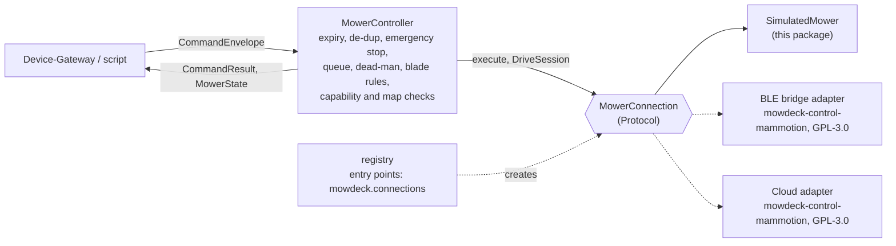

# mowdeck-control

Mower control without the platform: one interface for every way of talking to a mower, a controller that enforces the safety rules for all of them, and a fully simulated mower so that development and Phase 1 need no hardware. Licence: Apache-2.0. Depends only on `mowdeck-contracts` and the standard library: no network code, no PyMammotion, no FastAPI.

## Overview



| Module | Content |
| --- | --- |
| `connection` | `MowerConnection` and `DriveSession` protocols, `Outcome`, `ConnectionConfig`, `JobCommand` |
| `controller` | `MowerController`: the rules below, state forwarding (`watch_state()`, `on_state` callback) |
| `safety` | `decide_manual_blade`: blade rules for manual driving as a pure function |
| `simulator` | `SimulatedMower`, `SimulatedDriveSession`, `SimulationConfig`, `default_map()` |
| `registry` | `register_connection`, `create_connection`, `available_kinds`, `ConnectionRegistry` |
| `translation` | `MowRequest`, `NativeJob`, `plan_to_native_job`, `UnsupportedPattern` |
| `geo` | `to_wgs84`, `from_wgs84`, `to_geo_position`, `point_in_polygon`, scanline helpers |
| `paths` | `stripe_path`: the simulator's boustrophedon path, always inside the area and outside zones |
| `broadcast` | `StateBroadcaster`: bounded fan-out of `MowerState` snapshots for `watch_state()` |
| `timers`, `testing` | injectable timers (`AsyncioTimerFactory`) and `ManualClock` / `ManualTimers` for tests |
| `demo` | `python -m mowdeck_control.demo` |

The contract models `MowerCapabilities`, `CameraAccess`, `MowerMap`, `MapArea`, `MapZone`, `MapPath`, `DockPose` and `GeoReference` live in `mowdeck-contracts` (`mowdeck_contracts.v1`), because the Device-Gateway publishes them to other services.

## The interface

```python
class MowerConnection(Protocol):
    kind: ConnectionKind                       # property
    is_connected: bool                         # property
    async def connect(self) -> None
    async def disconnect(self) -> None
    async def capabilities(self) -> MowerCapabilities
    async def get_state(self) -> MowerState
    def watch_state(self) -> AsyncIterator[MowerState]   # current state first, then changes
    async def get_map(self) -> MowerMap                    # local metres plus GeoReference
    async def execute(self, command: JobCommand) -> Outcome  # everything except ManualDrive
    async def start_drive_session(self) -> DriveSession

class DriveSession(Protocol):
    is_open: bool                              # property
    async def update(self, linear: float, angular: float, blade_on: bool) -> None
    async def stop(self) -> None               # wheels and blades stop, session stays open
    async def close(self) -> None              # stop and release
```

- **Capabilities are explicit.** `MowerCapabilities` says which patterns run natively, whether manual driving (and blades while driving) is allowed, whether the mower can follow custom paths (False for LUBA today), how the camera is reached (`none`, `cloud`, `local`), whether the light can be switched (`light`), RTK sources, the blade height range, the maximum speed and the connection kinds.
- **Maps are local metres.** `MowerMap` holds areas, no-go zones, obstacles, paths and the dock in the mower's own east-north frame plus a `GeoReference` (origin and rotation). `mowdeck_control.geo.to_wgs84(map, x, y)` converts for display. This matches what PyMammotion delivers and what the Planner needs.
- **Manual driving is a session**, not a stream of independent commands: it is opened once, receives frames, and is stopped and closed by the controller.
- **Send and confirm are two phases** for adapters that confirm through the state: `TwoPhaseExecution.dispatch(command) -> Dispatch` sends and returns either a final `Outcome` (`Dispatch.done`) or a `confirm` coroutine (`Dispatch.awaiting(sent, confirm)`) that only watches the state, never re-sends, is safe to cancel and yields `accepted` on timeout. `execute` stays the one-call form (`await (await dispatch(c)).settle()`); `dispatch_of(connection, command)` falls back to `execute` for adapters without the split. Subclasses that wrap commands override `dispatch`, because the controller calls it.
- **Optional capabilities are separate protocols.** A connection with a camera also implements `CameraCapable` (`async def get_camera_session() -> CameraSession | None`, ADR 0032): short-lived credentials for a viewer to join the vendor's video itself; `None` means no camera on this connection. `camera_session_of(connection)` answers `None` for connections without the protocol. The session's token is a secret: never log it. A connection that can rebuild its map from data it already holds implements `MapRebuildable` (`def current_map() -> MowerMap | None`, no traffic to the mower); `MowerController.mower_map(rebuild=True)` uses it (the Device-Gateway's snapshot recheck), so a dock or geo reference learned after `get_map` reaches the map snapshot without a full re-read. A connection that knows the route the mower planned for its job implements `MowPathSource` (`def current_path() -> MowPath | None`, the route in local metres with the progress of the latest state, `None` without a job; no traffic, so it is read on every state; `current_path_of(connection)`), and one that can ask the mower to plan a start's route without starting implements `PathPreviewCapable` (`async def preview_path(area_ids, pattern) -> MowPath`; raises `CommandRejected`, `NotConnected` or `PathUnavailable`, with `timed_out` when the route did not arrive in time).

## Safety rules (enforced by `MowerController`)

| Rule | Behaviour |
| --- | --- |
| Expiry | `envelope.is_expired(now)` before execution and again after waiting in the queue: status `expired`, nothing reaches the mower. Only sends wait in the queue (see Serialization), so a command does not expire behind another command's confirmation |
| De-duplication | same `command_id` returns the first result again (bounded LRU, default 1024 ids); an in-flight duplicate waits for the first |
| Emergency stop priority | `EmergencyStop` skips the queue, ends the drive session, runs at once, and every command queued before it is rejected (`preempted by an emergency stop`) |
| Serialization | all other commands are sent one at a time per mower, in arrival order; a non-drive command ends an open drive session, except `SetLight`. The queue is held only while a command is sent: an adapter that confirms through the mower's state implements `TwoPhaseExecution`, and its confirmation wait runs outside the queue. Adapters without it hold the queue for the whole `execute` |
| Superseding | `StartMow`, `PauseMow`, `ResumeMow`, `ReturnToDock` (also with `end_job`) and `EmergencyStop` end the confirmation wait of every earlier command before they are sent; that command reports `accepted` (`"start_job sent ...; confirmation interrupted by pause_mow"`), never `failed`, because it went out. `SetBladeHeight`, `SetSpeed` and `SetLight` leave a pending confirmation alone; a `ManualDrive` frame is rejected while one is pending |
| Dead-man switch | each `ManualDrive` re-arms a timer of `ttl_ms`; when it fires the controller calls `stop()` and `close()` on the session |
| Blades | off unless a frame asks for them; forced off when `manual_drive_blades` is False, while leaving the dock (transfer move) and during a sensor stop |
| Sensor stops | a state with `activity = error` ends the drive session; adapters raise `SensorStop` and never let a command clear it |
| Limits | `SetBladeHeight` and `SetSpeed` are checked against the capabilities, `StartMow` against the map (area ids must exist, reloaded once) and the native patterns |
| Light | `SetLight` needs `capabilities.light` ("this mower has no switchable light" otherwise); allowed in every activity, also during an error or a stuck state (adapters skip their sensor stop check for it: AI assist lights up a stuck mower at night) and while driving manually. Always sent, even when `MowerState.light_on` already matches: the reported state can be stale and a second switch is harmless |
| Spot plans | a `StartMow` with a `spot_plan` (a Planner route) runs as a route only when `capabilities.custom_paths` is true; otherwise its `native` job is checked like an area start and sent instead, and a plan without one is rejected ("custom paths not supported ...") |
| Path preview | `MowerController.preview_path(area_ids, pattern)` needs `PathPreviewCapable`; it is refused while a job runs (mowing, paused, returning), while a start waits for its confirmation and while a drive session is open, and its areas and pattern are checked like a `StartMow`. It does not take the queue: the mower only plans, and a start sent meanwhile plans the same route again. `MowerController.current_path()` reads `MowPathSource` |
| Results | every `CommandResult` carries the `command_id` and the `correlation_id` of the envelope |
| Logging | every decision is logged on the stdlib logger `mowdeck_control.controller` with `extra` fields `command_id`, `correlation_id`, `mower_id`, `command_kind`, `status` |

Result statuses: `executed` (mower confirmed), `accepted` (sent without confirmation: drive frames, settings, a confirmation that timed out or was interrupted), `rejected` (refused before execution), `failed` (attempted, did not go out or errored), `expired`.

## Using the controller

```python
from datetime import timedelta
from uuid import uuid4

from mowdeck_contracts.v1 import CommandEnvelope, PrincipalKind, PrincipalRef, StartMow
from mowdeck_control import MowerController, SimulatedMower

mower = SimulatedMower()
async with MowerController(mower, mower_id=mower.mower_id, on_state=print) as controller:
    envelope = CommandEnvelope.create(
        mower_id=mower.mower_id,
        account_id=mower.account_id,
        issued_by=PrincipalRef(subject=uuid4(), kind=PrincipalKind.USER),
        command=StartMow(area_ids=["front"], pattern={"name": "stripes", "angle_deg": 30}),
        ttl=timedelta(seconds=30),
    )
    result = await controller.handle(envelope)
    assert result.status == "executed"
```

The controller takes an injectable `clock` and `timer_factory`. Tests use `mowdeck_control.testing.ManualClock` and `ManualTimers`, so the dead-man switch is tested without sleeping (`await timers.advance(1.5)`).

## Simulator

`SimulatedMower` is deterministic: nothing changes between calls to `tick(dt)`. `run(interval)` ticks in real time for the Device-Gateway.

- Default map: `front` (12 x 8 m) with the no-go zone `flowerbed` in one corner, `back` (10 x 6 m), a side path and the dock at `(-1, 1)`. Geo reference in Munich, rotated by 12.5 degrees.
- Lifecycle: docked, mowing, paused, mowing, returning, docked, charging, docked. Low battery during a job sends the mower home.
- Path: back and forth stripes at the job's angle and spacing (`stripes`, `diagonal`, `checkerboard`), always inside the area and outside no-go zones and obstacles; transfers run with blades off. Border laps are accepted but not simulated.
- Planned route (`MowPathSource`, `PathPreviewCapable`): every leg of the job is one point of a `MowPath` (a new polyline at every transfer), `progress.index` counts the legs done, the path ends with the job at the dock; `preview_path` returns the route of a start without starting (refused while a job runs).
- Battery drains while mowing and driving and charges at the dock; rates and speeds in `SimulationConfig`, with `time_scale` so a full mow takes seconds.
- Test hooks: `set_rtk(fix, source)` (without a fix the mower holds position), `set_battery`, `inject_error(code)`, `clear_error()`, `lift()` (stops blades and wheels, error `lifted`, only `clear_error()` ends it; `ResumeMow` is rejected).
- Manual driving via `start_drive_session()`; the simulated fence keeps the mower out of no-go zones.
- Camera: capability `cloud` and `get_camera_session()` returns a session with `provider` `fake` (no video; the web app draws a test pattern) for the cameras `front` and `rear`, valid `camera_session_seconds` (default 300). `camera: false` switches it off.
- Light: capability `light` and `SetLight` switch `MowerState.light_on` (false at start) in every state, also while stuck or lifted; `light: false` removes it (`light_on` stays null). `night: true` makes `capture_photo()` dark (brightness 0.12) while the light is off and nearly normal (0.8) while it is on, so AI assist's dark-frame handling runs without hardware (Fleet's simulated kind passes the option through like `stuck_after_seconds`).

Factory options (`ConnectionConfig.options`) override `SimulationConfig` fields, for example `{"time_scale": 60}`. `origin_lat` and `origin_lon` (together) move the demo garden to another WGS84 origin, so several simulated mowers can stand at different sites of one fleet map (default: Munich, 48.137154, 11.576124).

A slow job start: `start_delay_s` makes `StartMow` and `ResumeMow` two-phase like a real mower: the command is sent at once, the mower reports `mowing` only after that many simulated seconds of `tick()`, and the confirmation waits up to `confirm_timeout_s` real seconds (then `accepted`). `math.inf` never starts (a confirmation that never arrives); a pause, return or emergency stop before the start cancels it. The controller tests use it for the superseded-confirmation path.

Getting stuck (AI assist, ADR 0033): `inject_stuck()`, or the option `stuck_after_seconds` (development only; once per job after that many simulated seconds of mowing), puts the mower into `error` with code `stuck` and `drive_recoverable = True`. Forward moves and turns do nothing then; a backward move of `unstuck_backward_m` (default 0.3 m) frees it (`idle`). The controller admits drive frames only for `drive_recoverable` errors, never for lift, tilt or collision. `capture_photo()` (the optional `PhotoCapture` extension of `MowerConnection`) renders a top-down image of the map around the mower, heading up, with a marker when stuck: JPEG with Pillow (extra `photo`), a flat PNG without it.

## Registry and entry points

```python
from uuid import uuid4
from mowdeck_contracts.v1 import ConnectionKind
from mowdeck_control import ConnectionConfig, create_connection

connection = create_connection(
    ConnectionKind.SIMULATED, ConnectionConfig(mower_id=uuid4(), account_id=uuid4())
)
```

Other packages register adapters through the entry point group `mowdeck.connections`; the entry point name is the `ConnectionKind` value:

```toml
[project.entry-points."mowdeck.connections"]
ble_bridge = "mowdeck_control_mammotion:create_ble_bridge_connection"
cloud = "mowdeck_control_mammotion:create_cloud_connection"
```

Entry points are loaded lazily on the first lookup. Broken or unknown entry points are logged and skipped.

## Native jobs

`plan_to_native_job(MowRequest, capabilities)` turns a neutral request (areas, pattern name, angle, spacing, border laps, order) into a `NativeJob` (areas, stripe passes, spacing, border laps, order), or raises `UnsupportedPattern` when the mower cannot run the pattern itself. `MowRequest.from_start_mow(StartMow)` reads the `pattern` settings `name`, `angle_deg`, `spacing_m`, `border_laps` and `order`. The Planner (`mowdeck-patterns`, [ADR 0030](../../docs/adr/0030-mowing-patterns-and-planner.md)) attaches such a native job to a spot plan when the chain is one native pattern on a whole map area. Every other plan needs `custom_paths`: the simulator has it (it follows the segments of `StartMow.spot_plan` with the blades and speed of each segment; `SimulationConfig(custom_paths=False)` behaves like a LUBA), the Mammotion adapter does not.

## Writing a new adapter (checklist)

1. Create a package (for PyMammotion: `libs/mowdeck-control-mammotion`, GPL-3.0, see ADR 0011). Never import vendor libraries from `mowdeck-control`.
2. Implement `MowerConnection`; `connect` and `disconnect` are idempotent and `disconnect` ends all `watch_state()` iterators (use `StateBroadcaster`).
3. Report honest `capabilities()`; default everything to "not supported".
4. Convert the vendor map to `MowerMap` in local metres with a `GeoReference`; ids of areas must be stable (zone hashes).
5. `execute(EmergencyStop())` must act immediately, even while another call is in flight (PyMammotion: `Priority.EMERGENCY`).
6. Confirm through the state, not by waiting for a reply and re-sending: implement `TwoPhaseExecution` when a command needs a confirmation, never re-send a command that changes what the mower does, and answer `accepted` (not `failed`) when the confirmation does not come in time.
7. Raise `CommandRejected` for refusals, `NotConnected` without a link, `SensorStop` while a safety sensor holds the mower; never clear a sensor stop from a command.
8. Implement `DriveSession`; `stop()` and `close()` are idempotent and work after link loss. Do not add your own dead-man timer: the controller owns it (a device side timeout is an extra safety net, not a replacement).
9. Do not de-duplicate, check expiry or validate limits in the adapter; the controller does it.
10. Provide a factory `(ConnectionConfig) -> MowerConnection` and register it under `mowdeck.connections`.
11. Run the controller test scenarios against the adapter with a fake transport.

## Demo CLI

```bash
uv run python -m mowdeck_control.demo --seconds 3 --interval 0.5 --time-scale 60
```

Starts the simulator, sends `StartMow` through the controller and prints one state line per interval (`--areas front back` mows both areas).

## Development

```bash
uv run pytest libs/mowdeck-control --cov=mowdeck_control
```
