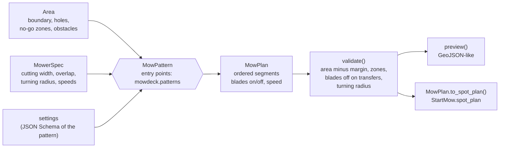

# mowdeck-patterns

Mowing patterns as plug-ins and the route validation chain. A pure computation library on [Shapely](https://shapely.readthedocs.io/): no network, no database, no FastAPI. Licence: Apache-2.0. Depends only on `mowdeck-contracts` and `shapely>=2.1`. The Planner service (`services/planner`) is a thin HTTP layer around it; scripts and other projects can use it directly.

## Overview



All geometry is `(x, y)` in metres in the mower's local map frame (`MowerMap` of `mowdeck-contracts`); convert with `mowdeck_control.geo` only for display.

| Module | Content |
| --- | --- |
| `models` | `Area`, `MowerSpec`, `Segment`, `MowPlan`, the errors `InvalidArea`, `InvalidSettings`, `PlanningError`, `PlanRejected` |
| `base` | `MowPattern` (the plug-in protocol), `BasePattern`, `PatternSettings`, `build_plan` |
| `geometry` | insets, stripe runs, back-and-forth ordering, offset rings, the transfer `Router` (visibility graph), `assemble` |
| `validation` | `check()` and `validate()`: the validation chain |
| `registry` | `PatternRegistry` (entry point group `mowdeck.patterns`), `chain()`, `plan()` |
| `coverage` | `coverage(track, width)`, `gaps(area, covered, min_area)` for re-mowing |
| `preview` | `preview(plan, to_wgs84=None)` |
| `patterns` | the built-in patterns |

## Usage

```python
from mowdeck_patterns import Area, MowerSpec, plan, preview

area = Area.of(
    [(0, 0), (12, 0), (12, 8), (0, 8)],
    no_go_zones=[[(9, 5.5), (12, 5.5), (12, 8), (9, 8)]],
)
mower = MowerSpec(cutting_width_m=0.4, overlap_m=0.05, turning_radius_m=0.0)
result = plan(area, mower, [("edge_only", {"laps": 2}), ("diagonal", {"angle_deg": 0})])
print(result.estimated_duration_s, result.covered_area_m2, result.coverage_ratio)
geojson = preview(result)  # features per segment plus totals
spot = result.to_spot_plan()  # mowdeck_contracts.v1.SpotMowPlan for StartMow
```

`plan()` builds a chain, computes it and runs the validation chain; it raises `PlanRejected` (with `reasons`), `InvalidSettings` (with `errors`), `PlanningError` or `UnknownPattern`. `Area.from_map(mower_map, "front")` takes an area of a mower map with the zones that touch it; `boundary=` replaces the outline with a spot drawn inside it.

## Built-in patterns

| Key | Pattern | Settings | Native hint |
| --- | --- | --- | --- |
| `stripes` | parallel back-and-forth runs | `angle_deg` | `stripes` |
| `diagonal` | stripes at 45 degrees to `angle_deg` | `angle_deg` | `diagonal` |
| `checkerboard` | two stripe passes at 90 degrees | `angle_deg` | `checkerboard` |
| `spiral` | concentric laps around the outer shape (cut at holes) | `direction` (`inward`, `outward`) | none |
| `border_fill` | border laps, then a fill pattern inside | `laps`, `fill.pattern`, `fill.settings` | with a native fill and at most 4 laps |
| `contour` | laps parallel to every edge, also around holes | `direction`, `rings` | none |
| `auto_aligned` | stripes at the angle with the fewest runs | `step_deg` | `stripes` at that angle |
| `cells` | slab decomposition through concave corners and hole corners, each cell striped at its own best angle | `sweep_angle_deg`, `step_deg` | none |
| `alternating` | stripes whose angle follows `run_index` through `angles_deg` (or is random but deterministic for `seed` and `run_index`) | `mode`, `angles_deg`, `run_index`, `seed` | `stripes` |
| `edge_only` | edge laps only | `laps` | `edge_only` (up to 4 laps) |
| `remow` | stripes over gap polygons only | `gaps` or `covered`, `min_gap_m2`, `angle_deg` | none |

Every built-in pattern also accepts `speed_mps` (default: the mower's speed). Unknown settings keys are refused. Spacing is always `cutting_width_m - overlap_m`; the mower's centre keeps `max(safety_margin_m, cutting_width_m / 2)` from every edge while cutting, so the blade reaches the edge but the mower never leaves the safety margin. Waves, circles, rays and lawn art come later.

## The plan

`MowPlan.segments` is an ordered list of `Segment(polyline, blades_on, speed, kind)`:

- `mow`: a cutting run;
- `turn`: the short connection between two neighbouring runs, inside the cutting region, blades on;
- `transfer`: driving to the next part (another cell, the next chain step), always blades off, routed around holes and zones inside the safe region along the shortest way (a visibility graph of the region's corners).

A segment with `reverse` is driven backwards (a three-point turn's middle leg) and always has the blades off.

### Turn styles

`plan(area, mower, steps, turns=TurnOptions(style, min_radius_m, reverse, fence))` shapes the lane ends for a spot run that turns this way ([ADR 0043](../../docs/adr/0043-turn-styles.md), `mowdeck_patterns.turns.shape_turns`). Only reversals between two `mow` runs (directions differing by more than 150 degrees) are shaped; spirals and rings stay as they are.

- `arc`: a semicircle of half the spacing when that reaches `min_radius_m` (0.3 m in the Planner), else a bulb turn of three arcs of the radius (away from the next lane, over it, back in); at the first and the last lane two lopsided bulbs that swing towards the inside only.
- `multi_point`: a three-point turn, forward arc, reverse arc (`reverse`, blades off), forward arc; without `reverse` (the drive link cannot reverse) it falls back to `arc` with a warning.
- `in_place`: the straight connection.

Every shape stays inside the area minus the safety margin and inside `fence` (the Planner passes the spot run's geofence). A shape that does not fit is pulled back into the lanes in 5 cm steps (each run keeps at least 10 cm); a lane end where nothing fits keeps its straight connection and the plan's `warnings` count those lane ends. `MowPlan.turn_style` is the style used.

`estimated_duration_s` is driving time plus `MowerSpec.turn_time_s` per heading change above 60 degrees; `covered_area_m2` is the mowable area under the blades (blades-on segments widened to the cutting width); `area_m2` the mowable area; `pattern_chain` the keys of the chain.

## The validation chain

The same for every plan (`check()` lists the findings, `validate()` raises `PlanRejected`):

1. every segment inside the area minus `safety_margin_m` (holes, no-go zones and obstacles left out);
2. no blades-on segment through a no-go zone, an obstacle or a hole;
3. transfers and reverse segments with the blades off, speeds positive and within `max_speed_mps` (blades on) and `transfer_speed_mps` (blades off);
4. turns feasible for `turning_radius_m`: a heading change of `theta` needs `r * tan(theta / 2)` of straight track before and after the corner, a reversal is impossible for `r > 0` (a change of the direction of travel, forwards to reverse, is a stop, not a corner). Mowers that turn on the spot use `r = 0`.

## Coverage and gaps

```python
from mowdeck_patterns import coverage, gaps, plan

covered = coverage(track_xy, cutting_width=0.4)  # widened track, jumps over 3 m break it
missed = gaps(area, covered, min_area=0.05)  # polygons, largest first
touch_up = plan(area, mower, [("remow", {"gaps": [list(p.exterior.coords) for p in missed]})])
```

## Adding a pattern

A pattern is a class with a `key`, a `name`, `settings_schema()` and `compute()`; registered through an entry point, it appears in the Planner (`GET /api/v1/planner/patterns`) and in the app (which builds the settings form from the schema) without any other change. The easiest way is to derive from `BasePattern` and only decide which runs to cut:

```python
from typing import ClassVar

from pydantic import Field

from mowdeck_patterns import BasePattern, PatternSettings
from mowdeck_patterns.geometry import Run, Workspace, stripe_runs


class FanSettings(PatternSettings):
    angles_deg: list[float] = Field(default_factory=lambda: [0.0, 60.0, 120.0], min_length=1)


class FanPattern(BasePattern[FanSettings]):
    key: ClassVar[str] = "fan"
    name: ClassVar[str] = "Fan"
    description: ClassVar[str] = "Three stripe passes at 60 degrees to each other."
    settings_model: ClassVar[type[PatternSettings]] = FanSettings

    def runs(self, workspace: Workspace, settings: FanSettings, start) -> list[Run]:
        runs: list[Run] = []
        for angle in settings.angles_deg:
            runs.extend(stripe_runs(workspace.work, angle, workspace.mower.spacing_m, start))
        return runs
```

```toml
[project.entry-points."mowdeck.patterns"]
fan = "my_package.fan:FanPattern"
```

The entry point name must equal `key`. `workspace.work` is the region the mower's centre may use while cutting, `workspace.safe` the region it may use at all; `assemble()` turns the runs into turns and routed transfers, `build_plan()` adds the estimates. A pattern that does not derive from `BasePattern` only has to satisfy the `MowPattern` protocol. Whatever it returns, the validation chain decides whether the plan is used; a plan that leaves the area is rejected. To let mowers without `custom_paths` run the pattern natively, implement `native_job(settings, mower, area)` returning `StartMow.pattern` settings. Plans can gate patterns as plan features (the Planner's `spot_mowing` feature gates all of them today).

## Tests

```bash
uv run pytest libs/mowdeck-patterns
MOWDECK_UPDATE_GOLDEN=1 uv run pytest libs/mowdeck-patterns -k golden   # rewrite the golden preview
```

Property checks cover the coverage ratio of every pattern on a rectangle, an L-shape and a shape with a hole, no blades-on segment inside a no-go zone, the rejection of plans that leave the area or turn too sharply, schema validity, entry point discovery and chains; `tests/golden/front_stripes_preview.json` pins the preview of stripes on the simulator's `front` area.
